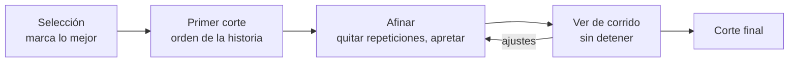

# Ritmo y narrativa en el montaje

Parte de: [[33-Edicion-Video/02 Montaje/_Índice Montaje|Montaje]]

> [!info] Cómo avanzar
> `progreso`: **pendiente** → **viendo** (estudiando) → **visto** (contestaste la autoevaluación sin abrir las respuestas) → **dominado** (hiciste el laboratorio o lo aplicaste de verdad).

## Contenido

### Qué es
El **ritmo** del montaje es la sensación de velocidad que produce la duración de las tomas y la frecuencia de los cortes; la **narrativa** es el orden en que presentas la información para que el espectador entienda y quiera seguir viendo. Montar no es pegar tomas bonitas: es decidir **qué se ve, cuánto dura y en qué orden** para contar algo.

### Cómo funciona
**Cuándo cortar una toma** (criterios que se combinan):
1. Cuando ya entregó su información: el espectador entendió el lugar, la acción o la emoción.
2. En un movimiento: cortar durante una acción (alguien voltea, abre una puerta) oculta el corte.
3. En una pausa o cambio de idea del diálogo.
4. Cuando la energía baja: si te aburres en la tercera vez que la ves, el público ya se fue.

**Cómo se construye el ritmo**:
- Tomas cortas y cortes frecuentes = energía, urgencia (reels, deportes).
- Tomas largas = calma, contemplación (paisajes del dron, atardeceres).
- Variar es lo que mantiene la atención: una secuencia rápida seguida de una toma larga hace que esa toma "respire".

La estructura narrativa básica (inicio que plantea, desarrollo, cierre) viene de la preproducción; ver [[Narrativa y storytelling en video]]. En redes, los primeros segundos deben dar el gancho ([[Creación de contenido (ganchos, retención y constancia)]]).

### Ejemplo: de 8 a 4 minutos
Tu primer corte de un video de viaje dura 8 min y querías 4:
1. Escribe en una frase de qué trata el video. Todo lo que no apoye esa frase es candidato a salir.
2. Quita **secuencias completas** antes que recortar cuadros: si hay dos escenas de mercado, deja la mejor.
3. En las entrevistas, elimina repeticiones, arranques en falso y explicaciones dobles; tapa los cortes con b-roll ([[Uso del b-roll en la edición]]).
4. Acorta entradas y salidas de cada toma: muchas tomas aguantan un segundo menos al inicio y al final.
5. Usa J-cuts y L-cuts para que el audio puentee y puedas quitar imagen sin perder sentido ([[J-cut y L-cut (edición)]]).
6. Duplica la línea de tiempo antes de cada pasada grande para poder regresar.

### Cuándo usar cada ritmo
- **Rápido**: videos verticales, intros, montajes musicales ([[Editar al ritmo de la música]]).
- **Medio**: tutoriales, vlogs, entrevistas.
- **Lento**: material aéreo contemplativo, cierres emotivos, cortometraje.
El error es aplicar un solo ritmo a todo el video.

### Errores comunes
- **No ver el video completo de corrido** antes de exportar: se te escapan saltos de audio, cuadros negros sueltos, un clip duplicado, la música que corta en seco, títulos con faltas de ortografía y partes que se sienten largas. Velo en otra pantalla o al día siguiente, sin pausar y sin tocar nada; solo anota.
- **Enamorarse de una toma** que costó trabajo (el dron, la toma con gimbal) aunque no aporte: si no suma a la historia, sale.
- **Dejar todas las tomas de la misma duración**: el resultado es monótono.
- **Explicar dos veces** lo mismo con voz y texto en pantalla sin necesidad.

### Para profundizar
- [Capacitación oficial de DaVinci Resolve (guía de edición)](https://www.blackmagicdesign.com/products/davinciresolve/training)
- [Manual de Kdenlive](https://docs.kdenlive.org/)

## Autoevaluación

Contesta primero en voz alta o en papel; luego despliega la respuesta.

> [!question]- ¿Qué es el ritmo en el montaje?
> La percepción de velocidad que dan la duración de los planos, la frecuencia de cortes y la relación con la música y el diálogo.

> [!question]- ¿Cuándo cortar una toma?
> Cuando ya entregó su información o emoción. Un plano general necesita más tiempo para leerse que un detalle.

> [!question]- Caso: tu primer corte dura 8 min y querías 4. ¿Qué haces?
> Elimina primero lo que no avanza la historia (repeticiones, introducciones), luego acorta pausas y reduce el b-roll redundante.

> [!question]- Error común: no ver el video completo de corrido antes de exportar. ¿Qué se escapa?
> Problemas de ritmo y saltos de audio que no notas editando trozo por trozo.

## Práctica

- [[Lab 2 - Montaje de entrevista con J-cuts y L-cuts]]
- [[Lab 3 - Reel vertical de 30 segundos editado a la música]]

