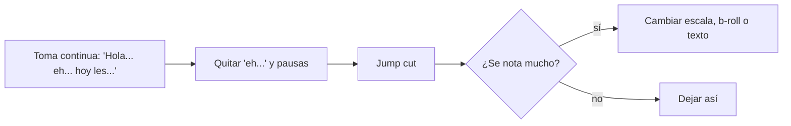

# Jump cut (edición)

Parte de: [[Tipos de corte (J-cut, L-cut, jump cut y match cut)]]

> [!info] Cómo avanzar
> `progreso`: **pendiente** → **viendo** (estudiando) → **visto** (contestaste la autoevaluación sin abrir las respuestas) → **dominado** (hiciste el laboratorio o lo aplicaste de verdad).

## Contenido

### Qué es
Un **jump cut** es un corte entre dos fragmentos de **la misma toma** (mismo encuadre y ángulo), separados por un salto de tiempo. Como el fondo no cambia y la persona se mueve un poco, se nota un "brinco". Se popularizó en el cine de la Nueva Ola francesa como recurso expresivo y hoy es el lenguaje normal del video a cámara en YouTube.

### Cómo funciona
Grabas a alguien hablando 5 minutos; al quitar silencios, errores y muletillas, cada corte une dos instantes de la misma toma. El cerebro detecta que todo es igual excepto la posición de la cabeza o las manos, y eso se percibe como salto.

Hay que distinguirlo del corte entre dos tomas con encuadres distintos (plano medio a primer plano), que no se percibe como salto. La [[Eje de 180 grados y continuidad|continuidad]] tradicional evita los jump cuts; el lenguaje de redes los acepta.

### Dónde es aceptado y dónde no
- **Aceptado**: vlogs, tutoriales, videos a cámara de YouTube, reels y TikTok. El público entiende que se quitó lo que sobraba y da sensación de ritmo y cercanía.
- **Evitado**: entrevistas formales, documentales, videos corporativos, bodas y ficción (salvo que sea intencional), donde rompe la sensación de continuidad y se ve descuidado.
- **Expresivo**: para mostrar paso del tiempo (alguien esperando en la misma banca a distintas horas) o ansiedad.

### Cómo disimularlo
1. **Cambio de escala ("punch-in")**: alterna 100 % y 110–120 % en fragmentos consecutivos. Si grabaste en 4K con la a6700 y exportas en 1080p, el zoom no pierde nitidez. En Resolve: Inspector → Zoom, o con keyframes.
2. **B-roll encima** del corte ([[Uso del b-roll en la edición]]).
3. **Texto o gráfico** que aparece justo en el corte y desvía la mirada.
4. **Cortar en un parpadeo o un gesto**, o al inicio de una idea nueva.
5. **Segunda cámara**: si grabaste también con el iPhone desde otro ángulo, alterna cámaras.

### Ejemplo
Tutorial a cámara con el Osmo Pocket 4P de 6 minutos que quieres dejar en 3. En Resolve, mira la forma de onda para ubicar los silencios, corta con la cuchilla (**B**) o con Ctrl+B en el cabezal, y borra con *Ripple delete* (Shift+Supr) para que no queden huecos. En cada segundo corte aplica zoom al 115 %. Donde dices "abran el menú Configuración", pones una captura de pantalla.

### Errores comunes
- **Micro jump cuts** de muy pocos cuadros entre palabras: parece un error técnico, no un recurso.
- **Cortar a mitad de palabra**: deja sílabas cortadas; corta en el silencio entre frases.
- **Escalar demasiado** material 1080p: se ve suave y con ruido.
- **Saltos de audio**: el ambiente cambia en cada corte; agrega 2–4 cuadros de fundido de audio o una pista de ambiente continua.

### Para profundizar
- [Capacitación oficial de DaVinci Resolve (página Cut)](https://www.blackmagicdesign.com/products/davinciresolve/training)
- [Manual de Kdenlive](https://docs.kdenlive.org/)

## Autoevaluación

Contesta primero en voz alta o en papel; luego despliega la respuesta.

> [!question]- ¿Qué es un jump cut?
> Un corte entre dos fragmentos de la misma toma (mismo encuadre), que produce un pequeño salto.

> [!question]- ¿Dónde es aceptado y dónde no?
> Aceptado en vlogs y YouTube para dar ritmo. En cine narrativo clásico suele evitarse porque se nota.

> [!question]- ¿Cómo lo disimulas?
> Con un cambio de escala (p. ej. 100 % → 115 %), un b-roll encima, o un plano de otra cámara.

## Práctica

- [[Lab 2 - Montaje de entrevista con J-cuts y L-cuts]]

