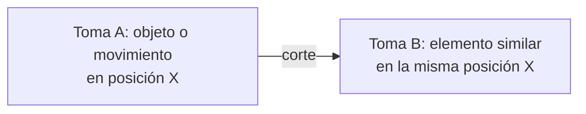

# Match cut (edición)

Parte de: [[Tipos de corte (J-cut, L-cut, jump cut y match cut)]]

> [!info] Cómo avanzar
> `progreso`: **pendiente** → **viendo** (estudiando) → **visto** (contestaste la autoevaluación sin abrir las respuestas) → **dominado** (hiciste el laboratorio o lo aplicaste de verdad).

## Contenido

### Qué es
Un **match cut** une dos tomas distintas mediante algo que **coincide** entre ellas: una forma, un movimiento, una composición, un color o un sonido. El corte se siente fluido porque el ojo sigue el elemento que se repite, y además crea una relación de significado entre las dos escenas (el ejemplo clásico del cine es un hueso lanzado al aire que se convierte en una nave espacial).

### Cómo funciona
Tipos de coincidencia:
- **Gráfica / de forma**: un círculo (un plato, la luna, una llanta) ocupa el mismo lugar en las dos tomas.
- **De movimiento**: la acción continúa en otra toma (lanzas una pelota en un lugar y cae en otro).
- **De composición**: la persona ocupa la misma posición del encuadre en dos lugares distintos.
- **De sonido**: un ruido parecido une dos escenas (un aplauso que se vuelve un trueno).

La clave técnica es que el elemento coincida en **posición, tamaño, dirección y velocidad** en el cuadro del corte. En edición ajustas con escala, posición y el punto exacto del corte; a veces una rampa de velocidad corta ayuda ([[Rampas de velocidad]]).

### Ejemplos fáciles de grabar con tu equipo
1. **Puerta**: con el Osmo Pocket 4P cierras la puerta de tu casa; corte a la misma puerta (o otra) abriéndose en el destino del viaje.
2. **Mano que tapa la lente**: tapas el iPhone con la mano en un lugar y la retiras en otro. Es un match cut con "borrado" natural.
3. **Giro de cámara**: haces un paneo rápido a la derecha al final de una toma y empiezas la siguiente con un paneo rápido en la misma dirección (whip pan).
4. **Forma circular**: una taza de café vista desde arriba y una toma cenital del dron de una glorieta, centradas igual ([[Composición aérea y cenital]]).
5. **Paso**: tu pie da un paso en la banqueta y el siguiente paso cae en la arena.

### Qué se necesita planear al grabar
- **Lista de tomas** con las dos tomas emparejadas ([[Storyboard y lista de tomas]]).
- Misma **posición del elemento** en el cuadro: usa la cuadrícula de la pantalla y toma una foto de referencia de la primera toma.
- Misma **altura y lente** (o una equivalente) para que el tamaño coincida.
- Misma **dirección y velocidad** del movimiento.
- Si mezclas cámaras (iPhone y a6700), cuida fps iguales para que el movimiento empate.
- Graba varias repeticiones y un poco más largo: en edición eliges el cuadro exacto.

### Cuándo usarlo y cuándo no
Úsalo para cambios de lugar o de tiempo con intención: intros de viaje, transiciones de "antes y después", reels creativos. No lo uses solo porque se ve "cool" si no conecta ideas, ni varias veces seguidas: pierde efecto. Para cambios normales, el corte directo basta ([[Tipos de corte (J-cut, L-cut, jump cut y match cut)]]).

### Errores comunes
- **Elementos desalineados**: el objeto brinca de lugar y el corte se ve como error; corrige con *Transform* en el Inspector.
- **Velocidades distintas**: un movimiento rápido que continúa lento rompe la ilusión.
- **No planear**: buscar match cuts en el material ya grabado rara vez funciona.

### Para profundizar
- [Capacitación oficial de DaVinci Resolve](https://www.blackmagicdesign.com/products/davinciresolve/training)
- [Manual de Kdenlive](https://docs.kdenlive.org/)

## Autoevaluación

Contesta primero en voz alta o en papel; luego despliega la respuesta.

> [!question]- ¿Qué es un match cut?
> Un corte entre dos tomas que comparten forma, movimiento o composición, creando una conexión visual (una pelota que se convierte en la luna).

> [!question]- Da un ejemplo fácil de grabar.
> Cerrar una puerta en casa y abrir otra puerta en otro lugar, con el mismo encuadre y movimiento.

> [!question]- ¿Qué se necesita planear al grabar?
> Mismo encuadre o posición del elemento clave en ambas tomas, y movimiento en la misma dirección.

## Práctica

- [[Lab 3 - Reel vertical de 30 segundos editado a la música]]

