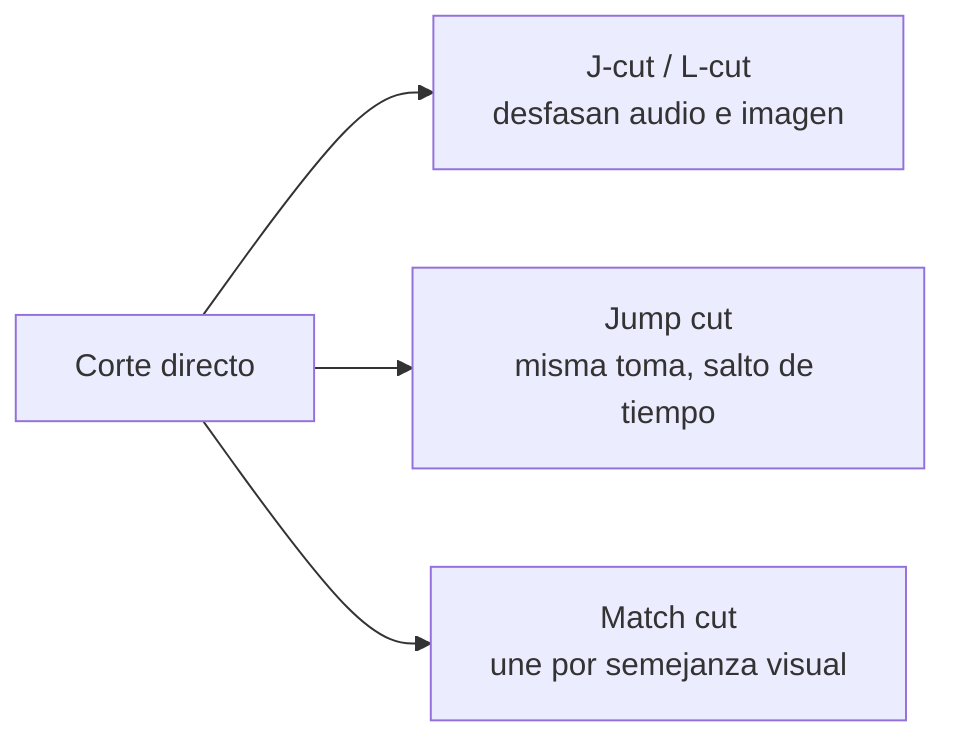

# Tipos de corte (J-cut, L-cut, jump cut y match cut)

Parte de: [[33-Edicion-Video/02 Montaje/_Índice Montaje|Montaje]]

> [!info] Cómo avanzar
> `progreso`: **pendiente** → **viendo** (estudiando) → **visto** (contestaste la autoevaluación sin abrir las respuestas) → **dominado** (hiciste el laboratorio o lo aplicaste de verdad).

## Contenido

### Qué es
Un **corte** es el paso instantáneo de una toma a otra. Además del **corte directo** (imagen y sonido cambian al mismo tiempo), hay variantes con nombre propio que cambian *cuándo* cambia el audio respecto a la imagen o *cómo* se relacionan las dos tomas. Conocerlas te da vocabulario y opciones para resolver problemas de edición.

### Cómo funcionan
| Tipo | Qué pasa | Para qué |
|---|---|---|
| Corte directo | Imagen y audio cambian juntos | El 90 % de cualquier edición |
| J-cut | El audio de la siguiente toma **entra antes** que su imagen | Anticipar, transiciones suaves |
| L-cut | El audio de la toma anterior **sigue** sobre la nueva imagen | Mostrar reacciones o contexto |
| Jump cut | Corte dentro de la misma toma, mismo encuadre | Acortar a alguien hablando a cámara |
| Match cut | Dos tomas unidas por una forma, movimiento o idea similar | Transición creativa con sentido |



El detalle de cada uno está en:
- [[J-cut y L-cut (edición)]]: los dos son *cortes divididos* (split edits); tienen en común que **audio e imagen no cortan en el mismo cuadro**, y suavizan el paso entre tomas porque el sonido conduce al espectador.
- [[Jump cut (edición)]]: aceptado en vlogs y YouTube; se nota y se puede disimular.
- [[Match cut (edición)]]: requiere planearlo al grabar.

### Por qué el corte directo es el más usado
Es **invisible**: el cerebro está acostumbrado a cambiar de punto de vista (como cuando volteas la mirada), así que un corte bien colocado no se nota y mantiene la atención en el contenido. Es instantáneo, no agrega información falsa (una disolvencia sugiere paso del tiempo) y deja el ritmo en tus manos.

### Ejemplo
Video de entrevista con b-roll:
1. Abres con el sonido del mercado antes de ver el mercado: **J-cut**.
2. La persona habla; quitas una muletilla y haces un **jump cut** con un pequeño zoom digital.
3. Mientras sigue hablando ves sus manos trabajando: **L-cut** hacia b-roll.
4. Una puerta que se cierra en una toma y otra que se abre en otro lugar: **match cut** para cambiar de escena.

### Caso: acortar a alguien a cámara sin b-roll
Si no tienes b-roll, usa **jump cuts**. Para que molesten menos, alterna el encuadre en cada corte (escala 100 % / 115 %) si grabaste en 4K y entregas en 1080p o 4K con margen, y corta en el inicio de una idea nueva.

### Cuándo usarlos y cuándo no
Usa el corte directo por defecto. Agrega J/L para entrevistas y diálogos, jump cuts para contenido a cámara, y match cuts solo cuando aportan significado. Las transiciones animadas son otra herramienta distinta ([[Transiciones con criterio]]).

### Errores comunes
- **Poner disolvencias en todos los cortes**: el video se siente lento, de presentación casera; además cada disolvencia sugiere paso de tiempo o cambio de lugar que no existe, y la imagen se ve "lavada" por la mezcla de dos tomas.
- **Cortar audio e imagen siempre juntos** en entrevistas: suena brusco; prueba J y L.
- **Jump cuts con micro-saltos** de pocos cuadros: parecen error.
- **Match cut forzado** sin relación real entre las tomas.

### Para profundizar
- [Capacitación oficial de DaVinci Resolve](https://www.blackmagicdesign.com/products/davinciresolve/training)
- [Manual de Kdenlive: edición en la línea de tiempo](https://docs.kdenlive.org/)

## Subtemas

- [[J-cut y L-cut (edición)]]
- [[Jump cut (edición)]]
- [[Match cut (edición)]]

## Autoevaluación

Contesta primero en voz alta o en papel; luego despliega la respuesta.

> [!question]- ¿Qué es un corte directo y por qué es el más usado?
> El paso inmediato de una toma a otra. Es invisible si tiene motivo (una mirada, una acción); casi toda edición es corte directo.

> [!question]- ¿Qué tienen en común el J-cut y el L-cut?
> El audio y el video **no cortan al mismo tiempo**: el sonido se adelanta o se queda, lo que hace la transición más natural.

> [!question]- Caso: quieres acortar a alguien hablando a cámara sin poner b-roll. ¿Qué corte usas?
> Un **jump cut** (corte con salto) intencional, o cubrir el salto con un cambio de tamaño (recorte/zoom digital) para que parezca otro plano.

> [!question]- Error común: usar transiciones de disolvencia en lugar de cortes en todo el video. ¿Qué efecto tiene?
> El video se siente lento y amateur. La disolvencia indica paso de tiempo; úsala con intención.

## Práctica

- [[Lab 2 - Montaje de entrevista con J-cuts y L-cuts]]

## Progreso de los subtemas

```base
filters:
  and:
    - file.inFolder("33-Edicion-Video/02 Montaje/Tipos de corte (J-cut, L-cut, jump cut y match cut)")
    - file.name != "Tipos de corte (J-cut, L-cut, jump cut y match cut)"
views:
  - type: table
    name: Progreso
    order:
      - file.name
      - progreso
      - nivel
```
