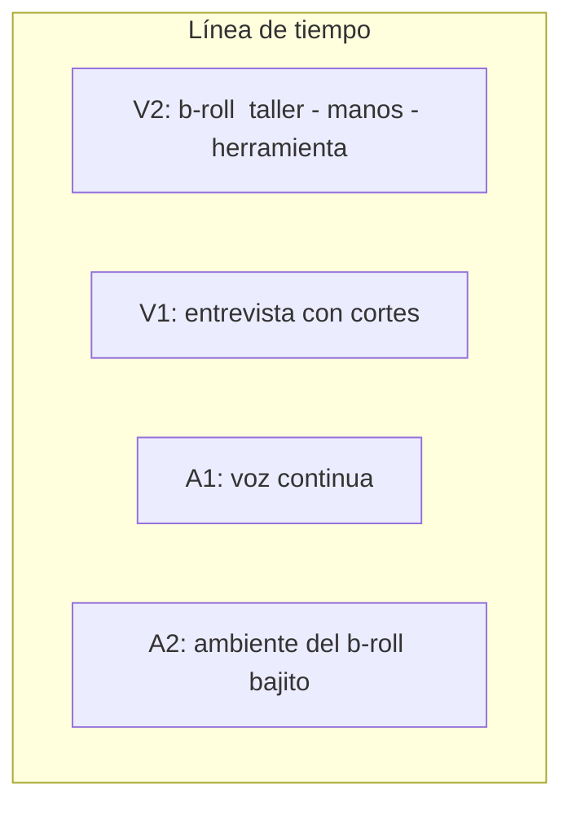

# Uso del b-roll en la edición

Parte de: [[33-Edicion-Video/02 Montaje/_Índice Montaje|Montaje]]

> [!info] Cómo avanzar
> `progreso`: **pendiente** → **viendo** (estudiando) → **visto** (contestaste la autoevaluación sin abrir las respuestas) → **dominado** (hiciste el laboratorio o lo aplicaste de verdad).

## Contenido

### Qué es
El **b-roll** es el material de apoyo que pones encima de la toma principal (la entrevista o el vlog a cámara, llamada *a-roll*). En edición sirve para **ilustrar** lo que se dice, **tapar cortes** del diálogo, dar **ritmo** y mostrar contexto. Cómo grabarlo se ve en [[B-roll y plano de ubicación]]; aquí, cómo usarlo al editar.

### Cómo funciona
En la línea de tiempo, la entrevista va en V1 con su audio en A1, y el b-roll en V2, normalmente **sin su audio** o con su ambiente muy bajo en otra pista. Como V2 tapa a V1, el espectador ve el b-roll y sigue escuchando a la persona.

Usos principales:
1. **Ilustrar**: la persona menciona algo y lo ves.
2. **Ocultar cortes**: quitaste una muletilla y hay un salto en la imagen; el b-roll lo cubre (alternativa al [[Jump cut (edición)]]).
3. **Respirar**: entre bloques de información, unas tomas con música dan pausa.
4. **Comprimir tiempo**: varias tomas cortas resumen un proceso largo.

### Duración de cada toma
Como guía, **2 a 5 segundos** por toma de b-roll: lo suficiente para entenderla, no tanto como para aburrir. Las tomas con movimiento interno (manos trabajando, un paneo del dron) aguantan más; los planos detalle estáticos, menos. Lo que manda es el ritmo del video ([[Ritmo y narrativa en el montaje]]) y, si hay música, sus beats.

### Ejemplo
El entrevistado dice: "Mi taller es pequeño, pero aquí hago todo".
- Plano general del taller completo con el iPhone en ultra gran angular: muestra lo pequeño (2–3 s).
- Plano detalle de herramientas colgadas muy juntas (2 s).
- Plano medio de él moviéndose entre la mesa y el estante, grabado con el Osmo Pocket 4P (3 s).
- Regresas a la entrevista justo cuando dice "aquí hago todo", para ver su cara en la frase importante.

Entrar al b-roll **un poco después** de que empieza la frase y salir **antes** de la frase clave hace que el cambio se sienta motivado.

### Cuándo usarlo y cuándo no
**Úsalo** cuando lo que se dice se puede mostrar, cuando necesitas cubrir cortes o cuando la toma a cámara lleva mucho tiempo sin cambio.

**No lo uses** cuando la emoción está en la cara de la persona (una anécdota personal, una reacción): ahí quédate en la entrevista. Tampoco para rellenar sin sentido.

### Errores comunes
- **B-roll que no tiene que ver con lo que se dice**: el espectador intenta relacionar imagen y palabra; si no encaja, se distrae o se confunde y el video se siente genérico, como de banco de imágenes. Busca relación directa o, al menos, del mismo lugar y momento.
- **Dejar el audio original del b-roll a todo volumen**: compite con la voz ([[Mezcla de voz y música]]).
- **Tomas temblorosas o mal expuestas** solo porque "hacía falta b-roll": mejor estabiliza ([[Estabilización en posproducción (Gyroflow)]]) o deja la entrevista.
- **No grabar suficiente**: regla de campo: por cada minuto de entrevista, varios minutos de b-roll variado.

### Para profundizar
- [Capacitación oficial de DaVinci Resolve (edición con varias pistas)](https://www.blackmagicdesign.com/products/davinciresolve/training)
- [Manual de Kdenlive: pistas y composición](https://docs.kdenlive.org/)

## Autoevaluación

Contesta primero en voz alta o en papel; luego despliega la respuesta.

> [!question]- ¿Para qué sirve el b-roll al editar?
> Ilustrar lo que se dice, esconder cortes en la entrevista y cambiar el ritmo.

> [!question]- ¿Cuánto debe durar cada toma de b-roll?
> Lo suficiente para entenderla: típicamente 2–5 s; más si es un plano general o tiene movimiento lento.

> [!question]- Caso: el entrevistado dice "mi taller es pequeño". ¿Qué b-roll pones?
> Un plano general del taller que muestre el espacio, no un detalle de una herramienta.

> [!question]- Error común: poner b-roll que no tiene que ver con lo que se dice. ¿Qué pasa?
> Distrae y confunde; el b-roll debe reforzar el mensaje.

## Práctica

- [[Lab 2 - Montaje de entrevista con J-cuts y L-cuts]]

