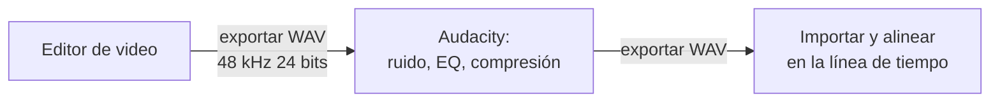

# Audacity

Parte de: [[33-Edicion-Video/03 Audio en posproducción/_Índice Audio en posproducción|Audio en posproducción]]

> [!info] Cómo avanzar
> `progreso`: **pendiente** → **viendo** (estudiando) → **visto** (contestaste la autoevaluación sin abrir las respuestas) → **dominado** (hiciste el laboratorio o lo aplicaste de verdad).

## Contenido

### Qué es
Audacity es un editor de audio libre y gratuito (código abierto) para Windows, macOS y Linux. En un flujo de video lo usas como "taller" para el audio: limpieza de ruido con perfil, ediciones finas en la forma de onda, normalización de loudness y conversión de formatos. No es un editor de video: lo combinas con Resolve, Kdenlive o Shotcut.

### Cómo funciona en el flujo de video

Para llevar el audio de un video a Audacity y de vuelta:
1. **Sacar el audio**:
   - Si grabaste con el [[DJI Mic Mini 2]], ya tienes el WAV del receptor o del transmisor: úsalo directo.
   - Si el audio está en el clip, exporta solo el audio desde el editor (en Resolve, *Deliver* con **Export Video** desactivado y audio en WAV/Linear PCM) o abre el MP4 en Audacity (necesita la biblioteca FFmpeg; Audacity te indica cómo instalarla).
   - Exporta desde el inicio exacto del clip o de la línea de tiempo, para que al regresar se alinee sin moverlo.
2. **Procesar en Audacity**: *Efecto → Reducción de ruido* (perfil y luego aplicar), *Filtro pasa altos*, *Compresor*, *Normalización de sonoridad* (por ejemplo −14 LUFS).
3. **Exportar en WAV** (PCM) a **48 kHz**, la frecuencia estándar de video, y 24 bits.
4. **Regresar al editor**: importa el WAV, colócalo en una pista nueva alineado con el original (si exportaste desde el inicio, solo pon ambos en el mismo punto; si no, usa la sincronización por forma de onda de Resolve: selecciona clips → *Auto Sync Audio → Based on Waveform*) y silencia la pista original.

### Ejemplo
Tutorial de 15 minutos con ruido de ventilador: exportas de Resolve la pista de voz completa en WAV 48 kHz, en Audacity tomas el perfil de ruido en 2 s de silencio, reduces 8 dB, aplicas un filtro pasa altos en 80 Hz y una normalización de sonoridad. Exportas `voz_limpia.wav` y en Resolve la pones en A2 desde el cuadro 0, silenciando A1.

### Cuándo usarlo y cuándo no
**Úsalo** cuando necesitas reducción de ruido por perfil (muy buena y gratis), cuando quieres editar audio con precisión de muestra, para podcasts o para limpiar una grabación antes de editar.

**No hace falta** si Fairlight (en Resolve) ya tiene lo que necesitas: EQ, compresión, *Noise Reduction* de Fairlight FX y medidor de loudness, sin exportar e importar. Tampoco lo uses para mezclar todo el video: la mezcla final se hace en el editor con la imagen enfrente.

### Errores comunes
- **Exportar en MP3 para volver a editar**: MP3 es un formato **con pérdida**; cada exportación descarta información y agrega artefactos. Además, los codificadores MP3 agregan un pequeño retraso o relleno al inicio que puede desfasar la sincronía con el video. Para trabajo intermedio usa **WAV** (o FLAC); MP3/AAC solo para entregar.
- **Cambiar la frecuencia de muestreo** a 44.1 kHz: el video usa 48 kHz; mezclarlas fuerza conversiones.
- **Recortar el inicio** del audio en Audacity: al regresar, ya no se alinea con el video.
- **Aplicar efectos destructivos sin guardar el original**: guarda el proyecto de Audacity (.aup3) y conserva el WAV original.

### Para profundizar
- [Audacity (sitio oficial)](https://www.audacityteam.org/)
- [Manual de Audacity](https://manual.audacityteam.org/)

## Autoevaluación

Contesta primero en voz alta o en papel; luego despliega la respuesta.

> [!question]- ¿Para qué usarías Audacity en el flujo de video?
> Editor de audio gratuito para limpiar voces (Reducción de ruido), normalizar, ecualizar y comprimir, y grabar voz en off.

> [!question]- ¿Cómo llevas el audio de un video a Audacity y de vuelta?
> Exporta solo el audio (WAV) desde Resolve o ábrelo en Audacity si tiene soporte para el formato; procesa y exporta WAV 48 kHz; reemplaza la pista en la línea de tiempo sincronizando el inicio.

> [!question]- Error común: exportar en MP3 para volver a editar. ¿Por qué no?
> Es un formato con pérdida y puede añadir un pequeño desfase al inicio; usa **WAV** para intercambio.

## Práctica

- [[Lab 4 - Limpieza de voz y loudness para YouTube]]

