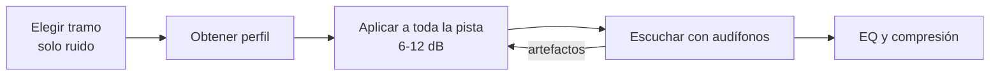

# Limpieza de ruido en audio

Parte de: [[33-Edicion-Video/03 Audio en posproducción/_Índice Audio en posproducción|Audio en posproducción]]

> [!info] Cómo avanzar
> `progreso`: **pendiente** → **viendo** (estudiando) → **visto** (contestaste la autoevaluación sin abrir las respuestas) → **dominado** (hiciste el laboratorio o lo aplicaste de verdad).

## Contenido

### Qué es
La limpieza de ruido es quitar o reducir sonidos no deseados de una grabación (zumbido eléctrico, siseo del preamplificador, aire acondicionado, viento) sin dañar la voz. Es un **rescate**: lo ideal es grabar limpio desde el inicio ([[Colocación del micrófono]], [[Ganancia y niveles de audio]]), porque toda reducción de ruido quita también algo de la señal buena.

### Cómo funciona
Hay dos familias de herramientas:

1. **Reducción con perfil (espectral)**, como el efecto *Reducción de ruido* de Audacity:
   - Seleccionas un fragmento donde **solo hay ruido** (1–2 s de "silencio" de la sala).
   - *Obtener perfil de ruido*: el programa analiza qué frecuencias y con qué nivel tiene ese ruido.
   - Seleccionas toda la pista y aplicas: en cada momento, el programa baja las frecuencias que se parecen al perfil. Parámetros: **reducción (dB)**, **sensibilidad** y **suavizado de frecuencias**.
2. **Reducción adaptativa / con IA**: el programa separa voz de ruido sin perfil. En Resolve, *Voice Isolation* es de Studio; en la gratuita tienes el efecto **Noise Reduction** de Fairlight FX (modo automático o con aprendizaje).

### Qué ruido es fácil y cuál difícil
- **Fácil**: ruido **constante y estable**: siseo, ventilador, aire acondicionado, zumbido de 60 Hz (en México la red eléctrica es de 60 Hz; un filtro *notch* en 60, 120, 180 Hz lo quita).
- **Difícil**: ruido **variable o parecido a la voz**: tráfico, gente hablando, música de fondo, platos, viento con golpes, eco de un cuarto vacío (reverberación). Ahí la reducción deja la voz rara antes de quitar el ruido.

### Ejemplo
Entrevista grabada con el [[DJI Mic Mini 2]] en un cuarto con ventilador:
1. En Resolve, exporta el audio o llévalo a Audacity ([[Audacity]]).
2. Selecciona 2 s antes de que la persona hable, *Obtener perfil*.
3. Aplica con 8 dB de reducción, sensibilidad 6, suavizado 3.
4. Escucha con audífonos: si suena "bajo el agua", baja a 5–6 dB.
5. Exporta WAV y reemplaza en la línea de tiempo.

Caso del micrófono con **cancelación de ruido alta** que dejó la voz metálica: ese procesamiento ya está **dentro** del archivo y no se puede deshacer en edición. Puedes suavizarlo un poco con EQ (bajar algo de agudos ásperos, agregar un poco de cuerpo en 150–250 Hz) o mezclarlo con el audio de la cámara si lo grabaste, pero no recuperarás la voz natural. La lección: en lugares tranquilos graba con la cancelación apagada o baja y guarda la grabación interna del transmisor como respaldo.

### Cuándo usarla y cuándo no
Úsala cuando el ruido distrae o compite con la voz. No la uses "por si acaso" en audio que ya está limpio, ni intentes eliminar el ruido por completo: un poco de ambiente suena natural, y la música de fondo lo disimula.

### Errores comunes
- **Reducción al máximo**: la voz queda metálica, con burbujas ("artefactos" o *musical noise*), entrecortada en las colas de las palabras. Mejor poca reducción y dos pasadas suaves que una agresiva.
- **Perfil tomado con voz incluida**: el programa considera la voz como ruido y la daña.
- **Juzgar con bocinas de laptop**: no escuchas los artefactos; usa audífonos.
- **Limpiar después de comprimir**: la compresión sube el ruido; limpia primero.

### Para profundizar
- [Manual de Audacity](https://manual.audacityteam.org/)
- [Fairlight en DaVinci Resolve](https://www.blackmagicdesign.com/products/davinciresolve/fairlight)

## Autoevaluación

Contesta primero en voz alta o en papel; luego despliega la respuesta.

> [!question]- ¿Cómo funciona la reducción de ruido con perfil (como en Audacity)?
> Seleccionas unos segundos con **solo ruido** (room tone) para que el programa aprenda su perfil; luego lo resta del resto de la pista.

> [!question]- ¿Qué ruido es fácil de quitar y cuál difícil?
> Fácil: ruido constante (zumbido, aire acondicionado, siseo). Difícil: ruido variable (tráfico, gente hablando, música).

> [!question]- Caso: grabaste con el [[DJI Mic Mini 2]] con cancelación de ruido alta y la voz suena metálica. ¿Lo arreglas en edición?
> Muy poco: lo que se pierde no se recupera. Para la próxima, graba con cancelación más baja y limpia en edición, donde puedes controlar cuánto quitas.

> [!question]- Error común: aplicar reducción de ruido al máximo. ¿Qué pasa?
> Artefactos "de robot" o burbujeantes. Mejor reducir poco (6–12 dB) y aceptar algo de ruido.

## Práctica

- [[Lab 4 - Limpieza de voz y loudness para YouTube]]

