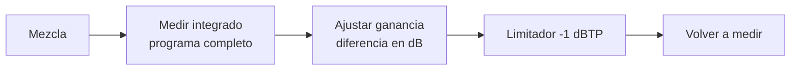

# Loudness (LUFS) por plataforma

Parte de: [[33-Edicion-Video/03 Audio en posproducción/_Índice Audio en posproducción|Audio en posproducción]]

> [!info] Cómo avanzar
> `progreso`: **pendiente** → **viendo** (estudiando) → **visto** (contestaste la autoevaluación sin abrir las respuestas) → **dominado** (hiciste el laboratorio o lo aplicaste de verdad).

## Contenido

### Qué es
El **loudness** es el volumen **percibido** de un programa completo. Se mide en **LUFS** (Loudness Units relative to Full Scale) según el estándar ITU-R BS.1770, que pondera las frecuencias como el oído humano. Es distinto del **pico** (dBFS), que solo dice cuál fue la muestra más alta. Las plataformas miden el loudness de tu video y lo **normalizan** (lo suben o bajan) para que todos suenen parecido.

### Cómo funciona
Medidas que verás en un medidor:
- **Integrated (integrado)**: promedio de todo el programa. Es el que comparan las plataformas.
- **Short-term / Momentary**: ventanas de 3 s y 400 ms, para ver partes concretas.
- **True Peak (dBTP)**: pico real considerando lo que pasa entre muestras al convertir a analógico o comprimir a AAC. Se recomienda no pasar de **−1 dBTP**.
- **LRA**: rango de loudness, qué tanto varía.

La relación es directa en dB: si mides −20 LUFS y quieres −14, subes **6 dB**, y los picos también suben 6 dB. Por eso se usa un **limitador** al final: deja subir el promedio sin que los picos pasen del techo.

### Valores de referencia (verificar; las plataformas los cambian)
- **YouTube**: se observa normalización hacia unos **−14 LUFS** integrados. YouTube no publica un valor oficial en su ayuda (Pendiente de confirmar).
- **Instagram, TikTok, Facebook**: no publican un objetivo oficial; muchos creadores entregan entre **−14 y −10 LUFS** (Pendiente de confirmar).
- **Televisión**: EBU R128 (Europa) usa **−23 LUFS**; en Estados Unidos ATSC A/85 usa −24 LKFS.
- **True peak**: −1 dBTP es la referencia más usada para streaming.

Si entregas **más fuerte** que el objetivo, la plataforma baja el volumen: si mezclaste a −9 LUFS y normaliza a −14, lo baja 5 dB. Terminas con el mismo volumen que los demás pero con menos dinámica (por comprimir de más). Si entregas **más bajo**, algunas plataformas no suben o lo suben poco, y tu video sonará más quieto.

### Ejemplo en Resolve
1. Página **Fairlight**: en el panel de medidores, abre el **Loudness** meter (puedes elegir el estándar, por ejemplo uno de −14 LUFS para streaming o EBU R128 −23).
2. Pon el cabezal al inicio, presiona *Start* en el medidor y reproduce **todo** el programa (o usa la medición del bus principal durante la reproducción completa).
3. Lee *Integrated*: −17.5 LUFS. Subes 3.5 dB en el bus principal (Main/Bus 1).
4. Agrega un **Limiter** en el bus con techo −1 dBTP y vuelve a medir.
5. Cuando trabajas con Audacity, el efecto *Normalización de sonoridad* hace lo mismo para un archivo.

### Cuándo aplicarlo
Siempre al final de la mezcla, una vez que voz, música y efectos están balanceados ([[Mezcla de voz y música]]). Mide el máster y, si exportas versiones para distintas plataformas, ajusta cada una.

### Errores comunes
- **Fiarse de los picos**: un video con picos en −1 dBFS puede medir −24 LUFS y sonar bajo.
- **Medir solo un fragmento**: el integrado necesita el programa completo.
- **Subir ganancia sin limitador**: los picos pasan de 0 dBTP y se distorsionan al codificar AAC.
- **Comprimir para "ganar la guerra del volumen"**: la normalización la anula.

### Para profundizar
- [ITU-R BS.1770 (algoritmo de medición de loudness)](https://www.itu.int/rec/R-REC-BS.1770)
- [EBU R 128 (recomendación de loudness)](https://tech.ebu.ch/publications/r128)
- [Fairlight en DaVinci Resolve](https://www.blackmagicdesign.com/products/davinciresolve/fairlight)

## Ejercicios

Resuélvelos en papel o en la herramienta; la solución está plegada.

> [!question]- Tu mezcla mide −20 LUFS y quieres −14. ¿Cuánto subes?
> **+6 dB** (vigilando que el true peak no pase de −1 dBTP; usa un limitador).

> [!question]- Mezclaste a −9 LUFS y la plataforma normaliza a −14. ¿Cuánto lo bajará?
> **5 dB**.

> [!question]- Tu mezcla tiene −16 LUFS y picos en −2 dBTP. Si subes 2 dB para llegar a −14, ¿qué pasa con los picos?
> Llegan a **0 dBTP**: te pasas del límite de −1; necesitas un limitador.

## Autoevaluación

Contesta primero en voz alta o en papel; luego despliega la respuesta.

> [!question]- ¿Qué son los LUFS?
> Una medida de **volumen percibido** a lo largo de un programa (loudness integrado), distinta de los picos en dBFS. Las plataformas normalizan el volumen con base en ella.

> [!question]- ¿Qué valores de referencia se usan? (verificar; las plataformas los cambian)
> Referencias comunes: YouTube alrededor de **−14 LUFS** integrados; para redes sociales (Instagram, TikTok) muchos creadores usan entre **−14 y −10 LUFS**; televisión en muchos países **−23/−24 LUFS**. Pico real (true peak) máximo cerca de **−1 dBTP**. (verificar; las plataformas los cambian)

> [!question]- ¿Qué pasa si entregas más fuerte que el objetivo de la plataforma?
> La plataforma baja el volumen para igualarlo; si comprimiste en exceso para ganar volumen, solo pierdes dinámica sin ganar nada.

> [!question]- ¿Dónde mides el loudness en Resolve?
> En **Fairlight**, el medidor de loudness (Loudness meter) en el panel de medidores; reproduce el programa completo para leer el integrado.

## Práctica

- [[Lab 4 - Limpieza de voz y loudness para YouTube]]

