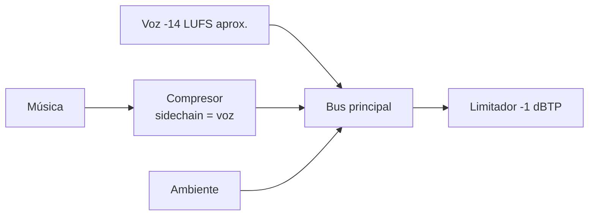

# Mezcla de voz y música

Parte de: [[33-Edicion-Video/03 Audio en posproducción/_Índice Audio en posproducción|Audio en posproducción]]

> [!info] Cómo avanzar
> `progreso`: **pendiente** → **viendo** (estudiando) → **visto** (contestaste la autoevaluación sin abrir las respuestas) → **dominado** (hiciste el laboratorio o lo aplicaste de verdad).

## Contenido

### Qué es
Mezclar es equilibrar las pistas (voz, música, ambiente, efectos) para que todo se escuche y **la voz siempre se entienda**. En video para redes y YouTube, la voz es la protagonista; la música acompaña y da emoción, pero nunca debe obligar al espectador a subir el volumen para entender.

### Cómo funciona
**Relación de volumen**: como punto de partida, la música bajo la voz va unos **12 a 20 dB por debajo** de la voz; en partes sin voz (intro, transiciones) sube a casi el nivel del programa. Ajusta de oído: si tienes que esforzarte para entender una palabra, la música está alta.

**Ducking**: es bajar automáticamente la música cuando hay voz y subirla en los silencios. Formas de hacerlo:
1. **Manual con keyframes** de volumen en la pista de música: preciso, te da control total.
2. **Compresor con sidechain**: el compresor de la pista de música "escucha" la pista de voz y baja la música cada vez que hay voz. En Fairlight, el procesador **Dynamics** de la pista de música admite una entrada de control externa (sidechain) desde la voz.
3. **Herramientas automáticas** de algunos editores (CapCut y otros tienen funciones de "ducking" o "auto volumen"; revisa si son de pago).

**Espacio en frecuencia**: si la música compite aunque esté baja, el problema suele ser que ocupa el mismo rango de la voz (1–4 kHz: guitarras, pianos, voces cantadas). Soluciones:
- Una EQ en la música con un "hueco" suave de −3 a −6 dB alrededor de 2–4 kHz.
- Elegir una versión **instrumental** o una pista con menos medios.
- Paneo: la voz al centro, la música abierta en estéreo.

### Ejemplo
Vlog de viaje en Resolve:
- A1 voz del [[DJI Mic Mini 2]] con EQ y compresión ([[Ecualización y compresión de voz]]).
- A2 ambiente del lugar (grabado por la cámara) a −25 dB relativo a la voz.
- A3 música de la Audio Library de YouTube.
En Fairlight, pon la voz a nivel, baja la música hasta que ya no compita y aplica ducking con keyframes: en la intro la música va arriba, al primer "hola" baja 15 dB con una rampa de medio segundo, y sube en las tomas de dron sin voz. Mide el loudness final ([[Loudness (LUFS) por plataforma]]).

### Cuándo usar cada técnica
- Keyframes: videos cortos o momentos clave.
- Sidechain: videos largos con mucha voz.
- EQ en música: cuando bajar volumen no basta.

### Errores comunes
- **Mezclar solo con bocinas de laptop**: no reproducen graves y exageran medios. La mezcla puede sonar bien ahí y en audífonos tener graves que retumban, o la música demasiado alta. Revisa en audífonos cerrados, en bocinas decentes y en el celular (donde lo verá la mayoría).
- **Música a todo volumen en la intro y la voz débil después**: el espectador sube el volumen y luego la música le explota.
- **Ducking con cambios bruscos**: rampas de 0.3–0.8 s suenan naturales.
- **Olvidar el ambiente**: sin ambiente, los cortes de voz suenan a vacío.

### Para profundizar
- [Fairlight en DaVinci Resolve](https://www.blackmagicdesign.com/products/davinciresolve/fairlight)
- [Capacitación oficial de DaVinci Resolve (guía de Fairlight)](https://www.blackmagicdesign.com/products/davinciresolve/training)

## Autoevaluación

Contesta primero en voz alta o en papel; luego despliega la respuesta.

> [!question]- ¿Qué relación de volumen se busca entre voz y música?
> La voz manda: la música de fondo suele quedar unos **15–20 dB** por debajo de la voz mientras se habla (referencia, se ajusta de oído).

> [!question]- ¿Qué es el ducking?
> Bajar automáticamente la música cuando hay voz y subirla en las pausas. En Resolve se hace con automatización o con el *sidechain* de un compresor en Fairlight.

> [!question]- Caso: la música compite con la voz aunque esté baja. ¿Qué pruebas?
> Ecualizar la música bajando la zona de 1–4 kHz (donde vive la inteligibilidad de la voz) o elegir una pista con menos voces y melodías.

> [!question]- Error común: mezclar solo con bocinas de laptop. ¿Qué pasa?
> No escuchas graves ni detalles; revisa con audífonos y con el celular, que es donde la mayoría verá el video.

## Práctica

- [[Lab 4 - Limpieza de voz y loudness para YouTube]]

