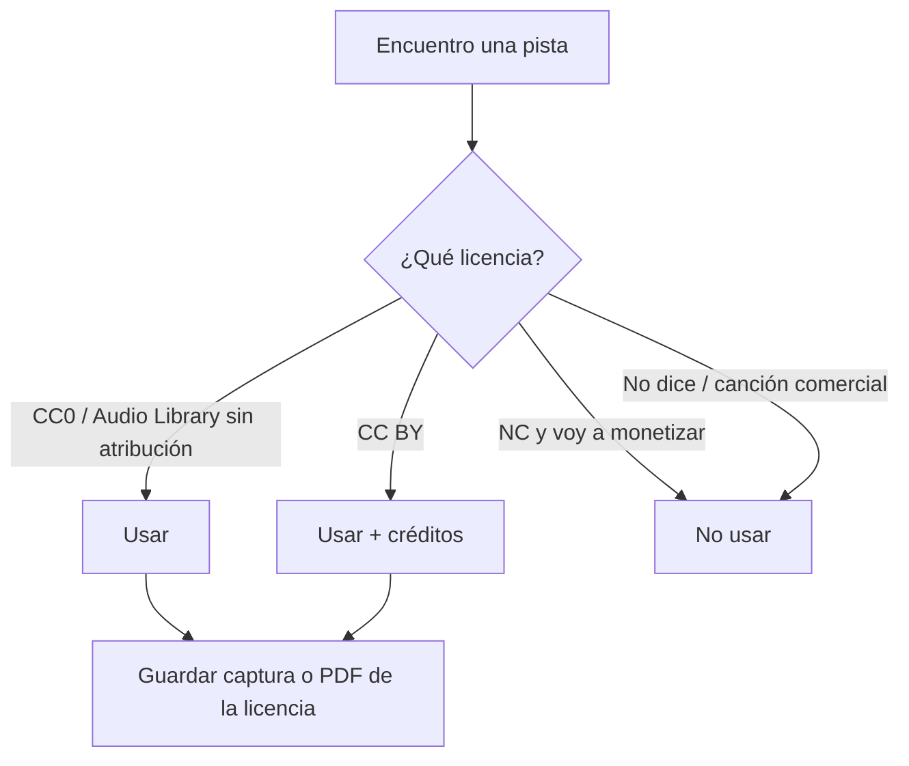

# Música y efectos libres de regalías

Parte de: [[33-Edicion-Video/03 Audio en posproducción/_Índice Audio en posproducción|Audio en posproducción]]

> [!info] Cómo avanzar
> `progreso`: **pendiente** → **viendo** (estudiando) → **visto** (contestaste la autoevaluación sin abrir las respuestas) → **dominado** (hiciste el laboratorio o lo aplicaste de verdad).

## Contenido

### Qué es
"Libre de regalías" (*royalty free*) significa que **no pagas por cada uso o reproducción**: obtienes una licencia (gratis o con pago único/suscripción) y puedes usar la pista según sus condiciones. **No significa "sin derechos" ni "dominio público"**: el autor sigue siendo dueño y la licencia define dónde, cómo y con qué obligaciones (créditos, uso comercial, plataformas) la puedes usar.

### Cómo funciona: tipos de licencia
| Licencia | Qué permite | Obligación |
|---|---|---|
| Dominio público / CC0 | Casi cualquier uso | Ninguna |
| **CC BY** | Usar, modificar y uso comercial | **Dar crédito** al autor como pide la licencia |
| CC BY-SA | Igual que BY | Crédito y compartir bajo la misma licencia |
| CC BY-NC | Solo **no comercial** | Crédito; no sirve si monetizas |
| CC BY-ND | Sin modificar | Crédito; no puedes recortar ni remezclar |
| Licencia propia de la plataforma | Lo que diga su texto | Leerla |

Una licencia **Creative Commons BY** te deja usar la obra incluso con fines comerciales, siempre que atribuyas: título, autor, fuente y licencia (por ejemplo, en la descripción del video).

### Dónde conseguir música y efectos seguros para YouTube
- **Biblioteca de audio de YouTube** (YouTube Studio → Biblioteca de audio): música y efectos para usar en YouTube; algunas pistas piden atribución y lo indican.
- **Pixabay Music**: pistas con la licencia de contenido de Pixabay; a veces generan reclamos de Content ID de terceros, así que guarda la licencia.
- **Freesound**: efectos de sonido con licencias CC0, CC BY o CC BY-NC (revisa cada uno).
- Música de las bibliotecas de editores (CapCut, etc.): puede estar autorizada solo dentro de esa app o red; no la des por buena para YouTube.

### Ejemplo
Para un video de viaje: música de fondo de la Biblioteca de audio de YouTube, el efecto de "whoosh" de Freesound con CC0, y el sonido de ambiente que grabaste tú. En `04 Música y SFX` guardas los archivos con una captura de la página de licencia (ver [[Organizar material de video]]). En la descripción pones la atribución de la pista CC BY.

### Cuándo usarlas y cuándo no
Úsalas siempre que no tengas música propia o licenciada por escrito. No uses pistas sin licencia clara, ni versiones "subidas por alguien" a otro sitio: la licencia debe venir del autor o de la plataforma oficial.

### Errores comunes
- **"Solo son 10 segundos"**: no existe una regla de segundos permitidos. Content ID detecta fragmentos cortos; el dueño puede monetizar tu video, bloquearlo en algunos países o silenciarlo, y una solicitud de retiro formal genera un *strike* ([[Content ID y derechos en plataformas]]). El uso justo (*fair use*) es una defensa legal de EE. UU. que se evalúa caso por caso, no un permiso automático.
- **Créditos como sustituto de licencia**: poner el nombre del artista no da permiso.
- **Usar NC en un canal monetizado**.
- **No guardar la prueba de la licencia**: sin ella no puedes disputar un reclamo.

### Para profundizar
- [Usar música y efectos de la Biblioteca de audio de YouTube](https://support.google.com/youtube/answer/3376882)
- [Licencia Creative Commons BY 4.0](https://creativecommons.org/licenses/by/4.0/deed.es)
- [Freesound](https://freesound.org/)

## Autoevaluación

Contesta primero en voz alta o en papel; luego despliega la respuesta.

> [!question]- ¿Qué significa "libre de regalías"?
> Que pagas (o no) una vez por la licencia y no pagas por cada uso o reproducción. No es lo mismo que gratis ni que dominio público.

> [!question]- ¿Dónde conseguir música gratuita segura para YouTube?
> La **Biblioteca de audio de YouTube** (YouTube Studio) es la opción más segura para ese canal. Revisa si la pista requiere atribución.

> [!question]- ¿Qué es una licencia Creative Commons BY?
> Permite usar la obra si das crédito al autor; otras variantes prohíben uso comercial (NC) o modificaciones (ND).

> [!question]- Error común: usar una canción comercial porque "solo son 10 segundos". ¿Qué pasa?
> No existe una regla de segundos permitidos; Content ID puede reclamarla igual.

