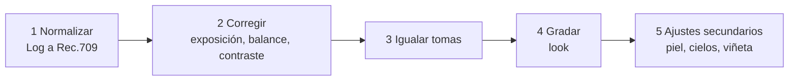

# Corrección de color vs gradación

Parte de: [[33-Edicion-Video/04 Color/_Índice Color|Color]]

> [!info] Cómo avanzar
> `progreso`: **pendiente** → **viendo** (estudiando) → **visto** (contestaste la autoevaluación sin abrir las respuestas) → **dominado** (hiciste el laboratorio o lo aplicaste de verdad).

## Contenido

### Qué es
- La **corrección de color** busca que la imagen se vea **correcta y natural**: exposición adecuada, blancos neutros, contraste razonable y tonos de piel creíbles. Es técnica y se apoya en los scopes.
- La **gradación** (*color grading*) le da a la imagen un **look o intención** (cálido nostálgico, frío, naranja/turquesa, desaturado). Es creativa.

Las dos se hacen en la página **Color** de Resolve, pero son etapas distintas.

### Cómo funciona: el orden

1. **Normalizar**: si grabaste en Log (S-Log3 de la a6700, Apple Log del iPhone, D-Log 2 del Osmo Pocket 4P), conviertes a Rec.709 con una transformación o LUT de conversión ([[Material Log y LUTs]]).
2. **Corregir** cada toma: exposición (negros, medios y altas luces en el waveform), balance de blancos (parade), saturación.
3. **Igualar** tomas para que una escena se vea continua ([[Igualar tomas y tonos de piel]]).
4. **Gradar**: aplicas el look, idealmente el mismo para toda la escena o el video (en Resolve, en un nodo de grupo o en un *Adjustment Clip*).
5. Secundarios: piel, cielo, viñeta.

El orden importa porque la gradación **amplifica** los problemas: si la toma tiene una dominante verde, el look naranja/turquesa se verá sucio. Corregir primero da una base neutra para que el look funcione igual en todas las tomas.

### Ejemplo
Video de un día de playa con la a6700 (S-Cinetone) y el iPhone:
- Corrección: bajas las altas luces del cielo que estaban al 100 %, subes un poco los medios para que las caras queden en buen nivel, quitas el tinte azul del iPhone en la sombra.
- Gradación: en un nodo posterior, calientas las altas luces, enfrías ligeramente las sombras y bajas un poco la saturación general para un look de verano "de película".

### Caso: look naranja/turquesa con caras grises
Si la piel se ve gris o verdosa, el look se aplicó sobre una toma no corregida o desaturó la piel. Solución: corrige balance y exposición antes; en la gradación, **protege la piel** con un calificador (Qualifier) o revisa que la piel quede sobre la línea de tono de piel del [[Vectorscopio]]. Los looks naranja/turquesa empujan sombras a cian y luces a naranja, y la piel debe quedarse en el naranja.

### Cuándo usar cada uno
Corrige **siempre**, aunque no hagas look: un video bien corregido ya se ve profesional. Grada cuando quieres una estética o coherencia de marca. En videos rápidos para redes, una corrección y una LUT creativa sutil al 30–50 % suelen bastar.

### Errores comunes
- **Corregir en una pantalla con modo "vívido" y brillo al máximo**: ves la imagen más saturada y brillante de lo que es; compensas de menos y en otras pantallas se ve apagada u oscura. Usa un modo sRGB/estándar, brillo moderado y confía en los scopes ([[Calibración del monitor]]).
- **Saltar directo al look** con una LUT creativa sobre Log sin convertir.
- **Grados distintos en cada toma** de la misma escena.
- **Exagerar saturación**: la piel se vuelve naranja.

### Para profundizar
- [Página Color de DaVinci Resolve](https://www.blackmagicdesign.com/products/davinciresolve/color)
- [Capacitación oficial (guía del colorista)](https://www.blackmagicdesign.com/products/davinciresolve/training)

## Autoevaluación

Contesta primero en voz alta o en papel; luego despliega la respuesta.

> [!question]- ¿Qué diferencia hay entre corrección y gradación?
> **Corrección**: dejar la imagen neutra y correcta (exposición, balance de blancos, contraste) y que todas las tomas coincidan. **Gradación**: dar un look creativo (cálido, frío, desaturado).

> [!question]- ¿En qué orden se hacen?
> Primero corrección (y conversión de Log a Rec.709), luego igualar tomas, al final gradación.

> [!question]- Caso: tu video tiene un look naranja/turquesa pero las caras se ven grises. ¿Qué falló?
> Probablemente la gradación se aplicó sin corregir bien antes, o se desplazó el tono de piel; revisa la línea de piel en el vectorscopio.

> [!question]- Error común: corregir mirando una pantalla con brillo y modo de color "vívido". ¿Qué pasa?
> Lo que ves no es lo que verá el público. Usa un modo de color estándar (sRGB/Rec.709) y apóyate en scopes.

## Práctica

- [[Lab 5 - Corrección y gradación de Apple Log con scopes]]

