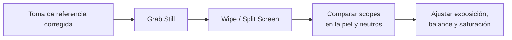

# Igualar tomas y tonos de piel

Parte de: [[33-Edicion-Video/04 Color/_Índice Color|Color]]

> [!info] Cómo avanzar
> `progreso`: **pendiente** → **viendo** (estudiando) → **visto** (contestaste la autoevaluación sin abrir las respuestas) → **dominado** (hiciste el laboratorio o lo aplicaste de verdad).

## Contenido

### Qué es
**Igualar tomas** (*shot matching*) es ajustar el color y la exposición de varias tomas de la misma escena para que parezcan grabadas en el mismo momento y con la misma cámara. Es fundamental cuando mezclas cámaras (a6700, iPhone 15 Pro, Osmo Pocket 4P, Mini 4K) o cuando la luz cambió durante la grabación.

### Por qué igualar
Si en una entrevista el plano abierto se ve cálido y el primer plano frío, cada corte "salta" y el espectador nota la edición en vez de escuchar a la persona. Igualar mantiene la continuidad, y deja una base pareja para aplicar el mismo look a todas ([[Corrección de color vs gradación]]).

### Cómo funciona
1. Elige una **toma de referencia** (la mejor expuesta, normalmente la de la cámara principal) y corrígela bien.
2. Toma una captura: clic derecho en el visor → **Grab Still**; queda en la **Gallery**.
3. En la siguiente toma, activa la comparación: botón de **Split Screen** o reproduce la captura con **Wipe** (Ctrl+W) para ver ambas en el visor, lado a lado o con cortina.
4. Compara **scopes**, no solo la imagen: mismo nivel de piel en el [[Waveform en corrección de color]], mismos canales en zonas neutras en el [[Parade RGB]], misma posición de la piel en el [[Vectorscopio]].
5. Ajusta en este orden: exposición → balance → saturación → piel.
6. Herramienta automática: clic derecho en un clip → **Shot Match to this clip** iguala de forma aproximada; úsala como punto de partida y afina a mano.

### Ejemplo: dos cámaras, un plano más magenta
Entrevista con la a6700 de frente y el iPhone 15 Pro de lado; el plano del iPhone se ve **más magenta**:
- En el parade, en la pared gris del fondo, el verde está más bajo que rojo y azul: dominante magenta.
- Corrige el **tinte** (eje verde–magenta): sube *Tint* hacia verde en *Primaries* o empuja la rueda Gamma un poco hacia verde.
- Verifica en el vectorscopio que la piel quede sobre la misma línea y con la misma longitud que en la a6700.
- Iguala el nivel de la cara en el waveform.

### Tonos de piel
Para la piel: aísla la cara con un **Qualifier** (gotero sobre la piel, ajusta suavizado) o una ventana circular con tracking, y haz ajustes **sutiles** de matiz y saturación. La piel debe quedar cerca de la línea de piel del vectorscopio y con brillo parecido entre tomas. No la "corrijas" a un solo tono: personas distintas tienen pieles distintas; lo que igualas es la misma persona entre tomas.

### Cuándo usarlo
En cualquier escena con más de una toma, sobre todo multicámara, entrevistas y secuencias donde la luz cambió (nubes, atardecer). En montajes musicales de lugares distintos basta una coherencia general.

### Errores comunes
- **Igualar mirando toda la imagen en vez del sujeto**: el fondo puede ser distinto de verdad (otra pared, ventana) y te lleva a cambiar la piel. Conviene igualar **la piel del sujeto y las zonas neutras comunes**.
- **Fiarse solo del Shot Match automático**.
- **Igualar sobre la toma mal expuesta**: elige bien la referencia.
- **Olvidar el balance al grabar**: si cada cámara tenía balance automático, igualar cuesta mucho más; fija el balance en campo.

### Para profundizar
- [Página Color de DaVinci Resolve](https://www.blackmagicdesign.com/products/davinciresolve/color)
- [Capacitación oficial (guía del colorista)](https://www.blackmagicdesign.com/products/davinciresolve/training)

## Autoevaluación

Contesta primero en voz alta o en papel; luego despliega la respuesta.

> [!question]- ¿Por qué igualar tomas?
> Para que el espectador no note cambios de color/brillo entre cortes de la misma escena.

> [!question]- ¿Qué herramientas de Resolve ayudan a comparar?
> Las **stills** (galería) y el modo de **pantalla dividida** (split screen) junto a los scopes.

> [!question]- Caso: en una entrevista con dos cámaras (iPhone y otro celular), un plano se ve más magenta. ¿Qué ajustas?
> Balance (tint) usando el parade en un área neutra y la línea de piel en el vectorscopio hasta que coincida con la toma de referencia.

> [!question]- Error común: igualar mirando toda la imagen en vez del sujeto. ¿Qué conviene?
> Igualar primero la **piel** y el sujeto principal; el fondo puede variar algo.

## Práctica

- [[Lab 5 - Corrección y gradación de Apple Log con scopes]]

