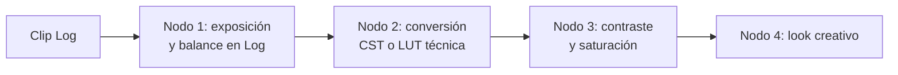

# Material Log y LUTs

Parte de: [[33-Edicion-Video/04 Color/_Índice Color|Color]]

> [!info] Cómo avanzar
> `progreso`: **pendiente** → **viendo** (estudiando) → **visto** (contestaste la autoevaluación sin abrir las respuestas) → **dominado** (hiciste el laboratorio o lo aplicaste de verdad).

## Contenido

### Qué es
- El **material Log** se graba con una curva logarítmica que guarda más rango dinámico; por eso se ve plano y desaturado hasta convertirlo (ver [[Perfiles de color en video (estándar, Log y HLG)]]). Tus perfiles Log: **S-Log3** en la Sony a6700 ([[Sony S-Cinetone y S-Log3]]), **Apple Log** en el iPhone 15 Pro ([[ProRes y Apple Log en el iPhone 15 Pro]]) y **D-Log 2 / D-Log** en el Osmo Pocket 4P. El DJI Mini 4K no tiene Log: graba en color normal.
- Una **LUT** (*Look-Up Table*) es una tabla que convierte cada color de entrada en un color de salida. Una LUT 3D (`.cube`) hace esa conversión para combinaciones de R, G y B. Hay LUTs **técnicas** (Log → Rec.709, del fabricante) y **creativas** (un look).

### Cómo funciona

Una LUT técnica espera la imagen **exactamente** como la grabó la cámara: con su curva y su espacio de color. Por eso:
- **Antes** de la LUT corriges exposición y balance (pequeños ajustes con Offset/temperatura en el nodo previo), porque la LUT asume una exposición "correcta" y recorta o distorsiona lo que se sale.
- **Después** ajustas contraste, saturación y look.

**Convertir Apple Log en Resolve** (dos formas):
1. Nodo con **Color Space Transform** (OpenFX, disponible en la gratuita): *Input Color Space* = Rec.2020, *Input Gamma* = Apple Log; *Output* = Rec.709 y Gamma 2.4. Activa *Tone Mapping* y *Gamut Mapping* para comprimir el rango con suavidad.
2. LUT oficial de Apple para Apple Log a Rec.709 aplicada en un nodo (clic derecho en el nodo → LUT).
Para **S-Log3** la CST usa S-Gamut3.Cine / S-Log3; para **D-Log 2** usa las LUTs de DJI (la cámara incluye LUTs a Rec.709) si tu versión de Resolve no la lista en la CST.

### Ojo con la versión gratuita en Windows
El Log de la a6700 (10 bits) y el D-Log 2 del Pocket 4P son H.264/H.265 de 10 bits, que **Resolve gratis en Windows no abre**. Conviértelos antes a DNxHR HQX o ProRes 422 ([[Proxies y rendimiento al editar]]). Apple Log en el iPhone 15 Pro se graba en **ProRes**, que sí abre. Grabar S-Log3 en 8 bits es posible, pero da banding al corregir.

### Ejemplo
Atardecer con el iPhone 15 Pro en Apple Log (ProRes):
1. Nodo 1: Offset +0.3 para compensar ligera subexposición; temperatura −100.
2. Nodo 2: CST Apple Log → Rec.709 con tone mapping.
3. Nodo 3: curva en S suave y saturación 55.
4. Nodo 4: LUT creativa al 40 % con *Key Output Gain* (la "opacidad" del nodo).

### Cuándo usar Log y LUTs
Log vale la pena con escenas de alto contraste y cuando vas a corregir con calma. Para videos rápidos, perfiles como S-Cinetone o el color estándar se ven bien sin conversión.

### Errores comunes
- **LUT de S-Log3 sobre Apple Log o D-Log 2**: cada cámara tiene otra curva y otro espacio de color; la imagen sale con contraste y colores equivocados (piel naranja o verdosa, sombras aplastadas) aunque "se vea con color".
- **LUT creativa directo sobre Log** sin convertir.
- **Aplicar la LUT y luego corregir exposición en el mismo nodo**: el orden de procesamiento de Resolve dentro del nodo hace que la LUT vaya al final.
- **Subexponer Log**: el ruido aparece al recuperar sombras.

### Para profundizar
- [Página Color de DaVinci Resolve](https://www.blackmagicdesign.com/products/davinciresolve/color)
- [Capacitación oficial (guía del colorista)](https://www.blackmagicdesign.com/products/davinciresolve/training)

## Autoevaluación

Contesta primero en voz alta o en papel; luego despliega la respuesta.

> [!question]- ¿Qué es una LUT?
> Una tabla que transforma valores de color de entrada en valores de salida. Una **LUT técnica** convierte Log a un espacio estándar (Rec.709); una **LUT creativa** da un look.

> [!question]- ¿Cómo conviertes Apple Log en Resolve?
> Con la LUT oficial de Apple (Apple Log a Rec.709, que Apple publica para descargar) en un nodo, o con **Color Space Transform** (entrada Apple Log, salida Rec.709) si tu versión de Resolve lo incluye (verifica en tu versión).

> [!question]- ¿Antes o después de la LUT corriges exposición y balance?
> **Antes** (en un nodo previo): la LUT espera material correctamente expuesto. Si corriges después, trabajas sobre información ya recortada.

> [!question]- Error común: aplicar una LUT de S-Log3 a material Apple Log o D-Log 2. ¿Qué pasa?
> Colores y contraste incorrectos: cada Log tiene su curva y espacio de color; usa la LUT o transformación de la cámara que grabó.

## Práctica

- [[Lab 5 - Corrección y gradación de Apple Log con scopes]]

