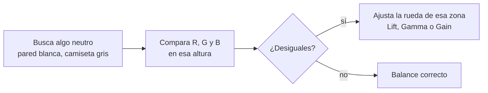

# Parade RGB

Parte de: [[Scopes (waveform, vectorscopio y parade)]]

> [!info] Cómo avanzar
> `progreso`: **pendiente** → **viendo** (estudiando) → **visto** (contestaste la autoevaluación sin abrir las respuestas) → **dominado** (hiciste el laboratorio o lo aplicaste de verdad).

## Contenido

### Qué es
El **parade RGB** es un waveform dividido en tres: muestra por separado el nivel de los canales **rojo, verde y azul**, uno junto a otro. Cada columna tiene la misma lógica que el [[Waveform en corrección de color]] (posición horizontal en el cuadro vs. nivel), pero por canal.

### Cómo funciona
En una zona que debería ser **neutra** (blanco, gris, negro), los tres canales tienen el mismo nivel. Si en esa zona un canal está más alto que los otros, hay una **dominante** de ese color; si está más bajo, hay dominante de su complementario.

| Lo que ves en zonas neutras | Dominante |
|---|---|
| Azul más alto | Imagen fría / azulada |
| Rojo más alto, azul más bajo | Cálida / naranja |
| Verde más alto | Verdosa (luces fluorescentes, LED baratos) |
| Verde más bajo | Magenta |

El parade se lee por zonas: la **parte baja** de cada columna son las sombras, la **media** los medios tonos y la **alta** las altas luces. Una dominante puede estar solo en sombras (por ejemplo, sombras azules por el cielo) y no en altas luces; por eso Resolve tiene ruedas separadas: **Lift** (sombras), **Gamma** (medios), **Gain** (altas luces) y **Offset** (todo).

### Ejemplo
Toma del Osmo Pocket 4P en interiores con balance automático: en el parade, la parte alta (pared blanca) muestra rojo en 85, verde en 80 y azul en 68. Dominante cálida en altas luces. En la rueda **Gain**, empuja hacia azul (o baja rojo y sube azul en los controles numéricos de canal) hasta que las tres columnas lleguen al mismo nivel en esa zona. Luego revisa las sombras: si el negro de una mochila tiene azul más alto, ajusta **Lift**.

Para hacerlo más rápido, Resolve tiene el gotero de balance de blancos en *Primaries*: haces clic en algo neutro y él empareja los canales; luego verificas en el parade.

### Cuándo usarlo
Para corregir balance de blancos y para **igualar tomas** de distintas cámaras: compara el parade de la a6700 con el del iPhone en la misma escena ([[Igualar tomas y tonos de piel]]).

### Errores comunes
- **Igualar los tres canales en un atardecer**: el atardecer **es** cálido; si emparejas los canales, lo vuelves gris y frío, y pierdes la razón por la que grabaste. Iguala solo lo que debería ser neutro, y deja la dominante cuando es la luz real y deseada.
- **Medir sobre algo que no es neutro**: una pared crema o una camisa beige no sirve de referencia.
- **Corregir solo con Offset**: arregla una zona y descompone otra; usa Lift/Gamma/Gain según la altura donde está la dominante.
- **Corregir con una LUT de visor o un look activo**: el parade mide la imagen ya teñida por el look; corrige en los nodos previos, con el look desactivado (Ctrl+D).

### Para profundizar
- [Página Color de DaVinci Resolve](https://www.blackmagicdesign.com/products/davinciresolve/color)
- [Capacitación oficial de DaVinci Resolve](https://www.blackmagicdesign.com/products/davinciresolve/training)

## Autoevaluación

Contesta primero en voz alta o en papel; luego despliega la respuesta.

> [!question]- ¿Qué muestra el parade RGB?
> Tres waveforms lado a lado: rojo, verde y azul.

> [!question]- ¿Cómo detectas una dominante de color con él?
> En algo que debería ser blanco o gris, los tres canales deberían estar a la misma altura; si el azul está más alto, hay dominante azul (fría).

> [!question]- Error común: igualar los tres canales en un atardecer. ¿Qué pasa?
> Eliminas el tono cálido que es justo el atractivo de la toma; la regla aplica a neutros, no a escenas con color intencional.

## Práctica

- [[Lab 5 - Corrección y gradación de Apple Log con scopes]]

