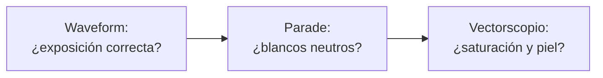

# Scopes (waveform, vectorscopio y parade)

Parte de: [[33-Edicion-Video/04 Color/_Índice Color|Color]]

> [!info] Cómo avanzar
> `progreso`: **pendiente** → **viendo** (estudiando) → **visto** (contestaste la autoevaluación sin abrir las respuestas) → **dominado** (hiciste el laboratorio o lo aplicaste de verdad).

## Contenido

### Qué es
Los **scopes** (monitores de forma de onda) son gráficas que miden la imagen: brillo, color y saturación de cada parte del cuadro. Te dan datos objetivos mientras corriges, en vez de depender solo de tus ojos y de tu pantalla.

### Por qué no basta con los ojos
- Tu monitor puede no estar calibrado, tener modo "vívido" o mucho brillo.
- El ojo se **adapta**: después de unos minutos mirando una imagen azulada, la empiezas a ver neutra.
- La luz del cuarto y el contraste con la interfaz oscura del programa engañan la percepción.
- Igualar tomas a simple vista es lento; los scopes muestran diferencias de inmediato.
Los ojos deciden si te gusta; los scopes te dicen si está bien.

### Cómo funcionan: cuál usar para qué
| Scope | Mide | Úsalo para |
|---|---|---|
| [[Waveform en corrección de color]] | Brillo (luma) de izquierda a derecha del cuadro | **Exposición** y contraste |
| [[Parade RGB]] | Rojo, verde y azul por separado | **Balance de blancos** y dominantes |
| [[Vectorscopio]] | Matiz y saturación | **Saturación** y **tonos de piel** |
| Histograma | Cuántos píxeles hay en cada nivel de brillo | Vista rápida de exposición |


Este orden replica el de la corrección: primero exposición, luego balance, luego color fino. Son las mismas herramientas que viste para exponer al grabar ([[Herramientas de exposición en video (zebras, waveform y false color)]]), ahora para posproducción.

### Dónde se activan en Resolve
- En la página **Color**, el botón **Scopes** en la barra de paletas (abajo a la derecha) los muestra en un panel; puedes elegir 1, 2 o 4 a la vez y cambiar cada uno a Waveform, Parade, Vectorscope o Histogram.
- **Workspace → Video Scopes → On** (atajo Ctrl+Shift+W) los abre en una ventana flotante, útil para moverla a un segundo monitor.
- En el menú de cada scope configuras escala (IRE/10 bits), la línea de tono de piel (*Show Skin Tone Indicator*) y el brillo de la traza.
En Kdenlive están en *Ver → Waveform / Vectorscopio / RGB Parade*.

### Ejemplo
Toma del iPhone en una cocina con luz cálida: el waveform muestra que nada pasa de 70 % (subexpuesta), el parade muestra el azul más bajo que el rojo en las altas luces (dominante cálida) y el vectorscopio muestra la piel corrida hacia el rojo. Subes ganancia, equilibras el azul en Gain y bajas un poco la saturación: tres scopes, tres decisiones.

### Errores comunes
- **Ver los scopes y nunca la imagen**: un atardecer "no neutro" es correcto.
- **Medir con proxies o una LUT de visor activa**: estás midiendo otra imagen.
- **Ignorar el rango de la escala**: aprende a leer 0–100 (IRE) o 0–1023 (10 bits).

### Para profundizar
- [Página Color de DaVinci Resolve](https://www.blackmagicdesign.com/products/davinciresolve/color)
- [Capacitación oficial de DaVinci Resolve](https://www.blackmagicdesign.com/products/davinciresolve/training)

## Subtemas

- [[Waveform en corrección de color]]
- [[Vectorscopio]]
- [[Parade RGB]]

## Autoevaluación

Contesta primero en voz alta o en papel; luego despliega la respuesta.

> [!question]- ¿Por qué usar scopes y no solo los ojos?
> Los ojos se adaptan y la pantalla puede mentir; los scopes miden objetivamente brillo y color.

> [!question]- ¿Cuál scope usas para exposición, cuál para balance y cuál para saturación/piel?
> Exposición: **waveform**. Balance de blancos: **parade RGB**. Saturación y tono de piel: **vectorscopio**.

> [!question]- ¿Dónde se activan en Resolve?
> En la página **Color**, el panel de Scopes (puedes mostrar varios a la vez).

## Práctica

- [[Lab 5 - Corrección y gradación de Apple Log con scopes]]

## Progreso de los subtemas

```base
filters:
  and:
    - file.inFolder("33-Edicion-Video/04 Color/Scopes (waveform, vectorscopio y parade)")
    - file.name != "Scopes (waveform, vectorscopio y parade)"
views:
  - type: table
    name: Progreso
    order:
      - file.name
      - progreso
      - nivel
```
