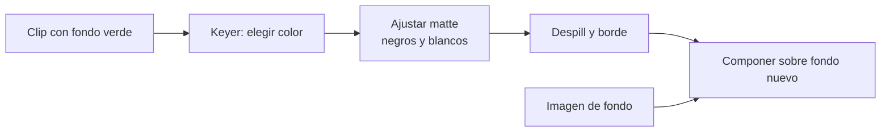

# Chroma key

Parte de: [[33-Edicion-Video/05 Gráficos y efectos/_Índice Gráficos y efectos|Gráficos y efectos]]

> [!info] Cómo avanzar
> `progreso`: **pendiente** → **viendo** (estudiando) → **visto** (contestaste la autoevaluación sin abrir las respuestas) → **dominado** (hiciste el laboratorio o lo aplicaste de verdad).

## Contenido

### Qué es
El **chroma key** es la técnica para **quitar un fondo de un color uniforme** (casi siempre verde o azul) y reemplazarlo por otra imagen. El software genera una máscara (canal alfa) que vuelve transparentes los píxeles de ese color, y lo que queda (la persona) se compone sobre el nuevo fondo.

### Cómo funciona
El *keyer* compara cada píxel con el color clave. Los que se parecen mucho se vuelven transparentes; los que no, quedan opacos; los intermedios (cabello, bordes con desenfoque) quedan semitransparentes. Después se limpia:
- **Matte/clip negro y blanco**: fuerzas el fondo a transparente total y el sujeto a opaco total.
- **Suavizar o contraer el borde** (*shrink/grow, blur*).
- **Despill**: quita el reflejo verde que el fondo proyecta sobre el sujeto (orillas verdosas en hombros y cabello).

Verde es lo más común porque los sensores tienen más información en el canal verde y rara vez la gente viste verde intenso; azul se usa si el sujeto lleva verde o para escenas nocturnas.

### Qué hace falta al grabar
- **Fondo uniforme y sin arrugas**: tela tensa o papel, de color bien saturado.
- **Iluminación pareja del fondo**, separada de la del sujeto: dos luces suaves sobre el fondo y la luz del sujeto aparte ([[Iluminación de tres puntos]], [[Luz LED continua]]).
- **Distancia** entre sujeto y fondo (1.5–2 m o más) para que no haya sombras ni reflejo verde.
- Ropa **sin el color clave** ni reflejos.
- Obturación rápida o poco movimiento para evitar desenfoque de movimiento en los bordes.
- **Mejor códec posible**: el submuestreo de croma importa ([[Profundidad de bits y submuestreo de croma]]). 4:2:2 da bordes más limpios que 4:2:0; la a6700 en 4:2:2 o el iPhone en ProRes ayudan. Recuerda que el 10 bits H.264/H.265 hay que convertirlo para la versión gratuita de Resolve en Windows.

### Dónde se hace en Resolve
- **Fusion**: nodo **Delta Keyer** (o Ultra Keyer). Flujo: MediaIn (sujeto) → Delta Keyer → Merge (foreground) sobre el fondo (background) → MediaOut. El Delta Keyer tiene pestañas para el color de fondo, *Matte* (umbrales, recorte) y *Fringe* (despill).
- **Color**: con el **Qualifier 3D** seleccionas el verde, inviertes, y conectas la salida de alfa del nodo (clic derecho en el editor de nodos → *Add Alpha Output*); el fondo nuevo va en una pista inferior de la página Edit.
- En Kdenlive y Shotcut hay filtros de *Chroma Key* sencillos; CapCut tiene *Chroma key* y quitar fondo automático (revisa si es Pro).

### Ejemplo
Video de reseña de tu impresora 3D con pantalla verde detrás de ti, grabado con la a6700 en 4:2:2 (convertido a DNxHR). En Fusion, Delta Keyer con el gotero en la tela, *Clean Background* para quitar arrugas, despill en el cabello, y Merge sobre un video de la impresora trabajando.

### Errores comunes
- **Fondo verde con sombras**: las zonas oscuras ya no se parecen al verde clave; el keyer las deja opacas o semitransparentes, aparecen manchas, huecos y bordes "sucios". Aumentar la tolerancia para quitarlas empieza a comerse al sujeto. Ilumina el fondo parejo.
- **Sujeto pegado al fondo**: reflejo verde y sombra.
- **Exceso de suavizado de borde**: halo.
- **Fondo nuevo con otra luz y perspectiva**: aunque el key sea perfecto, se ve falso; iguala dirección de luz y color.

### Para profundizar
- [Fusion en DaVinci Resolve](https://www.blackmagicdesign.com/products/davinciresolve/fusion)
- [Capacitación oficial de DaVinci Resolve (guía de Fusion)](https://www.blackmagicdesign.com/products/davinciresolve/training)

## Autoevaluación

Contesta primero en voz alta o en papel; luego despliega la respuesta.

> [!question]- ¿Qué es el chroma key?
> Eliminar un fondo de color uniforme (verde o azul) para reemplazarlo por otra imagen.

> [!question]- ¿Qué hace falta al grabar para que salga bien?
> Fondo **iluminado de forma pareja**, sin arrugas, sujeto separado del fondo (para evitar sombras y reflejos verdes), ropa que no tenga el color del fondo y obturación rápida suficiente para limitar desenfoque.

> [!question]- ¿Dónde se hace en Resolve?
> En la página Color con el *qualifier* + canal alfa, o en Fusion/Edit con el efecto **3D Keyer** o **Delta Keyer** (verifica en tu versión cuáles están en la gratuita).

> [!question]- Error común: fondo verde con sombras. ¿Qué resultado da?
> Bordes sucios y huecos en el recorte; ilumina el fondo por separado del sujeto.

