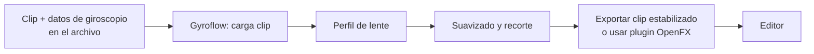

# Estabilización en posproducción (Gyroflow)

Parte de: [[33-Edicion-Video/05 Gráficos y efectos/_Índice Gráficos y efectos|Gráficos y efectos]]

> [!info] Cómo avanzar
> `progreso`: **pendiente** → **viendo** (estudiando) → **visto** (contestaste la autoevaluación sin abrir las respuestas) → **dominado** (hiciste el laboratorio o lo aplicaste de verdad).

## Contenido

### Qué es
**Gyroflow** es un programa **gratuito y de código abierto** que estabiliza video usando los **datos del giroscopio** que la cámara grabó junto con el clip. En vez de adivinar el movimiento analizando la imagen (como los estabilizadores tradicionales), sabe exactamente cómo giró la cámara en cada instante y lo compensa con un recorte y una deformación precisos, corrigiendo también la distorsión del lente y el efecto *rolling shutter*. El resultado suele parecer de gimbal.

### Cómo funciona

1. Cargas el clip; Gyroflow lee los metadatos de movimiento.
2. Eliges o carga automáticamente el **perfil de lente** (la calibración de la óptica).
3. Ajustas el **suavizado** (cuánto movimiento quitar) y el **zoom/recorte** dinámico.
4. Exportas un archivo nuevo (H.264/H.265 con aceleración por GPU, ProRes, DNx) o usas el **plugin OpenFX** para Resolve, que estabiliza dentro de la línea de tiempo (Pendiente de confirmar que el plugin funcione en la versión gratuita de Resolve 21.1).

### Con qué cámaras funciona (y con tu equipo)
- **Sony a6700**: **soportada**. Graba los datos de giroscopio en el archivo. Para el mejor resultado desactiva el estabilizador electrónico de la cámara (SteadyShot activo) y revisa en la documentación de Gyroflow la configuración recomendada para Sony (estabilización interna y compensación de lente). Copia la tarjeta completa, no solo los MP4 ([[Organizar material de video]]).
- **Cámaras de acción y FPV de DJI** (Action 2/4/5/6, Avata, Neo, O3/O4): soportadas.
- **DJI Osmo Pocket 4P y DJI Mini 4K**: no aparecen en la lista de cámaras soportadas. Tampoco hacen tanta falta: ambos tienen **gimbal mecánico de 3 ejes**.
- **iPhone 15 Pro**: no graba datos de giroscopio utilizables por Gyroflow en la app de Cámara; existen apps que registran el giroscopio del teléfono para usarlo como "sensor externo", pero el flujo es más complejo. Normalmente basta la estabilización del propio iPhone (o el modo Acción).
- Cámaras sin giroscopio: puedes pegar un teléfono a la cámara y grabar su giroscopio con una app de registro, y luego sincronizar en Gyroflow.

### Alternativa sin datos de giroscopio
Estabilizadores por análisis de imagen:
- **Resolve (gratuita)**: Edit → Inspector → **Stabilization** (modos Perspective, Similarity, Translation), o en Color con el tracker en modo *Stabilizer*. Ajusta *Cropping Ratio* y *Smooth*.
- **Kdenlive**: efecto *Stabilize* (vid.stab).
Funcionan bien con movimientos suaves y dejan artefactos con rolling shutter o desenfoque.

### Ejemplo
Caminata con la a6700 en mano con un lente gran angular, sin gimbal: cargas el clip en Gyroflow, perfil de lente correspondiente, suavizado moderado, exportas a ProRes 422 o DNxHR (que Resolve gratis abre en Windows) y editas. Tu GPU (GTX 1660 Ti) acelera el procesamiento y la exportación.

### Errores comunes
- **Estabilizar una toma con mucho desenfoque de movimiento**: Gyroflow quita el temblor, pero el desenfoque que se grabó en cada cuadro se queda; ves una imagen estable con "parpadeos" de borrosidad que se ven peor que el temblor. Al grabar, usa obturación más rápida (romper la [[Regla de los 180 grados del obturador]] con criterio) si planeas estabilizar.
- **Estabilización de la cámara activa + Gyroflow**: doble corrección y bamboleo.
- **Perfil de lente equivocado**: deformaciones en las orillas.
- **Suavizado al máximo**: el recorte es enorme y la toma "flota".

### Para profundizar
- [Gyroflow (sitio oficial)](https://gyroflow.xyz/)
- [Documentación de Gyroflow](https://docs.gyroflow.xyz/)

## Autoevaluación

Contesta primero en voz alta o en papel; luego despliega la respuesta.

> [!question]- ¿Qué hace Gyroflow?
> Estabiliza video usando los **datos del giroscopio** grabados por la cámara (no analiza la imagen), lo que da resultados muy estables y sin deformaciones raras.

> [!question]- ¿Con qué cámaras funciona?
> Con cámaras que guardan metadatos de movimiento compatibles; Gyroflow publica una lista (muchas Sony, como la línea de la a6700, aparecen en ella). Si el iPhone o tus DJI funcionan y con qué app de grabación: (Pendiente de confirmar en la lista oficial de Gyroflow).

> [!question]- ¿Qué alternativa hay si tu cámara no tiene datos de giroscopio?
> El estabilizador por análisis de imagen del editor (en Resolve, Stabilization en el Inspector o en la página Color).

> [!question]- Error común: estabilizar una toma con mucho desenfoque de movimiento. ¿Qué pasa?
> La imagen queda quieta pero cada cuadro sigue borroso y "flota"; conviene grabar con obturación algo más rápida si sabes que vas a estabilizar.

## Práctica

- [[Lab 7 - Rampa de velocidad y estabilización]]

