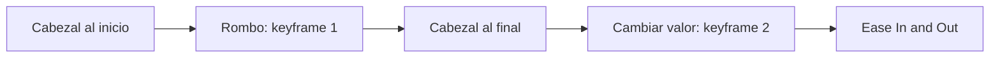

# Keyframes y animación básica

Parte de: [[33-Edicion-Video/05 Gráficos y efectos/_Índice Gráficos y efectos|Gráficos y efectos]]

> [!info] Cómo avanzar
> `progreso`: **pendiente** → **viendo** (estudiando) → **visto** (contestaste la autoevaluación sin abrir las respuestas) → **dominado** (hiciste el laboratorio o lo aplicaste de verdad).

## Contenido

### Qué es
Un **keyframe** (fotograma clave) es un punto en el tiempo donde fijas el valor de un parámetro: posición, escala, rotación, opacidad, volumen, intensidad de un efecto. Con **dos o más** keyframes, el editor **interpola** los valores intermedios y el parámetro cambia de forma animada entre ellos. Es la base de toda animación en video.

### Cómo funciona
```text
Zoom:  100 % ●───────────────────────● 115 %
       cuadro 0                      cuadro 150 (5 s a 30 fps)
       el editor calcula 100.1, 100.2 ... en los cuadros intermedios
```
- **Interpolación lineal**: velocidad constante; se siente mecánica.
- **Easing (suavizado)**: el cambio arranca lento, acelera y frena al final (*ease in / ease out*), como los objetos reales que tienen inercia. Es lo que hace que una animación se vea "profesional".

En Resolve, cada parámetro del Inspector tiene un **rombo** a la derecha: un clic crea el keyframe en el cuadro actual; flechas para saltar entre keyframes. En la línea de tiempo, el ícono de curvas en el clip abre el editor de keyframes, y con clic derecho sobre un keyframe eliges **Ease In**, **Ease Out** o **Ease In and Out**. También puedes ajustar la curva en el editor de *Curves*.

### Ejemplo: zoom lento (efecto Ken Burns) en Resolve
Foto del atardecer o toma estática del dron que quieres animar:
1. Coloca el cabezal al **inicio** del clip. En el Inspector → *Transform*, haz clic en el rombo de **Zoom** (100 %) y de **Position**.
2. Ve al **final** del clip. Cambia Zoom a 110–115 % y mueve un poco la posición hacia el sujeto: se crean los keyframes finales.
3. Abre el editor de curvas del clip y aplica **Ease In and Out**.
4. Reproduce: si el movimiento se nota mucho, baja el zoom final.
Atajo: el Inspector tiene **Dynamic Zoom**, que hace este efecto automáticamente con un rectángulo de inicio y uno de fin; tiene opción de suavizado (*Ease*).

Escalar más de ~120 % un clip 4K entregado en 4K empieza a perder nitidez; en una línea de tiempo 1080p tienes margen de 200 % con material 4K.



### Otros usos comunes
- **Volumen**: bajar la música cuando entra la voz (ducking manual, ver [[Mezcla de voz y música]]).
- **Opacidad**: entrada y salida de títulos y logos ([[Títulos y lower thirds]]).
- **Posición**: deslizar un gráfico o seguir manualmente un objeto.
- **Efectos**: subir el desenfoque o la intensidad de un color con el tiempo.
- **Velocidad**: las rampas de velocidad también se hacen con puntos y curvas ([[Rampas de velocidad]]).

### Cuándo usarlo y cuándo no
Úsalo para dar movimiento a fotos y tomas estáticas, animar gráficos simples y automatizar audio. Si necesitas animaciones complejas de texto o formas, usa plantillas o Fusion ([[Motion graphics básico (Fusion)]]); si necesitas seguir un objeto que se mueve, usa tracking en lugar de keyframes a mano ([[Máscaras y tracking en video]]).

### Errores comunes
- **Muchos keyframes muy cercanos**: la interpolación hace cambios bruscos entre ellos y la animación tiembla o se ve a saltos; también es difícil de editar. Usa los mínimos keyframes (inicio, fin y quizá uno intermedio) y deja que la curva haga el trabajo.
- **Sin easing**: movimientos robóticos.
- **Keyframe en el cuadro equivocado** porque el cabezal no estaba donde creías: usa las flechas para saltar entre keyframes.
- **Zoom excesivo** sobre material de baja resolución.

### Para profundizar
- [Capacitación oficial de DaVinci Resolve (Inspector y keyframes)](https://www.blackmagicdesign.com/products/davinciresolve/training)
- [Manual de Kdenlive (efectos y keyframes)](https://docs.kdenlive.org/)

## Autoevaluación

Contesta primero en voz alta o en papel; luego despliega la respuesta.

> [!question]- ¿Qué es un keyframe?
> Un punto en el tiempo donde fijas un valor (posición, escala, opacidad, volumen). El programa interpola entre keyframes.

> [!question]- ¿Cómo haces un zoom lento (efecto Ken Burns) en Resolve?
> En el Inspector, pon un keyframe de **Zoom** al inicio del clip y otro con un valor mayor al final.

> [!question]- ¿Qué es el easing?
> Suavizar la entrada y salida de una animación (ease in/out) para que no arranque ni frene de golpe.

> [!question]- Error común: animar con muchos keyframes cercanos. ¿Qué pasa?
> Movimientos bruscos o temblorosos; usa los menos posibles.

## Práctica

- [[Lab 6 - Subtítulos SRT y lower third]]

