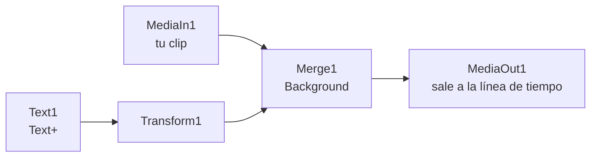

# Motion graphics básico (Fusion)

Parte de: [[33-Edicion-Video/05 Gráficos y efectos/_Índice Gráficos y efectos|Gráficos y efectos]]

> [!info] Cómo avanzar
> `progreso`: **pendiente** → **viendo** (estudiando) → **visto** (contestaste la autoevaluación sin abrir las respuestas) → **dominado** (hiciste el laboratorio o lo aplicaste de verdad).

## Contenido

### Qué es
**Fusion** es el módulo de composición y gráficos animados integrado en DaVinci Resolve (página Fusion), incluido en la versión gratuita. Trabaja con **nodos**: cada nodo hace una sola cosa (generar texto, transformar, mezclar, desenfocar) y los conectas para construir el resultado. Sirve para *motion graphics* (títulos animados, gráficos, logos), composición (chroma, reemplazo de pantallas) y efectos.

### Cómo funciona
El flujo mínimo:

- **MediaIn**: el clip de la línea de tiempo que entra a Fusion.
- **Generadores**: *Text+* (texto), *Background* (color o degradado), *Rectangle/Ellipse* (formas como máscaras).
- **Transform**: posición, tamaño, rotación.
- **Merge**: combina dos imágenes: la entrada amarilla es el fondo (*Background*), la verde es lo que va encima (*Foreground*); la azul es una máscara.
- **MediaOut**: lo que regresa a la página Edit.

Animar en Fusion es con keyframes en el Inspector (rombo al lado de cada parámetro), y en el **Spline Editor** ajustas las curvas de suavizado (easing). Atajo: **Shift+Espacio** abre el buscador para agregar cualquier nodo por nombre; con un nodo seleccionado, el nuevo se conecta automáticamente. El visor tiene dos pantallas: asigna un nodo a cada una con las teclas 1 y 2.

Para reutilizar: puedes agrupar nodos en una **macro** y publicarla como plantilla de título para usarla desde *Effects → Titles* en Edit, con controles sencillos en el Inspector.

### Ejemplo: título con barra animada
1. En Edit, pon un **Fusion Composition** (Effects → Effects → Fusion Composition) en V3 sobre tu clip y ábrelo en Fusion.
2. Agrega **Background** (color naranja) con una máscara **Rectangle** para hacer una barra.
3. Agrega **Text+** con el nombre del video.
4. **Merge** la barra sobre el fondo transparente y luego el texto sobre la barra.
5. Anima el *Width* del rectángulo de 0 a 0.6 en 12 cuadros y la opacidad del texto de 0 a 1 en los siguientes 8 cuadros.
6. En el Spline Editor, selecciona las curvas y aplica suavizado (tecla **S**).
7. Regresa a Edit: el compuesto aparece como clip con el gráfico sobre tu video.
Tu GTX 1660 Ti procesa Fusion por GPU, pero composiciones con desenfoques y partículas pueden ir lentas: usa *Render Cache* o baja la resolución de vista previa.

### Cuándo usar Fusion y cuándo los títulos de Edit
**Usa Edit** (Text, Text+, plantillas de Fusion Titles) para lower thirds, títulos simples y subtítulos: es más rápido y suficiente la mayoría de las veces ([[Títulos y lower thirds]]).

**Usa Fusion** cuando necesitas: animaciones con varios elementos sincronizados, gráficos que siguen un objeto (tracker), reemplazar una pantalla de celular, chroma key con más control ([[Chroma key]]), o crear tu propia plantilla reutilizable para todos tus videos.

### Errores comunes
- **Hacer todo en Fusion**: un principiante intenta editar o titular todo ahí y pierde horas. Conviene editar en Edit, usar plantillas y entrar a Fusion solo para el elemento que lo necesita; empieza modificando plantillas existentes antes de construir desde cero.
- **Conectar al revés las entradas del Merge**: el fondo tapa al texto.
- **Animar sin easing**: movimientos robóticos.
- **Resolución del compuesto distinta** a la del proyecto: gráficos borrosos.

### Para profundizar
- [Fusion en DaVinci Resolve](https://www.blackmagicdesign.com/products/davinciresolve/fusion)
- [Capacitación oficial de DaVinci Resolve (guía de Fusion)](https://www.blackmagicdesign.com/products/davinciresolve/training)

## Autoevaluación

Contesta primero en voz alta o en papel; luego despliega la respuesta.

> [!question]- ¿Qué es Fusion dentro de Resolve?
> La página de composición por nodos para gráficos animados, efectos y textos avanzados.

> [!question]- ¿Cuál es el flujo mínimo de nodos en Fusion?
> MediaIn → (efectos, Text+, Merge) → MediaOut. El nodo **Merge** combina un fondo con un primer plano.

> [!question]- ¿Cuándo vale la pena usar Fusion en lugar de títulos de la página Edit?
> Cuando necesitas animaciones personalizadas, seguimiento de objetos o composiciones con varias capas.

> [!question]- Error común de principiante: hacer todo en Fusion. ¿Qué conviene?
> Usar primero las plantillas de títulos de Edit; ir a Fusion solo cuando lo necesites.

