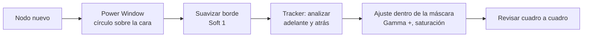

# Máscaras y tracking en video

Parte de: [[33-Edicion-Video/05 Gráficos y efectos/_Índice Gráficos y efectos|Gráficos y efectos]]

> [!info] Cómo avanzar
> `progreso`: **pendiente** → **viendo** (estudiando) → **visto** (contestaste la autoevaluación sin abrir las respuestas) → **dominado** (hiciste el laboratorio o lo aplicaste de verdad).

## Contenido

### Qué es
- Una **máscara** limita un ajuste o efecto a una **zona** de la imagen. En la página Color de Resolve se llaman **Power Windows**: formas (círculo, rectángulo, polígono, curva o degradado) que puedes suavizar en el borde e invertir. Así iluminas solo una cara, oscureces el cielo o desenfocas una placa.
- El **tracking** (seguimiento) analiza el movimiento de una zona cuadro por cuadro y hace que la máscara **la siga** automáticamente, para que el ajuste no se quede fijo cuando el sujeto o la cámara se mueven.

### Cómo funciona

- En Color: nodo nuevo (Alt+S) → paleta **Window** → elige la forma y dibújala. El nodo afecta solo el interior (o el exterior si inviertes).
- **Softness** controla el borde: un borde suave hace que el ajuste se mezcle de forma natural.
- Paleta **Tracker**: con la ventana seleccionada, presiona *Track Forward* (y *Track Reverse* desde el cuadro inicial). El tracker analiza posición, tamaño, rotación y perspectiva (puedes activar/desactivar cada uno). Si se pierde, corrige con keyframes en el *Frame mode*.
- En la página **Fusion** hay *Tracker* y *Planar Tracker* para pegar gráficos a superficies. Magic Mask (aislamiento automático de personas u objetos con IA) es de Studio; Power Windows y el tracker son de la versión gratuita.

### Caso: iluminar solo la cara del entrevistado que se mueve un poco
1. Corrige la toma completa en los nodos anteriores.
2. Nodo nuevo → ventana circular u ovalada sobre la cara, borde muy suave.
3. Dentro: sube un poco **Gamma** (medios) y, si quieres, calidez ligera.
4. **Track Forward** desde el inicio de la toma; revisa que la ventana siga la cara.
5. Si se aleja de más, ajusta tamaño o posición en los cuadros donde falla.
6. Desactiva y activa el nodo (Ctrl+D) para comparar: el cambio debe sentirse natural, no como un reflector.
Otra máscara clásica: una ventana invertida y muy suave para una viñeta que oscurece los bordes y lleva la mirada al centro.

### Ejemplo con tu material
Toma del Osmo Pocket 4P caminando por un mercado: con un degradado (*Gradient*) sobre el cielo, bajas altas luces y saturas un poco el azul; el tracker sigue el horizonte. En la toma del dron Mini 4K, un círculo suave sobre la iglesia sube un poco la exposición para destacarla.

### Cuándo usarlo y cuándo no
Úsalo para dirigir la atención, corregir zonas puntuales (una cara en sombra, un cielo quemado) y ocultar detalles. No lo uses para arreglar una exposición general mal hecha: corrige primero la toma completa. En movimientos muy complejos o con oclusiones, un *Qualifier* (selección por color) a veces funciona mejor que una forma.

### Errores comunes
- **Máscara con borde duro**: se nota la forma como un círculo o rectángulo pegado; cuando el sujeto se mueve o el tracking tiembla, el borde "flota" y delata el truco. Usa borde suave y ajustes moderados.
- **Ajuste demasiado fuerte**: efecto de reflector.
- **No revisar el tracking completo**: en un cuadro la máscara se va al fondo.
- **Trackear sin detalle**: zonas planas (pared lisa) no tienen puntos que seguir; trackea una zona con textura.

### Para profundizar
- [Página Color de DaVinci Resolve](https://www.blackmagicdesign.com/products/davinciresolve/color)
- [Capacitación oficial (guía del colorista)](https://www.blackmagicdesign.com/products/davinciresolve/training)

## Autoevaluación

Contesta primero en voz alta o en papel; luego despliega la respuesta.

> [!question]- ¿Qué es una máscara (power window en Resolve)?
> Una forma (círculo, rectángulo, curva) que limita un ajuste a una zona de la imagen.

> [!question]- ¿Qué es el tracking?
> Que la máscara siga automáticamente el movimiento del objeto a lo largo del clip.

> [!question]- Caso: quieres iluminar solo la cara del entrevistado que se mueve un poco. ¿Qué haces?
> Power window circular sobre la cara, suavizado alto, subir exposición dentro y aplicar tracking.

> [!question]- Error común: máscara con borde duro. ¿Qué se nota?
> Un círculo visible en la imagen; usa suavizado (softness) amplio.

