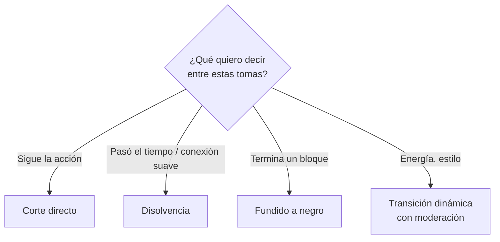

# Transiciones con criterio

Parte de: [[33-Edicion-Video/05 Gráficos y efectos/_Índice Gráficos y efectos|Gráficos y efectos]]

> [!info] Cómo avanzar
> `progreso`: **pendiente** → **viendo** (estudiando) → **visto** (contestaste la autoevaluación sin abrir las respuestas) → **dominado** (hiciste el laboratorio o lo aplicaste de verdad).

## Contenido

### Qué es
Una **transición** es la forma en que pasas de una toma a otra cuando no usas un corte directo: disolvencia, fundido a negro, barrido, zoom, giros, etc. Cada transición **comunica algo**; usarlas con criterio significa elegirlas por lo que dicen, no por cómo se ven.

### Cómo funcionan y qué comunican
| Transición | Qué comunica | Uso típico |
|---|---|---|
| **Corte directo** | Continuidad, mismo tiempo | Casi todo ([[Tipos de corte (J-cut, L-cut, jump cut y match cut)]]) |
| **Disolvencia (cross dissolve)** | Paso de tiempo, conexión entre ideas, tono suave o emotivo | Montajes lentos, recuerdos, cambio de lugar tranquilo |
| **Fundido a negro / desde negro** | Fin o inicio de un bloque, cierre, gran salto de tiempo | Apertura, final, cambio de capítulo |
| **Fundido a blanco** | Recuerdo, sueño, destello | Momentos puntuales |
| Barridos, zoom, giros, whip pan | Energía, estilo de redes | Reels y montajes rápidos, con moderación |

Una **disolvencia** sobrepone por unos cuadros el final de una toma con el inicio de la siguiente: durante un instante ves las dos. Por eso sugiere que el tiempo pasó o que ambas cosas están relacionadas.

Un **fundido a negro** lleva la imagen a negro y luego aparece la siguiente: es una pausa, un "punto y aparte". Al final de un video, un fundido a negro con la música resolviendo da sensación de cierre.

### Cómo se hacen en Resolve
- *Effects → Video Transitions*: arrastra la transición al punto de edición. Ajusta la **duración** en el Inspector (en cuadros o segundos).
- Atajo: **Ctrl+T** aplica la transición estándar (disolvencia de 1 s por defecto; cámbiala en *Preferences → User → Editing*).
- La transición necesita **material sobrante** (handles) antes y después del corte; si no lo hay, Resolve la acorta o la recorre.
- Audio: *Audio Transitions → Cross Fade* para suavizar cambios de sonido.

### Ejemplo
Video de viaje de 5 minutos:
- Apertura: fundido desde negro de 1 s con el sonido del ambiente.
- Dentro de cada día: cortes directos y J-cuts.
- Cambio de un día al siguiente: disolvencia de 20 cuadros de la toma nocturna a la mañana.
- Cierre: última toma del dron y fundido a negro de 2 s cuando termina la música.
- En el reel vertical del mismo viaje, dos whip pans entre lugares, hechos al grabar con el Osmo Pocket 4P (no con plugins).

### Cuándo usarlas y cuándo no
Úsalas cuando el significado lo pide: tiempo, cierre, cambio de tono. No las uses para "arreglar" un corte que no funciona: casi siempre el problema es el punto de corte o el orden.

### Errores comunes
- **Transiciones llamativas en todo el video** (cubos, giros, páginas): distraen del contenido, hacen que el video se vea de plantilla o amateur, rompen el ritmo y cansan. Si usas una transición de estilo, que sea parte de una estética coherente y en pocos momentos.
- **Disolvencias largas en todos los cortes**: todo se vuelve lento.
- **Mezclar muchos tipos** distintos en un mismo video.
- **Sin handles**: la transición termina repitiendo cuadros o se acorta sola.

### Para profundizar
- [Capacitación oficial de DaVinci Resolve](https://www.blackmagicdesign.com/products/davinciresolve/training)
- [Manual de Kdenlive (transiciones)](https://docs.kdenlive.org/)

## Autoevaluación

Contesta primero en voz alta o en papel; luego despliega la respuesta.

> [!question]- ¿Qué comunica una disolvencia (cross dissolve)?
> Paso del tiempo o cambio de lugar suave.

> [!question]- ¿Y un fundido a negro?
> Fin de una parte o del video.

> [!question]- Error común: usar transiciones llamativas (giros, cubos) en todo el video. ¿Qué pasa?
> Distraen y se ven amateur; el corte directo bien motivado es la mejor transición.

## Práctica

- [[Lab 7 - Rampa de velocidad y estabilización]]

