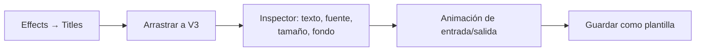

# Títulos y lower thirds

Parte de: [[33-Edicion-Video/05 Gráficos y efectos/_Índice Gráficos y efectos|Gráficos y efectos]]

> [!info] Cómo avanzar
> `progreso`: **pendiente** → **viendo** (estudiando) → **visto** (contestaste la autoevaluación sin abrir las respuestas) → **dominado** (hiciste el laboratorio o lo aplicaste de verdad).

## Contenido

### Qué es
- Un **título** es cualquier texto en pantalla: nombre del video, capítulos, datos, llamadas a la acción.
- Un **lower third** (cintillo o "tercio inferior") es el gráfico que aparece en la parte baja de la pantalla para **identificar** a quien habla o el lugar: nombre y cargo, ubicación, usuario de redes. Se llama así porque ocupa el tercio inferior del encuadre, sin tapar la cara.

### Cómo funciona en Resolve
- En la página **Edit**, abre *Effects → Titles*. Hay dos tipos:
  - **Text** (título básico): rápido, se edita en el Inspector.
  - **Text+** y **Fusion Titles**: plantillas animadas hechas en Fusion; puedes editar el texto en el Inspector y, si quieres, abrir la animación en Fusion ([[Motion graphics básico (Fusion)]]).
- Arrastra el título a una pista superior (V3) sobre la entrevista.
- En el Inspector ajusta fuente, tamaño, color, posición, sombra o fondo (*Background*) para que se lea sobre cualquier imagen.
- Para animarlo (entrada y salida), usa la plantilla animada o keyframes de opacidad y posición ([[Keyframes y animación básica]]).
- Guarda tu lower third favorito como **Power Bin** o plantilla para reutilizarlo con el mismo estilo en todos tus videos.

### Cuánto tiempo dejarlo
Regla práctica: el tiempo suficiente para **leerlo dos veces** a velocidad normal. Para un lower third de nombre y cargo, unos **4 a 6 segundos**; para un título de una palabra, 2–3 s; para textos más largos, calcula unos 3–4 palabras por segundo y suma un segundo. Haz la prueba: léelo en voz alta mientras se reproduce.

### Qué cuidar en vertical (Reels, TikTok, Shorts)
- La app pone **botones a la derecha** (me gusta, comentar), la **descripción y el usuario abajo** y a veces controles arriba. Deja el texto en la zona central: aproximadamente evita el 15–20 % inferior y la franja derecha. Revisa las zonas seguras en una plantilla de 1080×1920 (Pendiente de confirmar: cada app las cambia).
- Texto **más grande** que en horizontal: se ve en pantallas pequeñas.
- Lower thirds más arriba que en horizontal, por la descripción. Más en [[Video vertical (Reels, TikTok y Shorts)]].

### Ejemplo
Entrevista para un video de impresión 3D: lower third con "Ana López" (fuente sans serif bold, 60 px en 1080p) y abajo "Diseñadora de piezas" (regular, 40 px), sobre una barra semitransparente negra al 60 %. Entra con un deslizamiento de 10 cuadros a los 2 s de que empieza a hablar, dura 5 s y sale con desvanecido. Lo guardas como plantilla para el resto de las entrevistas.

### Cuándo usarlos y cuándo no
Úsalos para identificar personas y lugares la primera vez que aparecen, para destacar datos y para estructurar (capítulos). No repitas el nombre cada vez que la persona sale; no pongas en texto lo que la voz ya dice palabra por palabra (para eso están los [[Subtítulos (SRT)]]).

### Errores comunes
- **Tres tipografías distintas**: se ve desordenado. Conviene **una familia** (usando sus pesos bold/regular) o máximo **dos** fuentes que contrasten (una para títulos, otra para texto), y repetirlas en todo el video y en la miniatura.
- **Texto sin contraste** sobre fondo claro: agrega sombra, contorno o barra.
- **Animaciones lentas y largas**: 8–12 cuadros bastan para entrar.
- **Texto pegado al borde**: respeta márgenes de seguridad (activa *Safe Area* en el visor).

### Para profundizar
- [Capacitación oficial de DaVinci Resolve (títulos)](https://www.blackmagicdesign.com/products/davinciresolve/training)
- [Fusion en DaVinci Resolve](https://www.blackmagicdesign.com/products/davinciresolve/fusion)

## Autoevaluación

Contesta primero en voz alta o en papel; luego despliega la respuesta.

> [!question]- ¿Qué es un lower third (cintillo)?
> Un gráfico en el tercio inferior con el nombre y el cargo de una persona o un dato.

> [!question]- ¿Cuánto tiempo dejar un título en pantalla?
> Lo suficiente para leerlo dos veces: como referencia, 3–5 s para un nombre.

> [!question]- ¿Qué cuidar en vertical?
> Que no caiga en zonas de la interfaz de la app ni muy pegado a los bordes.

> [!question]- Error común: usar 3 tipografías distintas. ¿Qué conviene?
> Una o dos fuentes y estilos consistentes en todo el video.

## Práctica

- [[Lab 3 - Reel vertical de 30 segundos editado a la música]]
- [[Lab 6 - Subtítulos SRT y lower third]]

