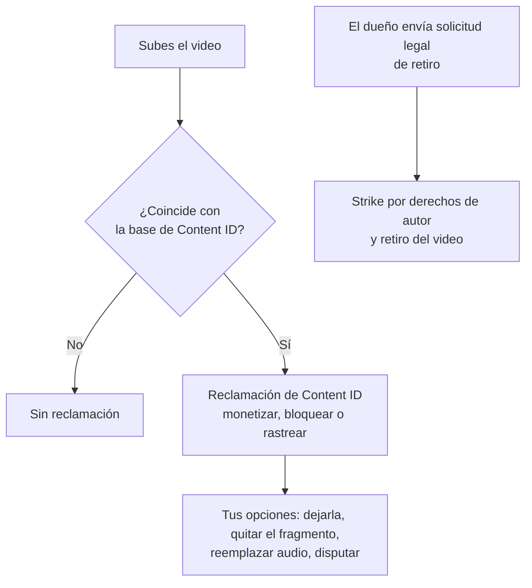

# Content ID y derechos en plataformas

Parte de: [[33-Edicion-Video/06 Entrega/_Índice Entrega|Entrega]]

> [!info] Cómo avanzar
> `progreso`: **pendiente** → **viendo** (estudiando) → **visto** (contestaste la autoevaluación sin abrir las respuestas) → **dominado** (hiciste el laboratorio o lo aplicaste de verdad).

## Contenido

### Qué es
**Content ID** es el sistema automático de YouTube que compara cada video que se sube contra una base de archivos (música, películas, programas) entregados por los dueños de derechos. Cuando encuentra una coincidencia, genera una **reclamación de Content ID** y aplica la política que el dueño eligió: **monetizar** tu video (los ingresos van al dueño), **bloquearlo** (en todo el mundo o en algunos países) o solo **rastrear** sus estadísticas. Otras plataformas (Facebook/Instagram, TikTok) tienen sistemas similares de detección.

### Cómo funciona

### Reclamación vs strike
| | Reclamación de Content ID | Strike por derechos de autor |
|---|---|---|
| Origen | Coincidencia automática | **Solicitud legal de retiro** del dueño |
| Afecta | Normalmente **solo ese video** | El **canal**: el video se retira |
| Consecuencia | Pierdes ingresos, bloqueo o silencio en ese video | Restricciones; varios strikes ponen en riesgo el canal |

Según la ayuda de YouTube, las reclamaciones afectan videos pero normalmente no el canal ni la cuenta; un strike solo viene de una solicitud de retiro válida. Los **Shorts de 1 a 3 minutos** con una reclamación activa quedan **bloqueados** sin importar la política (sin strike).

### Tus opciones ante una reclamación
1. **Dejarla** si es válida (puedes cambiar de opinión después).
2. **Quitar el contenido reclamado** en YouTube Studio: recortar el fragmento, silenciar la canción o **reemplazarla por una pista de la Biblioteca de audio de YouTube**. Si se quita bien, la reclamación se libera.
3. **Compartir ingresos** con el editor de la música, en el Programa de Socios, cuando aplica.
4. **Disputar** si tienes los derechos o una licencia válida. YouTube no media: el dueño revisa. Disputar sin razón válida puede llevar a una solicitud de retiro y a un strike.

### Caso: canción que sí tienes licenciada
Ve a YouTube Studio → Contenido → *Restricciones* → detalles de la reclamación → **Disputar**, elige que tienes una licencia y explica: nombre de la pista, plataforma de donde la licenciaste, número o enlace de licencia. Por eso guardas la prueba de cada licencia en `04 Música y SFX` ([[Organizar material de video]]). Muchas bibliotecas de pago tienen además un formulario para liberar reclamaciones o una lista de canales autorizados: registra tu canal antes de publicar.

### Ejemplo
Subes un vlog con una pista de Pixabay Music y te llega una reclamación de un tercero que registró esa pista en Content ID. Revisas la licencia guardada, disputas con la evidencia y, si no se libera, reemplazas la pista desde YouTube Studio por una de la Biblioteca de audio de YouTube ([[Música y efectos libres de regalías]]).

### Errores comunes
- **"Pongo los créditos en la descripción y ya puedo usar cualquier canción"**: dar crédito **no es una licencia**. El derecho de usar una obra lo otorga el dueño; sin permiso, la canción sigue siendo de él, Content ID la detecta igual y el dueño puede reclamar o pedir el retiro. Los créditos solo son la condición de licencias como CC BY.
- **Asumir que unos segundos están permitidos**: no hay un mínimo seguro.
- **Disputar por enojo** sin derechos: escala a strike.
- **Reutilizar clips de películas, TV o videos ajenos** sin permiso: también tienen Content ID.

### Para profundizar
- [Cómo funciona Content ID (ayuda de YouTube)](https://support.google.com/youtube/answer/2797370)
- [Información sobre las reclamaciones de Content ID](https://support.google.com/youtube/answer/6013276)
- [Biblioteca de audio de YouTube](https://support.google.com/youtube/answer/3376882)

## Autoevaluación

Contesta primero en voz alta o en papel; luego despliega la respuesta.

> [!question]- ¿Qué es Content ID?
> El sistema automático de YouTube que compara los videos subidos con una base de obras registradas (música, películas).

> [!question]- ¿Qué diferencia hay entre una reclamación de Content ID y un strike?
> La **reclamación** puede monetizar tu video para el dueño, silenciar la parte o bloquearlo en ciertos países; un **strike** (aviso de derechos de autor) es una solicitud formal de retiro que afecta la cuenta.

> [!question]- Caso: recibes una reclamación por una canción que tienes licenciada. ¿Qué haces?
> Disputar la reclamación desde YouTube Studio adjuntando la licencia o los datos de la fuente.

> [!question]- Error común: "pongo los créditos en la descripción y ya puedo usar cualquier canción". ¿Por qué no?
> Dar crédito no es tener permiso: necesitas licencia o que la obra lo permita.

## Práctica

- [[Lab 8 - Exportar por plataforma]]

