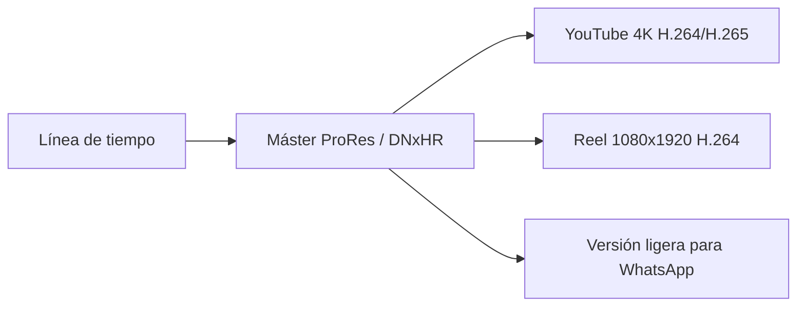

# Exportar video (códec, bitrate y formato por plataforma)

Parte de: [[33-Edicion-Video/06 Entrega/_Índice Entrega|Entrega]]

> [!info] Cómo avanzar
> `progreso`: **pendiente** → **viendo** (estudiando) → **visto** (contestaste la autoevaluación sin abrir las respuestas) → **dominado** (hiciste el laboratorio o lo aplicaste de verdad).

## Contenido

### Qué es
Exportar (renderizar) es convertir tu línea de tiempo en un archivo final. Decides el **contenedor** (MP4, MOV), el **códec** (H.264, H.265, ProRes, DNxHR), la **resolución**, la **cadencia** (fps), el **bitrate** y el audio. Las bases técnicas están en [[Códecs y contenedores de video (H.264, H.265 y ProRes)]] y [[Bitrate y tamaño de archivo]]; aquí, cómo elegir para cada destino.

### Cómo funciona: tamaño y bitrate
`tamaño (MB) ≈ bitrate total (Mbps) × duración (s) / 8`

| Caso | Cálculo | Resultado |
|---|---|---|
| 10 min a 20 Mbps + audio 0.32 Mbps | 20.32 × 600 / 8 | ≈ 1,524 MB ≈ 1.5 GB |
| Límite de 500 MB para 4 min | 500 × 8 / 240 | máx. ≈ 16.7 Mbps totales |
| Reel de 30 s a 12 Mbps | 12 × 30 / 8 | 45 MB |

Dividir entre 8 convierte megabits a megabytes. El resultado es aproximado porque el contenedor agrega un poco y el bitrate variable fluctúa.

### Ajustes por destino
**YouTube** (horizontal). La ayuda oficial de YouTube recomienda MP4, audio AAC-LC (u Opus) a 48 kHz, y para SDR estos bitrates de referencia: 1080p 8 Mbps (24–30 fps) o 12 Mbps (48–60 fps); 4K 35–45 Mbps (24–30 fps) o 53–68 Mbps (48–60 fps). Como YouTube vuelve a comprimir, subir con más bitrate que el mínimo da mejor resultado. Exportar en 4K, aunque el proyecto sea 1080p escalado, hace que YouTube asigne un códec de mejor calidad (práctica común entre creadores; Pendiente de confirmar en documentación oficial).

En Resolve: página **Deliver** → preset **YouTube** (elige 1080p o 2160p) o *Custom*: formato MP4, códec H.264 o H.265, resolución y fps **iguales a la línea de tiempo**, calidad *Restrict to* el bitrate deseado, audio AAC 320 kbps.

**Reels / TikTok / Shorts** (vertical): 1080 × 1920, H.264, la cadencia del proyecto (30 fps es lo más común), AAC. Revisa los requisitos actuales de cada app (verificar; las plataformas los cambian). Un reel de 30–60 s a 12–20 Mbps queda en tamaños cómodos para subir desde el celular.

**Máster**: un archivo de alta calidad para archivar y recomprimir después: **ProRes 422 HQ** o **DNxHR HQ/HQX** en MOV (Resolve en Windows exporta ProRes desde la 19.1.4), o H.265 a bitrate alto. A partir del máster sacas versiones para cada plataforma con [[HandBrake]] sin volver a abrir el proyecto.

### Tu PC y la versión gratuita
La codificación H.264/H.265 por hardware (NVENC) en Resolve es función de Studio; en la gratuita Resolve usa su codificador por software, más lento en tu PC. Además, la gratuita exporta en 8 bits y hasta UHD 60 fps. Una alternativa rápida: exportar el máster en DNxHR y comprimir con HandBrake usando **NVENC** de tu GTX 1660 Ti (H.264 o H.265; la 1660 Ti no codifica AV1 por hardware).

### Ejemplo
Video de viaje de 8 min en línea de tiempo 4K 30p: máster DNxHR HQ en `07 Exportados`, versión de YouTube H.264 4K a 45 Mbps (≈2.7 GB), y un reel 1080×1920 de 45 s a 16 Mbps (≈90 MB).

### Errores comunes
- **Exportar un proyecto de 30 fps a 60 fps "para que se vea más fluido"**: no hay información nueva; el editor duplica cada cuadro, el movimiento se ve igual y el archivo pesa más. La fluidez se decide al grabar ([[Resolución y cuadros por segundo]]).
- **Bitrate bajísimo para ahorrar**: bloques y banding, sobre todo en cielos y tomas del dron.
- **Resolución o fps distintos a la línea de tiempo** sin razón.
- **No guardar máster**: para una versión nueva tienes que reabrir y reexportar todo.
- **Olvidar revisar el archivo exportado** completo antes de subirlo.

### Para profundizar
- [Configuración de codificación recomendada para subir a YouTube](https://support.google.com/youtube/answer/1722171)
- [Capacitación oficial de DaVinci Resolve (página Deliver)](https://www.blackmagicdesign.com/products/davinciresolve/training)

## Ejercicios

Resuélvelos en papel o en la herramienta; la solución está plegada.

> [!question]- Exportas 10 min a 20 Mbps de video + 0.32 Mbps de audio. ¿Tamaño aproximado?
> 20.32 × 600 / 8 ≈ **1524 MB ≈ 1.5 GB**.

> [!question]- Tienes un límite de subida de 500 MB para un video de 4 min. ¿Bitrate total máximo?
> 500 × 8 / 240 ≈ **16.7 Mbps**.

> [!question]- Un reel de 30 s a 12 Mbps, ¿cuánto pesa?
> 12 × 30 / 8 = **45 MB**.

## Autoevaluación

Contesta primero en voz alta o en papel; luego despliega la respuesta.

> [!question]- ¿Qué ajustes básicos usar para YouTube?
> MP4 o MOV, **H.264** o **H.265**, a la resolución y cadencia del proyecto, bitrate alto, audio AAC 48 kHz. Resolve trae un preset de YouTube en Deliver.

> [!question]- ¿Qué ajustes para Reels/TikTok/Shorts?
> 1080 × 1920, H.264, 30 fps (o la del proyecto), audio AAC. Revisa los requisitos actuales de cada app (verificar; las plataformas los cambian).

> [!question]- ¿Qué es un máster y por qué guardarlo?
> Una exportación de alta calidad (p. ej. ProRes 422 o H.265 a alto bitrate) para archivar y volver a comprimir después para cualquier plataforma.

> [!question]- Error común: exportar un proyecto 30 fps a 60 fps "para que se vea más fluido". ¿Qué pasa?
> No gana fluidez: solo duplica cuadros y pesa más.

## Práctica

- [[Lab 8 - Exportar por plataforma]]

