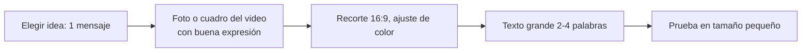

# Miniaturas y diseño básico

Parte de: [[33-Edicion-Video/06 Entrega/_Índice Entrega|Entrega]]

> [!info] Cómo avanzar
> `progreso`: **pendiente** → **viendo** (estudiando) → **visto** (contestaste la autoevaluación sin abrir las respuestas) → **dominado** (hiciste el laboratorio o lo aplicaste de verdad).

## Contenido

### Qué es
La **miniatura** (*thumbnail*) es la imagen que representa tu video en YouTube antes de que alguien le dé clic. Junto con el título, es lo que decide si alguien abre tu video: debe comunicar de qué trata y generar curiosidad en un vistazo, incluso en tamaño pequeño en un celular.

### Tamaño y requisitos
Según la ayuda oficial de YouTube (revisada en noviembre de 2026):
- Relación **16:9** para videos (9:16 para Shorts).
- Resolución **recomendada 3840×2160** (en Shorts 2160×3840); mínimo **640 px** de ancho. Durante años la referencia fue 1280×720 y sigue siendo un tamaño válido, pero hoy YouTube recomienda 4K.
- Peso: hasta **50 MB** desde computadora y hasta **2 MB** desde el celular.
- Formatos JPG o PNG.
- Necesitas una **cuenta verificada** para subir miniaturas personalizadas.

### Qué hace que una miniatura funcione
- **Un solo mensaje**: un sujeto principal (cara con expresión clara, objeto o resultado) y no más de 3–4 palabras grandes. Si necesitas explicar, eso va en el título.
- **Legible en pequeño**: verla al 10 % de tamaño es la prueba real; ahí se ve en el celular.
- **Contraste** de color y brillo: sujeto separado del fondo (luz en la cara, fondo más oscuro o desenfocado, contorno).
- **Coherencia** con el título y con el contenido: complementa el título, no lo repite.
- **Consistencia** de estilo entre videos (misma tipografía y colores que tus títulos, ver [[Títulos y lower thirds]]).
- Evita poner elementos en la **esquina inferior derecha**, donde YouTube muestra la duración.

### Con qué programas gratuitos
- **GIMP**: editor de imágenes libre y gratuito, capas y máscaras ([[GIMP]]).
- **Photopea**: editor en el navegador parecido a Photoshop, abre PSD ([[Photopea]]).
- **Canva** (plan gratuito): plantillas y textos rápidos; revisa qué elementos son de pago.
- **DaVinci Resolve**: en la página Color, clic derecho en el visor → *Grab Still* y exporta la imagen de un cuadro del video (ideal si grabaste en 4K con la a6700). En la página Photo de Resolve 21 también puedes ajustar fotos.
- También puedes tomar una foto dedicada en la grabación con la a6700 o el iPhone: suele ser mejor que un cuadro del video.

### Ejemplo
Video "Probé la impresora 3D Elegoo Centauri 2 Combo": foto de ti sosteniendo la pieza impresa, luz lateral, fondo oscuro desenfocado; en GIMP recortas a 3840×2160, subes un poco el contraste, agregas "¿VALE LA PENA?" en dos líneas con la misma fuente de tus títulos y un contorno. Exportas JPG por debajo de 2 MB para poder cambiarla también desde el celular.

### Errores comunes
- **Miniatura engañosa** (promete algo que el video no tiene): la gente da clic y se va enseguida; eso baja la retención y la satisfacción del público, y YouTube recomienda menos el video. Además, las miniaturas engañosas o con contenido inapropiado van contra las políticas de YouTube: pueden retirarte la miniatura y, si reincides, recibir advertencias o *strikes* de Normas de la comunidad, que además reducen cuántas miniaturas puedes subir.
- **Mucho texto pequeño**: ilegible en el celular.
- **Cara sin expresión o mal iluminada**.
- **Elementos clave en la esquina de la duración**.

### Para profundizar
- [Agregar miniaturas personalizadas (ayuda de YouTube)](https://support.google.com/youtube/answer/72431)
- [GIMP (sitio oficial)](https://www.gimp.org/)
- [Photopea](https://www.photopea.com/)

## Autoevaluación

Contesta primero en voz alta o en papel; luego despliega la respuesta.

> [!question]- ¿Qué tamaño se usa para miniaturas de YouTube?
> YouTube recomienda **3840 × 2160** (4K, 16:9), con un mínimo de 640 px de ancho; en Shorts, vertical 2160 × 3840. Durante años la referencia fue 1280 × 720 y todavía se acepta, pero ya no es lo recomendado. Desde la computadora el archivo puede pesar hasta 50 MB; desde el celular el límite sigue siendo menor (unos 2 MB). Revísalo al subir: las plataformas cambian estos valores.

> [!question]- ¿Qué hace que una miniatura funcione?
> Una idea clara, una cara con expresión o un objeto grande, contraste alto y poco texto (3–4 palabras) legible en pequeño.

> [!question]- ¿Con qué programas gratuitos puedes hacerla?
> GIMP, Photopea (en el navegador), Canva (versión gratuita) o exportando un cuadro desde Resolve y agregando texto.

> [!question]- Error común: miniatura engañosa. ¿Qué consecuencia tiene?
> La gente abandona rápido y baja la retención; además puede violar políticas de la plataforma.

## Práctica

- [[Lab 8 - Exportar por plataforma]]

