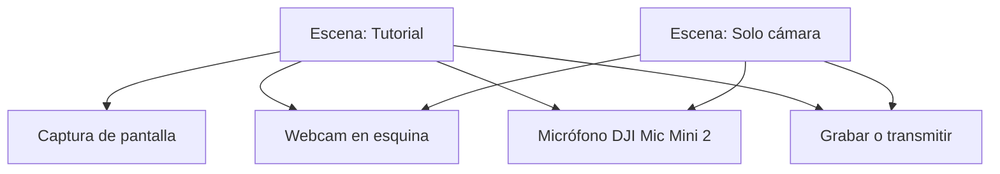

# OBS Studio

Parte de: [[33-Edicion-Video/06 Entrega/_Índice Entrega|Entrega]]

> [!info] Cómo avanzar
> `progreso`: **pendiente** → **viendo** (estudiando) → **visto** (contestaste la autoevaluación sin abrir las respuestas) → **dominado** (hiciste el laboratorio o lo aplicaste de verdad).

## Contenido

### Qué es
**OBS Studio** (Open Broadcaster Software) es un programa gratuito y de código abierto para **grabar y transmitir** video en vivo desde la PC. Combina pantalla, cámaras, micrófonos, imágenes y textos en una composición, y la graba a un archivo o la transmite a YouTube, Twitch u otras plataformas. En tu flujo es la herramienta para tutoriales, screencasts y grabaciones de clases ([[Tutorial y screencast]]).

### Cómo funciona: escenas y fuentes
- Una **fuente** es cada elemento que capturas: *Captura de pantalla*, *Captura de ventana*, *Dispositivo de captura de video* (webcam, o el iPhone/Osmo Pocket como webcam), *Captura de entrada de audio* (micrófono), *Imagen*, *Texto*, *Navegador*.
- Una **escena** es una combinación de fuentes con su acomodo. Puedes tener varias y cambiar entre ellas: "Pantalla completa", "Pantalla + cámara en esquina", "Solo cámara", "Pausa".
- El **mezclador de audio** muestra cada fuente de sonido y permite aplicar filtros (supresión de ruido, compresor, compuerta de ruido).

### Ajustes de grabación recomendados
- *Ajustes → Salida → Grabación*:
  - **Formato**: **MP4 híbrido** (Hybrid MP4, disponible desde OBS 30.2). Escribe el archivo en forma fragmentada mientras grabas y lo finaliza al detener; si OBS se cierra o se va la luz, el archivo **se puede recuperar**. Con MP4 normal, un cierre inesperado deja el archivo ilegible. La alternativa clásica es **MKV** y luego *Archivo → Convertir (remux)* a MP4 para editar.
  - **Codificador**: **NVIDIA NVENC H.264** o **HEVC** con tu GTX 1660 Ti, para que la grabación no cargue la CPU.
  - **Control de calidad**: CQP/CQ (calidad constante) alrededor de 18–23 para grabación local.
- *Ajustes → Video*: resolución base igual a tu monitor, salida 1920×1080, 30 fps para tutoriales (60 para videojuegos o movimiento rápido).
- *Ajustes → Audio*: 48 kHz, la misma frecuencia que usarás en el editor.
- Puedes grabar **pistas de audio separadas** (micrófono y sonido del sistema) para mezclarlas mejor en Resolve.

### Ejemplo
Tutorial de Docker para tu canal: escena "Pantalla + cámara" con captura de pantalla 1080p, el iPhone 15 Pro como webcam en una esquina y el [[DJI Mic Mini 2]] por USB como micrófono, con filtro de compresor. Grabas en MP4 híbrido con NVENC. Luego en Resolve cortas silencios ([[Jump cut (edición)]]), haces zoom a zonas de la pantalla con keyframes y exportas.

### Cuándo usarlo y cuándo no
Úsalo para grabar pantalla, clases, videojuegos, transmisiones en vivo y podcasts con cámara. Para grabar con calidad de cine, graba directamente en la cámara; OBS depende de la captura (webcam/tarjeta) y del codificador de la PC.

### Errores comunes
- **Grabar en MP4 clásico**: si OBS falla, pierdes la grabación. Usa MP4 híbrido o MKV.
- **No probar el audio**: graba 10 s y escúchalo antes de una sesión larga.
- **Resolución de salida distinta al proyecto**: luego escalas y pierdes nitidez.
- **Codificador por CPU (x264)** en una PC que también ejecuta lo que grabas: cuadros perdidos; usa NVENC.

### Para profundizar
- [OBS Studio (sitio oficial)](https://obsproject.com/)
- [Formato Hybrid MP4 (base de conocimiento de OBS)](https://obsproject.com/kb/hybrid-mp4)

## Autoevaluación

Contesta primero en voz alta o en papel; luego despliega la respuesta.

> [!question]- ¿Para qué sirve OBS Studio?
> Grabar la pantalla, la webcam y el audio de la PC, y hacer transmisiones en vivo; es gratuito y de código abierto.

> [!question]- ¿Qué son las escenas y fuentes?
> Una **escena** es una composición (por ejemplo, pantalla + cámara en una esquina); las **fuentes** son lo que la compone (captura de pantalla, cámara, micrófono, imagen).

> [!question]- ¿Qué formato de grabación conviene para no perder el archivo si se cierra?
> **MKV** (si OBS se cierra no se corrompe toda la grabación); luego usa *Remux* a MP4 desde el menú de OBS.

