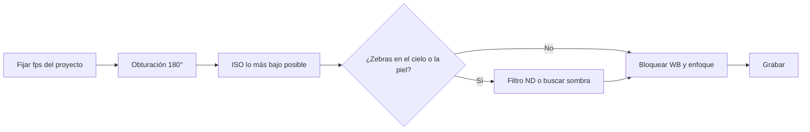

# Blackmagic Camera (app)

Parte de: [[34-Equipo/01 Mi equipo actual/_Índice Mi equipo actual|Mi equipo actual]]

> [!info] Cómo avanzar
> `progreso`: **pendiente** → **viendo** (estudiando) → **visto** (contestaste la autoevaluación sin abrir las respuestas) → **dominado** (hiciste el laboratorio o lo aplicaste de verdad).

## Contenido

### Qué es
Blackmagic Camera es una app **gratuita** de Blackmagic Design (los creadores de DaVinci Resolve) que convierte tu iPhone 15 Pro en algo muy parecido a una cámara de cine: te deja fijar a mano cada parámetro de exposición, ver herramientas de monitoreo profesionales y grabar en códecs pensados para editar. La app Cámara de Apple decide casi todo por ti; Blackmagic Camera te devuelve el control para que dos tomas seguidas se vean igual y para que el material llegue limpio a la edición.

### Cómo funciona
La app se organiza en una barra superior con los ajustes de exposición y una barra inferior con códec, resolución y medios. Lo que más vas a usar:

- **Cuadros por segundo exactos**: 23.98, 24, 25, 29.97, 30 y más, según el modelo y el códec. Elige la cadencia del proyecto antes de grabar.
- **Obturación en grados o en velocidad**: puedes trabajar con ángulo de obturación (de 1.1° a 360°) o con velocidad (1/24 a 1/8000). Con el ángulo fijo en **180°**, la velocidad se recalcula sola cuando cambias de cadencia: la mitad de la duración de cada cuadro.
- **ISO, balance de blancos y tinte** independientes y con bloqueo.
- **Monitoreo**: zebras (75–100 %), *false color*, *focus peaking*, histograma, guías de encuadre y zonas seguras, y medidores de audio.
- **LUTs**: puedes previsualizar una LUT (por ejemplo, una conversión de Apple Log a Rec.709) e incluso grabarla en el clip.
- **Códecs**: H.264, H.265 (HEVC) y **Apple ProRes**, con la opción de espacio de color **Apple Log** en el 15 Pro. Los clips se guardan en el iPhone o en un disco USB-C externo.

La lógica es la misma de cualquier cámara de cine: el iPhone tiene **apertura fija**, así que solo te quedan dos llaves para la luz (ISO y obturación). Si la obturación está atada a 180°, el ISO es la única que queda; cuando ya está al mínimo y sigue sobrando luz, la respuesta es un filtro ND. La regla completa está en [[Regla de los 180 grados del obturador]].

### Ejemplo
Vas a grabar una entrevista corta en el patio de tu casa para un video de YouTube, con el [[DJI Mic Mini 2]] en la camisa del entrevistado.

1. En la app eliges **HEVC 4K a 24 fps** (o ProRes si tienes espacio y vas a colorear fuerte) y espacio de color Apple Log si piensas aplicar una LUT en DaVinci Resolve.
2. Fijas la obturación en **180°**: a 24 fps queda en **1/48**.
3. Bajas el ISO al mínimo y activas zebras al 95 %. Si la cara del entrevistado muestra rayas, pones un ND en la funda o lo mueves a la sombra.
4. Fijas el balance de blancos en 5600 K (día) y ajustas el tinte mirando la piel.
5. Tocas para enfocar en los ojos y **bloqueas** el enfoque.
6. En audio eliges el micrófono externo y revisas los medidores: la voz debe moverse alrededor de −12 dB sin tocar el rojo.

Resultado: un clip que no "respira" cuando pasa una nube o alguien cruza detrás, y que en la edición pega con las tomas de tu próxima cámara.

### Cuándo usarlo y cuándo no
- **Úsala** en entrevistas, tomas planeadas, cuando vas a mezclar el iPhone con otra cámara (a6700, Pocket 4P) o cuando quieres Log para corregir color.
- **Usa la app Cámara de Apple** para lo espontáneo: un momento que se va en dos segundos, modo Acción, modo Cine o cámara lenta automática. Ahí la velocidad de reacción vale más que el control.
- Si no vas a editar, el automático de Apple con HDR suele verse mejor sin trabajo.

### Errores comunes
- **Dejar todo en automático en una toma larga**: la exposición y el color cambian a mitad de la toma. Bloquea ISO, obturación, balance y enfoque.
- **Fijar 180° a pleno sol sin ND**: con apertura fija, la imagen se quema aunque el ISO esté al mínimo. Lleva un ND o acepta una velocidad más rápida a sabiendas.
- **Grabar en Log y publicar sin convertir**: el clip se verá gris y lavado. Aplica la LUT o la transformación en la edición, o no uses Log.
- **Olvidar el micrófono**: si la fuente de audio queda en el micrófono interno, perderás la ventaja del Mic Mini 2. Revisa los medidores antes de grabar.
- **No revisar el espacio libre**: ProRes llena el teléfono muy rápido; mira el tiempo restante que muestra la app.

### Para profundizar
- [Blackmagic Camera: página del producto](https://www.blackmagicdesign.com/products/blackmagiccamera)
- [Blackmagic Camera: especificaciones técnicas](https://www.blackmagicdesign.com/products/blackmagiccamera/techspecs)
- [Apple: grabar video ProRes en el iPhone](https://support.apple.com/en-us/109041)

## Autoevaluación

Contesta primero en voz alta o en papel; luego despliega la respuesta.

> [!question]- ¿Qué te da la app Blackmagic Camera que no tiene la app Cámara de Apple?
> Es **gratuita** y da control manual estilo cine: **obturación en grados (1.1° a 360°) o en velocidad**, ISO, balance de blancos y tinte, cuadros por segundo exactos (23.98, 24, 25, 29.97, 30…), **zebras, focus peaking, false color, histograma**, guías de encuadre, previsualización de **LUTs 3D**, medidores de audio, y códecs H.264/H.265/**ProRes** con espacio de color **Apple Log**. Fuentes: [producto](https://www.blackmagicdesign.com/products/blackmagiccamera) · [especificaciones](https://www.blackmagicdesign.com/products/blackmagiccamera/techspecs).

> [!question]- ¿Qué significa grabar con obturación de 180° y qué velocidad resulta a 24, 30 y 60 fps?
> 180° = el obturador está abierto la mitad del tiempo de cada cuadro: velocidad = 1 / (2 × fps). **24 fps → 1/48**, **30 fps → 1/60**, **60 fps → 1/120**. Da un desenfoque de movimiento natural. En la app basta con fijar *Shutter* en **180°** y la velocidad se ajusta sola al cambiar fps. Ver [[Regla de los 180 grados del obturador]].

> [!question]- Caso: grabas a 180° en exterior a pleno sol y la imagen sale quemada aunque bajaste el ISO al mínimo. ¿Qué haces?
> El iPhone tiene apertura fija, así que con 1/48–1/60 entra demasiada luz. Opciones: **filtro ND** de clip/funda (ver [[Filtros ND y Black Mist para video]]), buscar sombra, o aceptar una velocidad más rápida (pierdes el desenfoque de movimiento natural). Usa **zebras** para confirmar.

> [!question]- Error común: dejar la exposición y el balance de blancos en automático en una toma larga. ¿Qué se nota?
> Cambios de brillo y de color a mitad de la toma ("respira") cuando alguien pasa o cambia la luz: casi imposible de arreglar en la edición. Bloquea **ISO, obturación, WB y enfoque** antes de grabar.

## Práctica

- [[Lab 1 - Conoce tu iPhone 15 Pro (lentes, ProRAW y Blackmagic Camera a 180 grados)]]
- [[Lab 2 - Audio limpio con el DJI Mic Mini 2 en el iPhone]]

