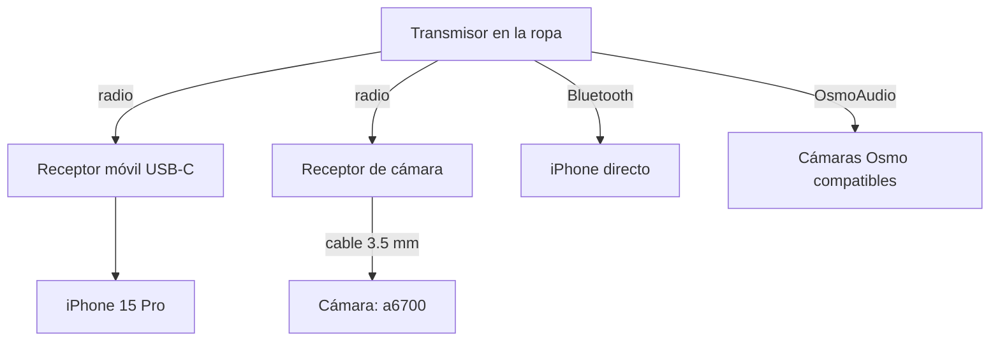

# DJI Mic Mini 2

Parte de: [[34-Equipo/01 Mi equipo actual/_Índice Mi equipo actual|Mi equipo actual]]

> [!info] Cómo avanzar
> `progreso`: **pendiente** → **viendo** (estudiando) → **visto** (contestaste la autoevaluación sin abrir las respuestas) → **dominado** (hiciste el laboratorio o lo aplicaste de verdad).

## Contenido

### Qué es
El DJI Mic Mini 2 es un sistema de micrófono inalámbrico de solapa: uno o dos **transmisores** pequeños que se sujetan con imán o clip a la ropa y un **receptor** que se conecta al teléfono o a la cámara. Sirve para que la voz se escuche cerca y limpia aunque la cámara esté lejos, que es la mejora más grande que puedes hacerle a un video. Es la versión ligera y económica de la familia DJI Mic: sacrifica funciones de los modelos caros a cambio de tamaño y precio.

### Cómo funciona
Cada transmisor capta la voz y la envía por radio al receptor. Según la [FAQ oficial](https://www.dji.com/mx/mic-mini-2/faq), el alcance en exterior sin interferencias llega a unos 300–400 m según el receptor y el modo; en la práctica, con cuerpos y paredes en medio, cuenta con bastante menos.

Formas de conectarlo al iPhone 15 Pro:

1. **Receptor móvil en el USB-C**: la opción más confiable para video. Aparece como micrófono externo y lo eliges en Blackmagic Camera.
2. **Bluetooth directo**: sin receptor, pero DJI avisa que no todas las apps lo aceptan como micrófono y la cancelación de ruido queda fija en el nivel fuerte.
3. **Receptor de cámara con salida analógica**: el que usarás con la a6700. Ojo: según la FAQ, el receptor *móvil* no admite el cable TRS de 3.5 mm a cámara.
4. **OsmoAudio**: conexión directa del transmisor a cámaras DJI compatibles (Osmo Pocket 4, Osmo 360, Osmo Nano, Osmo Action 6 y Action 4). La Osmo Pocket 4P no aparece en esa lista (Pendiente de confirmar).

Modos de grabación: **mono**, **estéreo** (un transmisor por canal) y **Ms**, que graba la voz principal y una pista de seguridad 6 dB más baja. La cancelación de ruido tiene niveles (Off/Low/High en el receptor móvil; Basic/Strong en el receptor Mic Mini).

Lo que **no** tiene: grabación interna en el transmisor (si el teléfono falla, no hay respaldo) y la FAQ no menciona entrada de 3.5 mm para lavalier externo.

### Ejemplo
Grabas un recorrido caminando por el centro de tu ciudad con el iPhone en un selfie stick:

1. Pones el transmisor en el pecho, a un palmo de la boca (15–20 cm), sin que roce el cuello de la camisa. Si hay viento, colocas el peluche (cubierta antiviento).
2. Conectas el receptor móvil al USB-C y en Blackmagic Camera eliges el micrófono externo.
3. Como hay tráfico, empiezas con cancelación **Low**: escuchas con audífonos 10 segundos de prueba. Si el ruido de fondo tapa la voz, subes a High y vuelves a escuchar; si la voz suena metálica, regresas.
4. Activas **Ms** porque vas a reírte o subir la voz en algún momento; en DaVinci Resolve usarás la pista de −6 dB en los fragmentos saturados.
5. Al terminar, revisas un clip completo en el teléfono antes de irte: sin grabación interna, no hay segunda oportunidad.

Más detalle práctico en el [[Lab 2 - Audio limpio con el DJI Mic Mini 2 en el iPhone]].

### Cuándo usarlo y cuándo no
- **Úsalo** para cualquier toma donde alguien hable a la cámara: vlogs, entrevistas, tutoriales, recorridos.
- **No es ideal** cuando necesitas respaldo garantizado (bodas, entrevistas que no se repiten): un sistema con grabación interna te protege de fallas del teléfono. También pierde frente a un micrófono de cañón si quieres captar el ambiente o varias personas que se mueven.
- Si solo grabas ambiente o paisaje, el micrófono del iPhone basta.

### Errores comunes
- **Subir la cancelación al máximo de entrada**: la voz se vuelve robótica. Acerca primero el micrófono; la distancia limpia más que el procesado.
- **Confiar en Bluetooth para video**: algunas apps ignoran el micrófono y grabas con el interno sin darte cuenta. Usa el receptor.
- **No escuchar con audífonos**: roces de ropa, viento o cortes solo se notan escuchando.
- **Esconder el transmisor bajo varias capas de tela**: suena apagado y con roces. Si lo ocultas, que sea bajo una sola capa ligera y bien fijo.
- **Olvidar la carga del estuche**: el estuche recarga los transmisores, pero solo si él mismo está cargado.

### Para profundizar
- [DJI Mic Mini 2: preguntas frecuentes (DJI México)](https://www.dji.com/mx/mic-mini-2/faq)
- [Blackmagic Camera: especificaciones (opciones de audio)](https://www.blackmagicdesign.com/products/blackmagiccamera/techspecs)

## Autoevaluación

Contesta primero en voz alta o en papel; luego despliega la respuesta.

> [!question]- ¿Qué NO tiene el DJI Mic Mini 2 que sí tienen micrófonos más caros?
> **No tiene grabación interna** (el transmisor no guarda audio: si falla la grabación en el teléfono, no hay respaldo) y la ficha oficial **no menciona entrada de 3.5 mm para lavalier** en el transmisor. Fuente: [FAQ oficial de DJI México](https://www.dji.com/mx/mic-mini-2/faq).

> [!question]- ¿De qué formas lo conectas al iPhone 15 Pro?
> 1) **Receptor móvil** en el puerto USB-C del iPhone (la opción más confiable para video). 2) **Bluetooth directo** del transmisor al iPhone (mantén 2 s el botón de vinculación); DJI advierte que **no está garantizado** que la app de cámara lo use como micrófono y que con Bluetooth la cancelación de ruido queda fija en *Strong*. 3) Receptor de cámara con cable 3.5 mm TRS para cámaras. Fuente: [FAQ](https://www.dji.com/mx/mic-mini-2/faq).

> [!question]- ¿Qué es el modo Ms (pista de seguridad) y cuándo lo usas?
> Graba dos pistas: la principal y una de **respaldo a −6 dB**; si la voz sube de golpe (grito, risa) y la principal se satura, usas la de respaldo. Úsalo con una sola persona hablando; en edición separas las pistas. Requiere un receptor/dispositivo que grabe en estéreo (verifícalo en la lista de compatibilidad de DJI).

> [!question]- Caso: grabas en una calle con tráfico. ¿Qué nivel de cancelación de ruido usas?
> Empieza en **Low/Basic** y escucha con audífonos. El nivel **High/Strong** quita más ruido pero distorsiona la voz (sonido "robótico"). Mejor aún: acerca el micrófono a la boca (15–20 cm) antes de subir la cancelación.

> [!question]- ¿Con qué cámaras DJI se conecta directo sin receptor (OsmoAudio)?
> Según la [FAQ de DJI](https://www.dji.com/mx/mic-mini-2/faq): **Osmo Pocket 4, Osmo 360, Osmo Nano y Osmo Action 6** (hasta dos transmisores) y Osmo Action 4 (uno). La Osmo Pocket 4P no aparece nombrada en esa lista (Pendiente de confirmar).

## Práctica

- [[Lab 2 - Audio limpio con el DJI Mic Mini 2 en el iPhone]]

