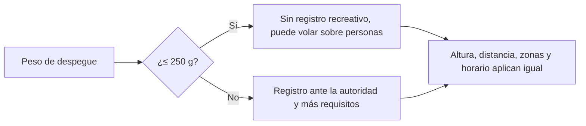

# DJI Mini 4K

Parte de: [[34-Equipo/01 Mi equipo actual/_Índice Mi equipo actual|Mi equipo actual]]

> [!info] Cómo avanzar
> `progreso`: **pendiente** → **viendo** (estudiando) → **visto** (contestaste la autoevaluación sin abrir las respuestas) → **dominado** (hiciste el laboratorio o lo aplicaste de verdad).

## Contenido

### Qué es
El DJI Mini 4K es tu dron: un cuadricóptero plegable de **246 g** de peso de despegue (con batería, hélices y microSD) con cámara 4K estabilizada en tres ejes. Ese peso no es un detalle: al quedar en **250 g o menos**, en México no necesita registro para uso recreativo y puede volar sobre personas según la NOM-107, aunque todas las demás reglas aplican. Esta nota es la ficha del equipo; todo lo de pilotaje, normativa y tomas está en [[_Índice Drones|35-Drones]].

### Cómo funciona
Según la [ficha oficial de DJI](https://www.dji.com/mini-2-se/specs) (página compartida con el Mini 2 SE):

| Dato | Valor |
|---|---|
| Peso de despegue | 246 g |
| Tiempo de vuelo máximo | 31 min (en laboratorio, sin viento) |
| Velocidad máxima | 16 m/s (modo Sport) |
| Resistencia al viento | 10.7 m/s (nivel 5) |
| Temperatura de operación | 0 a 40 °C |
| Navegación | GPS + GLONASS + Galileo |
| Transmisión | DJI O2; 10 km FCC / 6 km CE sin interferencias |
| Sensor | 1/2.3", 12 MP, lente 24 mm equiv. ƒ/2.8 fija |
| Video | 4K a 24/25/30 fps; 2.7K y 1080p hasta 60 fps |
| Bitrate y códec | 100 Mbps, MP4 H.264 |
| Perfil de color | solo Normal (sin D-Log) |
| Foto | JPEG y DNG; AEB, intervalo, panorámica |
| Batería | 2250 mAh, 7.7 V, 17.32 Wh |
| Detección | solo hacia abajo |

Tres consecuencias prácticas de esa tabla:

1. **No esquiva obstáculos.** Su sistema de visión mira hacia abajo para flotar estable y aterrizar; al frente, atrás y a los lados no detecta nada. El RTH vuelve en línea recta: tú eres el sensor.
2. **Apertura fija y perfil Normal.** Para usar obturación de 180° con sol necesitas filtros ND, y como no hay perfil plano, tienes poca latitud para recuperar cielos quemados. Expón con cuidado.
3. **El alcance de transmisión no es un permiso.** Aunque el enlace llegue a varios kilómetros, la norma te limita a 457 m horizontales y siempre a la vista.

### Ejemplo
Antes de un viaje a la playa preparas el Mini 4K:

- **Peso**: le quieres poner protectores de hélice. Con solo 4 g de margen, pesas el dron con todo puesto en una báscula de cocina. Si pasa de 250 g, vuelas sin protectores.
- **Almacenamiento**: a 100 Mbps el dron escribe 12.5 MB/s, unos **0.75 GB por minuto**. Una microSD U3/V30 de 64 GB te da alrededor de 85 minutos de 4K, más que suficiente para tres baterías.
- **Baterías**: cada una es de 17.32 Wh, muy por debajo de los 100 Wh que suelen limitar las aerolíneas, pero van en equipaje de mano y con carga baja (ver [[Baterías de dron (cuidado y viajes)]]).
- **Plan de vuelo**: la playa tiene viento; revisas que las ráfagas estén lejos de 38.5 km/h (10.7 m/s) y que no haya aeródromo a menos de 9.2 km.

### Cuándo usarlo y cuándo no
- **Úsalo** para tomas aéreas de paisaje, ubicación y transición en tus videos, fotos cenitales y panorámicas.
- **No lo uses** con lluvia, con viento cerca del límite, de noche (la norma limita al horario diurno), cerca de aeropuertos o helipuertos, ni en interiores sin GPS donde deriva fácilmente.
- Si necesitas perfil Log, evasión de obstáculos o seguimiento automático, es un límite del equipo, no de tu técnica.

### Errores comunes
- **Agregar accesorios sin pesar**: puedes pasar de 250 g y cambiar tus obligaciones legales.
- **Volar cerca de árboles confiando en "sensores"**: no los tiene hacia delante ni a los lados.
- **Usar una microSD cualquiera**: DJI pide U3 o superior; las tarjetas lentas o falsas cortan las grabaciones. Ver [[Tarjetas de memoria (clases de velocidad)]].
- **Calcular el vuelo con los 31 minutos de la ficha**: es un valor ideal; con viento y regreso, planea bastante menos y aterriza con margen.

### Para profundizar
- [DJI: especificaciones del Mini 4K](https://www.dji.com/mini-2-se/specs)
- [Manual de usuario del DJI Mini 4K (PDF)](https://dl.djicdn.com/downloads/DJI_Mini_4K/20260427/DJI_Mini_4K_User_Manual_v1.0_zh-cn.pdf)
- [NOM-107-SCT3-2019 en el DOF](https://dof.gob.mx/normasOficiales/8006/sct11_C/sct11_C.html)

## Autoevaluación

Contesta primero en voz alta o en papel; luego despliega la respuesta.

> [!question]- ¿Qué datos clave del DJI Mini 4K tienes que saber de memoria?
> Peso de despegue **246 g** (con batería, hélices y microSD), menos de 250 g; video **4K a 24/25/30 fps**, 2.7K y 1080p hasta 60 fps, **100 Mbps H.264**, perfil de color **solo Normal** (sin D-Log); foto **12 MP** en JPEG y **DNG (RAW)**; sensores solo **hacia abajo** (no esquiva obstáculos). Fuente: [especificaciones DJI](https://www.dji.com/mini-2-se/specs). Todo lo de vuelo está en [[35-Drones/_Índice Drones|35-Drones]].

> [!question]- ¿Por qué el Mini 4K no evita obstáculos y qué implica?
> Su sistema de visión apunta **hacia abajo** (para mantenerse estable al flotar y aterrizar). No detecta árboles, cables ni paredes al frente o los lados: tú eres el sensor. Vuela con margen y en **modo Cine** cerca de objetos.

> [!question]- Error común: comprar una microSD cualquiera para el Mini 4K. ¿Qué pide DJI?
> DJI recomienda **UHS-I Speed Grade 3 (U3) o superior** o una de su lista recomendada. Con 100 Mbps (12.5 MB/s) una U3/V30 sobra, pero una tarjeta lenta o falsa provoca cortes de grabación. Ver [[Tarjetas de memoria (clases de velocidad)]].

