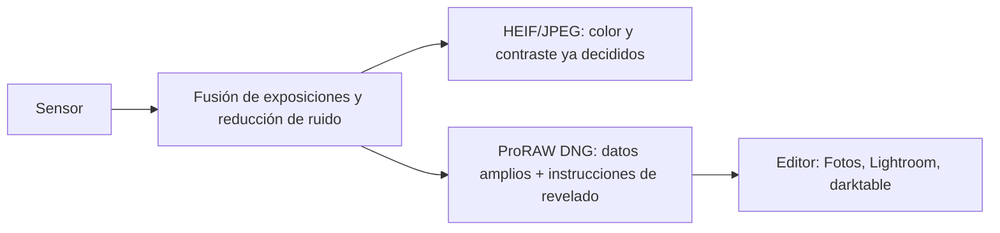

# Apple ProRAW en el iPhone 15 Pro

Parte de: [[iPhone 15 Pro para foto y video]]

> [!info] Cómo avanzar
> `progreso`: **pendiente** → **viendo** (estudiando) → **visto** (contestaste la autoevaluación sin abrir las respuestas) → **dominado** (hiciste el laboratorio o lo aplicaste de verdad).

## Contenido

### Qué es
Apple ProRAW es un formato de foto que guarda **mucha más información** que un HEIF o JPEG normal, en un archivo DNG. Combina las ventajas de un RAW (puedes cambiar balance de blancos, exposición y recuperar luces y sombras sin destruir la imagen) con parte del procesamiento computacional del iPhone (fusión de varias exposiciones, reducción de ruido). Sirve para las fotos que vas a **revelar** con calma, no para las del día a día.

### Cómo funciona
Cuando tomas una foto normal, el iPhone procesa la imagen, decide el color y el contraste, y comprime el resultado: lo que no guardó ya no se puede recuperar. Con ProRAW el teléfono guarda los datos casi crudos del sensor ya alineados y limpios, más instrucciones de revelado que el editor puede respetar o ignorar.

Para activarlo, según [Apple](https://support.apple.com/en-us/119916):

1. **Ajustes > Cámara > Formatos** y enciende **ProRAW y control de resolución**.
2. En la app Cámara aparece el botón **RAW** (o el selector de formato): tócalo para activarlo por foto.
3. Elige **12 MP** o **48 MP**. Los 48 MP solo existen con la cámara principal a 1x; la ultra gran angular, el tele, el modo Noche, el flash y el macro se quedan en 12 MP.

**Tamaño**: Apple estima alrededor de **25 MB a 12 MP y 75 MB a 48 MP**, entre 10 y 12 veces lo que pesa un HEIF o JPEG. Cien fotos a 48 MP son unos 7.5 GB.

**Limitaciones**: ProRAW **no funciona** con Live Photos, en modo Retrato ni en video. Si no ves el botón RAW, probablemente estás en uno de esos modos.

### Ejemplo
Estás en un mirador al atardecer: el cielo está muy brillante y el valle ya en sombra.

1. Activas RAW a **48 MP** con la cámara principal (1x), que es la de mejor calidad.
2. Tocas el cielo para que no se queme y bajas un poco la exposición con el control deslizante.
3. Disparas dos o tres fotos.
4. En casa abres el DNG en un editor gratuito (la app Fotos del iPhone, o darktable en la PC): subes las sombras del valle, bajas las luces del cielo y ajustas el balance de blancos para un tono más cálido. El ruido en las sombras es bajo porque el iPhone ya fusionó varias exposiciones.

Comparación: la misma escena en HEIF te daría un cielo bonito pero un valle casi negro, o un valle visible con el cielo blanco; recuperar cualquiera de los dos en la edición produce bandas y ruido.

### Cuándo usarlo y cuándo no
- **Úsalo** en paisaje, arquitectura, contraluces, escenas con luces y sombras extremas y fotos que quieres imprimir o recortar mucho (48 MP).
- **No lo uses** en ráfagas cotidianas, fotos de documentos, capturas para mandar por mensaje, cuando tienes poco espacio, o cuando no vas a editar: sin revelado, un ProRAW se ve igual o peor que un HEIF bien procesado.
- Si necesitas movimiento o profundidad de campo simulada, usa Live Photos o Retrato en formato normal.

### Errores comunes
- **Dejarlo encendido siempre**: llenas el iPhone y la nube en días. Apágalo después de la sesión.
- **Buscarlo en modo Retrato o Live Photos**: no aparece porque no es compatible.
- **Pensar que 48 MP funciona en todas las cámaras**: solo con la principal a 1x.
- **Compartir el DNG sin revelar**: muchas apps lo muestran plano o con colores raros. Exporta a JPEG o HEIF después de editar.
- **No respaldar**: los archivos grandes se pierden igual de fácil; aplica [[Respaldo 3-2-1 de fotos y videos]].

### Para profundizar
- [Apple: acerca de Apple ProRAW](https://support.apple.com/en-us/119916)
- [Apple: especificaciones técnicas del iPhone 15 Pro](https://support.apple.com/en-us/111829)
- [darktable (revelador RAW gratuito)](https://www.darktable.org/)

## Autoevaluación

Contesta primero en voz alta o en papel; luego despliega la respuesta.

> [!question]- ¿Cómo se activa ProRAW y qué resoluciones hay?
> **Ajustes > Cámara > Formatos > ProRAW y control de resolución**; luego en la app Cámara toca **RAW**. Puedes elegir **12 MP o 48 MP** (48 MP solo con la principal a 1x). Fuente: [Apple 119916](https://support.apple.com/en-us/119916).

> [!question]- ¿Cuánto pesa una foto ProRAW y cuándo NO conviene?
> Unos **25 MB a 12 MP y 75 MB a 48 MP** (10–12 veces un HEIF/JPEG, según [Apple](https://support.apple.com/en-us/119916)). No conviene para ráfagas cotidianas, fotos de documentos o cuando tienes poco espacio. Úsalo en paisaje, contraluces y fotos que vas a revelar.

> [!question]- Error común: buscar ProRAW en modo Retrato o en Live Photos. ¿Por qué no aparece?
> Apple indica que **ProRAW no funciona con Live Photos, en modo Retrato ni en video**. Además, ultra gran angular, tele, modo Noche, flash y macro se limitan a 12 MP.

## Práctica

- [[Lab 1 - Conoce tu iPhone 15 Pro (lentes, ProRAW y Blackmagic Camera a 180 grados)]]

