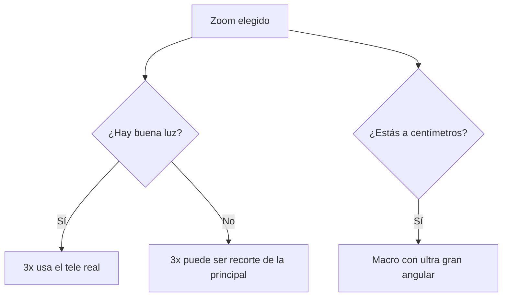

# Lentes y zoom del iPhone 15 Pro

Parte de: [[iPhone 15 Pro para foto y video]]

> [!info] Cómo avanzar
> `progreso`: **pendiente** → **viendo** (estudiando) → **visto** (contestaste la autoevaluación sin abrir las respuestas) → **dominado** (hiciste el laboratorio o lo aplicaste de verdad).

## Contenido

### Qué es
El iPhone 15 Pro tiene tres cámaras traseras, cada una con su propio sensor y lente, y además ofrece "focales" intermedias que salen de recortar el sensor principal. Saber de dónde sale cada número del selector de zoom te dice cuál vas a ver nítido y cuál va a tener ruido, sobre todo con poca luz. Según la [ficha de Apple](https://support.apple.com/en-us/111829):

| Botón | Equivalente | De dónde sale | Apertura |
|---|---|---|---|
| 0.5x | 13 mm | Ultra gran angular, 12 MP, 120° | ƒ/2.2 |
| 1x | 24 mm | Principal, 48 MP, estabilización por desplazamiento del sensor | ƒ/1.78 |
| 1.2x / 1.5x | 28 / 35 mm | Recortes del sensor principal | ƒ/1.78 |
| 2x | 48 mm | Recorte central de 12 MP del sensor principal | ƒ/1.78 |
| 3x | 77 mm | Teleobjetivo, 12 MP | ƒ/2.8 |

### Cómo funciona
- **La principal (1x) es la mejor**: sensor más grande, la apertura más luminosa y estabilización del sensor. Recoge más luz por píxel, así que tiene menos ruido y más rango dinámico.
- **2x no es zoom digital "malo"**: como el sensor principal tiene 48 MP, el centro de 12 MP sigue siendo de buena calidad. Con buena luz se ve casi como una lente aparte.
- **El tele 3x tiene ƒ/2.8 y un sensor más chico**: con poca luz el iPhone puede decidir no usarlo y recortar la principal, aunque tú hayas tocado 3x. Verás más ruido y menos detalle.
- **La ultra gran angular (0.5x)** cubre 120°: entra mucho, pero deforma lo que está en los bordes (caras estiradas, edificios que se inclinan). También es la cámara que usa el iPhone para **macro**: al acercarte a pocos centímetros cambia sola a ella.

**Perspectiva**: la sensación de "acercar" depende de la distancia, no solo del zoom. Un retrato a 3x desde más lejos aplana las facciones y hace que el fondo se vea más cerca y más grande; a 0.5x desde cerca, la nariz crece y el fondo se aleja.

### Ejemplo
Estás en una cena en interior con luz cálida y tenue, y quieres un retrato de tu pareja.

- A **3x** el iPhone probablemente usa un recorte de la principal o el tele con ISO alto: imagen blanda y con ruido.
- Mejor: acércate un paso y usa **2x**, que sale del sensor principal con ƒ/1.78. Si puedes, pon a la persona de frente a la fuente de luz (una lámpara, una ventana) en vez de contra ella.
- Para la foto del platillo usa **1x** desde arriba; si te acercas mucho y ves que la imagen salta de cámara, es el macro activándose: puedes desactivar el cambio automático en Ajustes > Cámara si te molesta.
- Para el salón completo, 0.5x, manteniendo a las personas lejos de los bordes.

### Cuándo usarlo y cuándo no
- **1x**: casi todo, sobre todo con poca luz y para ProRAW de 48 MP ([[Apple ProRAW en el iPhone 15 Pro]]).
- **2x**: retratos y detalles con luz normal; es el "medio tele" más limpio.
- **3x**: retratos con fondo comprimido, detalles lejanos, conciertos con buena iluminación de escenario.
- **0.5x**: interiores chicos, arquitectura, paisaje con primer plano dramático, tomas en movimiento.
- **Evita el zoom digital** más allá de 3x salvo para documentar; la calidad cae rápido.

### Errores comunes
- **Usar 3x de noche esperando calidad de tele**: con poca luz, usa 2x o acércate.
- **Retratos a 0.5x de cerca**: deforma la cara. Para personas, 2x o 3x.
- **Sujetos importantes en los bordes del 0.5x**: ahí la distorsión es mayor.
- **Cambiar de lente a mitad de un clip**: el salto de color y nitidez se nota; en video elige la lente antes y no la cambies.
- **Lentes sucias**: el iPhone vive en el bolsillo; límpialas con un paño de microfibra antes de cada sesión.

### Para profundizar
- [Apple: especificaciones técnicas del iPhone 15 Pro](https://support.apple.com/en-us/111829)
- [Apple: acerca de Apple ProRAW](https://support.apple.com/en-us/119916)

## Autoevaluación

Contesta primero en voz alta o en papel; luego despliega la respuesta.

> [!question]- ¿Cuál es la lente de mejor calidad del iPhone 15 Pro y por qué?
> La **principal (1x, 24 mm, ƒ/1.78, 48 MP)**: sensor más grande, apertura más luminosa y estabilización por desplazamiento del sensor. El 2x también sale de ese sensor (recorte central de 12 MP), así que también se ve bien con buena luz ([ficha](https://support.apple.com/en-us/111829)).

> [!question]- Caso: estás en interior con poca luz y quieres un retrato a 3x. ¿Qué pasa y qué harías?
> El 3x (77 mm) tiene **ƒ/2.8** y un sensor más pequeño: con poca luz el iPhone puede usar un recorte digital de la lente principal en vez del tele, y verás más ruido. Mejor acércate y usa **2x** (sale del sensor principal con ƒ/1.78) o agrega luz.

> [!question]- ¿Para qué sirve la ultra gran angular (0.5x) además de "que quepa más"?
> Para **macro** (el iPhone cambia a esa lente al acercarte mucho), interiores pequeños, arquitectura y tomas en movimiento (estabiliza mejor). Ojo: deforma caras en los bordes y rinde peor con poca luz (ƒ/2.2).

## Práctica

- [[Lab 1 - Conoce tu iPhone 15 Pro (lentes, ProRAW y Blackmagic Camera a 180 grados)]]

