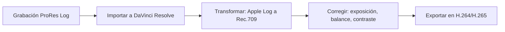

# ProRes y Apple Log en el iPhone 15 Pro

Parte de: [[iPhone 15 Pro para foto y video]]

> [!info] Cómo avanzar
> `progreso`: **pendiente** → **viendo** (estudiando) → **visto** (contestaste la autoevaluación sin abrir las respuestas) → **dominado** (hiciste el laboratorio o lo aplicaste de verdad).

## Contenido

### Qué es
Son dos cosas distintas que suelen usarse juntas:

- **Apple ProRes** es un **códec** de video de alta calidad y poca compresión entre cuadros. Cada cuadro se guarda casi completo, así que la edición es fluida y el color aguanta correcciones fuertes. El precio: archivos enormes.
- **Apple Log** es una **curva de codificación** (una forma de repartir la luz en el archivo) que guarda más información en las luces y sombras. El clip sale **gris y lavado** a propósito y necesita una conversión en la edición.

En la app Cámara del iPhone 15 Pro puedes elegir **ProRes HDR**, **ProRes SDR** o **ProRes Log**. Con [[Blackmagic Camera (app)]] además puedes usar Apple Log con HEVC, que pesa mucho menos.

### Cómo funciona
**Activar**: Ajustes > Cámara > Formatos > Apple ProRes; luego en modo Video tocas el indicador de formato y eliges ProRes Log o ProRes HDR ([Apple 109041](https://support.apple.com/en-us/109041)).

**Límites según almacenamiento** (memoria interna):

| Capacidad | ProRes permitido |
|---|---|
| 128 GB | 1080p a 25/30 fps |
| 256 GB o más | 1080p hasta 60 fps y 4K hasta 30 fps |
| Cualquiera con disco USB-C | 4K a 60 fps grabando directo al disco |

Apple pide además al menos **10 % de espacio libre** y advierte que ProRes puede pesar **hasta 30 veces más que HEVC**. No funciona en modo Cine, cámara lenta ni time-lapse.

**Requisitos del disco externo** para 4K60: escritura de **al menos 220 MB/s**, consumo de **máximo 4.5 W**, formato **exFAT**, sin cifrado con contraseña y cable **USB 3 de 10 Gb/s** o más. Si el disco es lento aparece el aviso de velocidad de grabación lenta.

**Cuánto pesa**: el [white paper de ProRes](https://www.apple.com/cl/final-cut-pro/docs/Apple_ProRes.pdf) da 884 Mb/s para ProRes 422 HQ 4K a 30p. Dividir entre 8 da 110.5 MB/s, unos 6.6 GB por minuto o casi **400 GB por hora**.

**En la edición**: el material Log siempre pasa por una transformación. En DaVinci Resolve puedes aplicar la LUT oficial de Apple Log a Rec.709 o un nodo *Color Space Transform* (de Apple Log a Rec.709 Gamma 2.4) y después corregir. El detalle general está en [[Material Log y LUTs]].

### Ejemplo
Vas a grabar un atardecer de 5 minutos para una pieza que corregirás en Resolve, con un iPhone de 256 GB:

- **Opción A, interna**: ProRes Log 4K30. Cinco minutos son unos 33 GB; caben si tienes espacio y dejas el 10 % libre.
- **Opción B, 4K60**: conectas un SSD que cumpla los 220 MB/s con un cable de 10 Gb/s, lo formateas en exFAT y grabas directo. Un minuto a 4K60 son unos 13.3 GB.
- **Opción C, ligera**: Blackmagic Camera en HEVC con Apple Log. Conservas la curva Log con archivos mucho más pequeños, aunque con más compresión.

Con cualquiera: lente principal 1x, exposición y balance bloqueados, obturación al doble de la cadencia. En casa, LUT de Apple Log a Rec.709 y luego ajustes finos.

### Cuándo usarlo y cuándo no
- **ProRes**: cuando vas a corregir color fuerte, mezclar con otras cámaras o tu PC sufre al decodificar HEVC.
- **Log**: escenas con mucho contraste y cuando sí vas a colorear.
- **No los uses** para videos rápidos que publicas el mismo día, para grabaciones largas sin un disco grande, o si no vas a convertir el Log: HEVC con HDR o SDR se ve mejor sin trabajo.

### Errores comunes
- **Grabar todo en ProRes**: te quedas sin espacio y pasar los archivos tarda horas.
- **Usar un cable USB 2 o un SSD lento** para 4K60: aparece el aviso y se corta la grabación.
- **Publicar el Log sin transformar**: se ve gris y sin vida.
- **Subexponer el Log**: las sombras se llenan de ruido al convertir. Usa zebras y no tengas miedo de exponer un poco más, cuidando las luces.
- **No dejar el 10 % libre** en el iPhone: la opción se desactiva.

### Para profundizar
- [Apple: grabar video ProRes en el iPhone](https://support.apple.com/en-us/109041)
- [Apple ProRes white paper (PDF)](https://www.apple.com/cl/final-cut-pro/docs/Apple_ProRes.pdf)
- [Apple: especificaciones del iPhone 15 Pro](https://support.apple.com/en-us/111829)

## Ejercicios

Resuélvelos en papel o en la herramienta; la solución está plegada.

> [!question]- Apple publica que ProRes 422 HQ 3840×2160 a 30p tiene una tasa objetivo de **884 Mb/s** ([white paper](https://www.apple.com/cl/final-cut-pro/docs/Apple_ProRes.pdf) ). ¿Cuántos MB/s y cuántos GB por minuto son?
> 884 / 8 = **110.5 MB/s**. × 60 s = 6630 MB ≈ **6.6 GB por minuto**.

> [!question]- A 60p la tasa se duplica (**1768 Mb/s**). ¿Cuántos MB/s necesita el disco? Compáralo con el requisito de Apple.
> 1768 / 8 = **221 MB/s**, prácticamente los **220 MB/s** que Apple pide como mínimo de escritura para 4K60. Por eso un SSD lento falla.

> [!question]- ¿Cuántos minutos de ProRes 422 HQ 4K60 caben en un SSD de 1 TB (1000 GB)?
> 1768 Mb/s → 13.26 GB/min. 1000 / 13.26 ≈ **75 minutos** (algo menos en la práctica por el formato del disco).

## Autoevaluación

Contesta primero en voz alta o en papel; luego despliega la respuesta.

> [!question]- ¿Qué resolución ProRes puedes grabar según la capacidad de tu iPhone 15 Pro?
> Según la tabla de [Apple 109041](https://support.apple.com/en-us/109041): **128 GB → solo 1080p a 25/30 fps**; **256 GB o más → 1080p hasta 60 y 4K hasta 30 fps** en la memoria interna; **4K a 60 fps** solo grabando a un disco externo USB-C.

> [!question]- ¿Qué requisitos pide Apple al SSD externo para ProRes 4K60?
> Escritura de **al menos 220 MB/s**, consumo máximo **4.5 W**, formato **exFAT**, sin cifrado con contraseña, y cable **USB 3 de 10 Gb/s** (un cable de carga USB 2 no sirve). Si es lento aparece el aviso de *velocidad de grabación lenta*.

> [!question]- ¿Qué es Apple Log y qué tienes que hacer con ese material en la edición?
> Es una curva logarítmica que guarda más información en luces y sombras: el clip se ve **lavado y gris** a propósito. En DaVinci Resolve aplica la transformación (LUT o Color Space Transform de Apple Log a Rec.709) y luego ajusta. Si no piensas corregir color, mejor graba en HDR o SDR normal.

> [!question]- Caso: tienes el modelo de 128 GB y quieres ProRes en 4K. ¿Qué opciones tienes?
> Conectar un **SSD externo** que cumpla los requisitos de Apple (grabación directa por USB-C) o usar HEVC 4K con Log desde la app Blackmagic Camera. En la memoria interna de 128 GB Apple limita ProRes a 1080p30.

## Práctica

- [[Lab 1 - Conoce tu iPhone 15 Pro (lentes, ProRAW y Blackmagic Camera a 180 grados)]]

