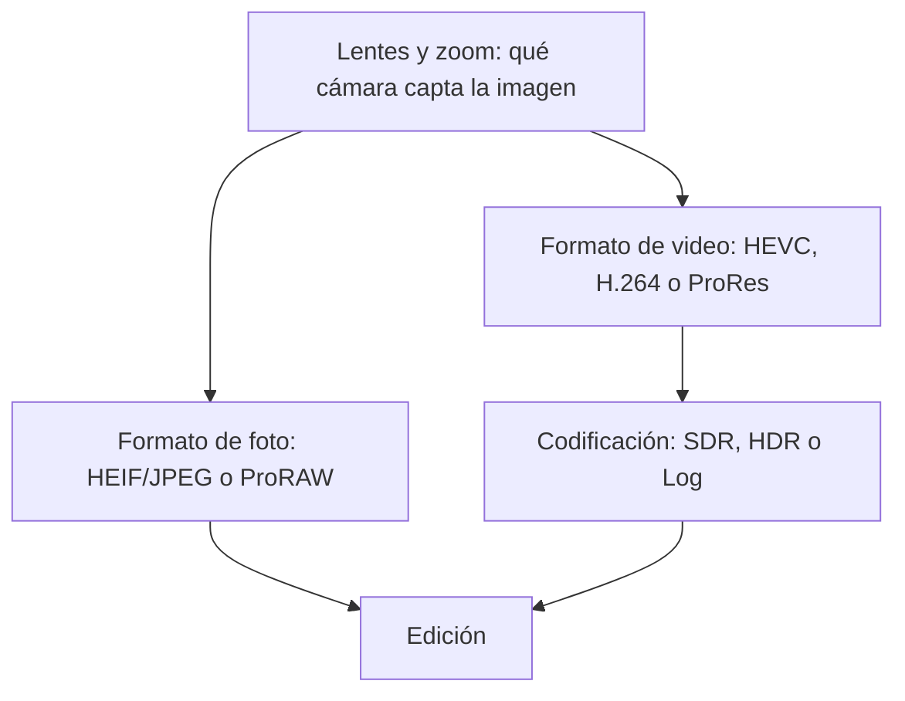

# iPhone 15 Pro para foto y video

Parte de: [[34-Equipo/01 Mi equipo actual/_Índice Mi equipo actual|Mi equipo actual]]

> [!info] Cómo avanzar
> `progreso`: **pendiente** → **viendo** (estudiando) → **visto** (contestaste la autoevaluación sin abrir las respuestas) → **dominado** (hiciste el laboratorio o lo aplicaste de verdad).

## Contenido

### Qué es
El iPhone 15 Pro es tu cámara de todos los días y, bien configurado, una cámara de video seria. Tiene tres cámaras traseras, puede guardar fotos en **ProRAW** y grabar video en **ProRes** con **Log**, y graba directo a un SSD por su puerto USB-C. Esta nota es el mapa: qué tiene el teléfono, cómo se relacionan sus funciones y qué conviene usar según lo que grabas. El detalle de cada pieza está en sus subtemas.

### Cómo funciona
Piensa el iPhone en tres capas que se combinan:



1. **[[Lentes y zoom del iPhone 15 Pro]]**: principal 48 MP, 24 mm, ƒ/1.78 con estabilización por desplazamiento del sensor; ultra gran angular 12 MP, 13 mm, ƒ/2.2; teleobjetivo 3x 12 MP, 77 mm, ƒ/2.8. De la principal salen también 28 mm, 35 mm y el 2x (48 mm). La principal es la de mejor calidad, sobre todo con poca luz.
2. **[[Apple ProRAW en el iPhone 15 Pro]]**: foto en DNG de 12 o 48 MP para revelar; pesa unas 10 veces más que un HEIF.
3. **[[ProRes y Apple Log en el iPhone 15 Pro]]**: video con poca compresión y curva logarítmica para corregir color; pesa hasta 30 veces más que HEVC y tiene límites según la capacidad del teléfono.

**Formatos de video** de la app Cámara según la [ficha de Apple](https://support.apple.com/en-us/111829): 4K a 24/25/30/60 fps, 1080p a 25/30/60, cámara lenta 1080p a 120/240, modo Acción hasta 2.8K a 60, modo Cine hasta 4K HDR a 30, más ProRes y Log.

**Dos apps, dos estilos**: la app Cámara es rápida y automática; [[Blackmagic Camera (app)]] es manual y predecible (obturación en grados, zebras, LUTs, Apple Log también en HEVC).

### Ejemplo
Tres configuraciones que puedes guardar en tu memoria:

| Situación | App | Ajuste |
|---|---|---|
| Diario, viajes, familia | Cámara | HEVC 4K a 30 (o 24), HDR, foto HEIF |
| Atardecer que vas a colorear | Blackmagic Camera | ProRes o HEVC con Apple Log, 1x, 24 fps a 180°, exposición y balance bloqueados |
| Paisaje para imprimir | Cámara | ProRAW 48 MP con la principal a 1x |

En el caso del atardecer, en DaVinci Resolve aplicas primero la transformación de Apple Log a Rec.709 y luego ajustas. Si tu iPhone es de 128 GB, el ProRes interno se limita a 1080p30: para 4K usa un SSD externo o HEVC con Log.

Para el audio, conecta el receptor del [[DJI Mic Mini 2]] al USB-C; para estabilizar, un tripié pequeño o un soporte (ver [[Tripiés y soportes]]).

### Cuándo usarlo y cuándo no
- **Úsalo** como cámara principal mientras llega la a6700: con buena luz rivaliza con cámaras dedicadas, siempre lo traes y su estabilización es muy buena.
- **Sus límites**: apertura fija (necesitas ND para 180° con sol), sensores pequeños en tele y ultra gran angular (sufren con poca luz), sin cambio de lentes y calentamiento en grabaciones largas de ProRes.
- Para profundidad de campo real, poca luz seria o lentes especializadas, ahí entra la [[Sony a6700]].

### Errores comunes
- **Grabar todo en ProRes "porque es mejor"**: llenas el teléfono en minutos y necesitas el 10 % libre para seguir grabando.
- **Usar Log sin convertir en la edición**: se ve gris.
- **Mezclar cadencias** (24 en unas tomas, 30 en otras) en el mismo proyecto: el movimiento se ve irregular al conformar.
- **Hacer zoom digital** más allá de 3x esperando calidad.
- **No respaldar**: pasa el material a la PC y a un segundo disco al final de cada sesión.

### Para profundizar
- [Apple: especificaciones técnicas del iPhone 15 Pro](https://support.apple.com/en-us/111829)
- [Apple: grabar video ProRes](https://support.apple.com/en-us/109041)
- [Apple: acerca de Apple ProRAW](https://support.apple.com/en-us/119916)
- [Blackmagic Camera](https://www.blackmagicdesign.com/products/blackmagiccamera)

## Subtemas

- [[Lentes y zoom del iPhone 15 Pro]]
- [[Apple ProRAW en el iPhone 15 Pro]]
- [[ProRes y Apple Log en el iPhone 15 Pro]]

## Autoevaluación

Contesta primero en voz alta o en papel; luego despliega la respuesta.

> [!question]- ¿Qué cámaras traseras tiene el iPhone 15 Pro y qué equivalencias de distancia focal ofrece?
> Tres módulos: **principal 48 MP, 24 mm, ƒ/1.78** (con estabilización por desplazamiento del sensor), **ultra gran angular 12 MP, 13 mm, ƒ/2.2** (120°) y **teleobjetivo 3x 12 MP, 77 mm, ƒ/2.8**. Del sensor principal salen además los recortes de **28 mm, 35 mm** y el **2x (48 mm)**. Fuente: [ficha técnica de Apple](https://support.apple.com/en-us/111829).

> [!question]- ¿Qué formatos de video graba la app Cámara y cuáles te convienen como principiante?
> 4K a 24/25/30/60 fps, 1080p a 25/30/60, cámara lenta 1080p a 120/240, modo Acción hasta 2.8K60, modo Cine hasta 4K HDR30 y **ProRes** y **Log** ([ficha](https://support.apple.com/en-us/111829)). Para empezar: **HEVC 4K a 30 fps** (o 24) para casi todo; deja ProRes/Log para tomas donde vayas a corregir color y tengas espacio.

> [!question]- Caso: quieres grabar un atardecer y luego corregirlo en DaVinci Resolve. ¿Qué cambias respecto a tu configuración diaria?
> Usa **ProRes Log** (o Apple Log en Blackmagic Camera), lente principal 1x (la de mejor calidad), bloquea exposición/enfoque y balance de blancos, y graba a 24 o 30 fps con obturación a 1/48–1/60 (o 180°). En la edición aplica una LUT de Apple Log a Rec.709 antes de ajustar.

> [!question]- Error común: grabar todo en ProRes "porque es mejor". ¿Por qué es mala idea en un iPhone?
> ProRes pesa **hasta 30 veces más** que HEVC según Apple ([109041](https://support.apple.com/en-us/109041)): llenas el teléfono en minutos, necesitas 10 % de espacio libre para grabar y tardas mucho en pasar los archivos. Úsalo solo cuando aporte (corrección de color fuerte, mezcla con otras cámaras).

## Práctica

- [[Lab 1 - Conoce tu iPhone 15 Pro (lentes, ProRAW y Blackmagic Camera a 180 grados)]]

## Progreso de los subtemas

```base
filters:
  and:
    - file.inFolder("34-Equipo/01 Mi equipo actual/iPhone 15 Pro para foto y video")
    - file.name != "iPhone 15 Pro para foto y video"
views:
  - type: table
    name: Progreso
    order:
      - file.name
      - progreso
      - nivel
```
