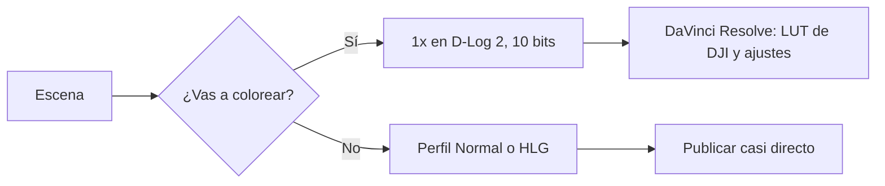

# DJI Osmo Pocket 4P

Parte de: [[34-Equipo/02 Próximo equipo/_Índice Próximo equipo|Próximo equipo]]

> [!info] Cómo avanzar
> `progreso`: **pendiente** → **viendo** (estudiando) → **visto** (contestaste la autoevaluación sin abrir las respuestas) → **dominado** (hiciste el laboratorio o lo aplicaste de verdad).

## Contenido

### Qué es
La DJI Osmo Pocket 4P es una cámara de bolsillo con **gimbal mecánico integrado** y, a diferencia de las Pocket anteriores, **dos cámaras**: una gran angular para casi todo y una de medio tele para retratos y detalles. Sirve para grabar caminando, en viajes y vlogs con imagen estable sin cargar un estabilizador aparte. En tu equipo ocupa el lugar entre el iPhone (siempre contigo, pero sin gimbal) y la a6700 (máxima calidad, más voluminosa).

### Cómo funciona
Datos según la comparación de [Heliguy](https://www.heliguy.com/blogs/knowledge-base/what-are-the-main-differences-between-osmo-pocket-4p-and-osmo-pocket-4/); el [anuncio oficial de DJI](https://www.dji.com/media-center/announcements/dji-debuts-osmo-pocket-4p-cannes) no publica todas las cifras, así que confírmalas en la ficha cuando la tengas (Pendiente de confirmar):

| Cámara | Sensor | Equivalente | Para qué |
|---|---|---|---|
| Gran angular (1x) | 1" apilado | ~20 mm | Vlog, paisaje, interiores, poca luz |
| Medio tele (3x) | 1/1.28", ƒ/1.8 | ~60 mm | Retratos, detalles, fondo comprimido |

- **D-Log 2 de 10 bits** con hasta 17 pasos de rango dinámico según Heliguy, **solo en 1x**. Al pasar al 3x pierdes D-Log 2: graba en perfil Normal o HLG.
- Zoom combinado de hasta 9x en foto y 12x en video (los pasos intermedios son recortes digitales).
- Obturación electrónica hasta 1/16000 s, batería de 1545 mAh y tres micrófonos integrados.
- Peso, almacenamiento y precio en México: (Pendiente de confirmar).

El gimbal estabiliza en tres ejes de forma mecánica: no recorta la imagen como la estabilización electrónica del iPhone, y permite paneos suaves con el joystick o siguiendo un rostro.

### Ejemplo
Te grabas caminando por un mercado mientras explicas qué vas a comer, con el [[DJI Mic Mini 2]]:

1. **Audio**: lo ideal sería la conexión directa OsmoAudio, sin receptor. La [FAQ del Mic Mini 2](https://www.dji.com/mx/mic-mini-2/faq) la confirma para la Osmo Pocket 4 pero no nombra la 4P (Pendiente de confirmar). Cuando la tengas, prueba vincularlos; si no funciona, usa el receptor que corresponda.
2. **Imagen**: 1x, perfil Normal (lo vas a publicar pronto), 4K a 30 fps con obturación a 1/60 si tienes un ND; si no, deja la velocidad más rápida.
3. **Gimbal**: modo de seguimiento con la cámara hacia ti; caminas con pasos cortos para evitar el rebote vertical.
4. **Detalles**: para los platillos cambias al 3x, que separa mejor el plato del fondo.

Si en otro momento grabas un atardecer en la playa con mucho contraste, ahí sí: 1x en D-Log 2 y colorear en Resolve.

### Cuándo usarla y cuándo no
- **Úsala** para vlogs, viajes, caminatas, eventos donde una cámara grande estorba, y tomas en movimiento que con el iPhone temblarían.
- **No es la mejor** para profundidad de campo marcada, poca luz extrema o lentes especializadas: ahí entra la [[Sony a6700]].
- **No necesitas** un gimbal para el iPhone si ya la tienes: la 4P cubre ese papel.
- Para material que no vas a editar, el perfil Normal te ahorra tiempo.

### Errores comunes
- **Grabar todo un viaje en D-Log 2**: cada clip exige corrección de color. Reserva D-Log 2 para escenas de contraste fuerte o proyectos que vas a colorear.
- **Mezclar 1x en D-Log 2 con 3x en Normal sin plan**: los colores no van a coincidir. Si mezclas, iguala en la edición o usa el mismo perfil en ambas.
- **Forzar el gimbal**: girarlo con la mano cuando está encendido daña los motores. Usa el joystick o apágalo antes de guardar.
- **Olvidar la protección del gimbal**: en la mochila, la cámara debe ir en su funda.
- **Confiar en que el Mic Mini 2 se conecta directo**: verifícalo antes de una grabación importante.

### Para profundizar
- [DJI: anuncio de la Osmo Pocket 4P](https://www.dji.com/media-center/announcements/dji-debuts-osmo-pocket-4p-cannes)
- [Heliguy: diferencias entre Osmo Pocket 4P y Pocket 4](https://www.heliguy.com/blogs/knowledge-base/what-are-the-main-differences-between-osmo-pocket-4p-and-osmo-pocket-4/)
- [DJI Mic Mini 2: preguntas frecuentes](https://www.dji.com/mx/mic-mini-2/faq)

## Autoevaluación

Contesta primero en voz alta o en papel; luego despliega la respuesta.

> [!question]- ¿Qué cámaras tiene la Osmo Pocket 4P y para qué sirve cada una?
> Según reseñas especializadas: cámara **1x gran angular (~20 mm equiv.) con sensor de 1"** para casi todo (vlog, paisaje, poca luz) y cámara **3x (~60 mm equiv.) con sensor de 1/1.28" ƒ/1.8** para retratos y detalles con fondo más comprimido. Fuente: [Heliguy](https://www.heliguy.com/blogs/knowledge-base/what-are-the-main-differences-between-osmo-pocket-4p-and-osmo-pocket-4/); el anuncio oficial de DJI ([Cannes](https://www.dji.com/media-center/announcements/dji-debuts-osmo-pocket-4p-cannes)) no da cifras (Pendiente de confirmar).

> [!question]- ¿En qué cámara/zoom está disponible D-Log 2 de 10 bits?
> Solo en **1x** (la cámara gran angular). Si cambias al 3x, graba en el perfil normal o HLG y planea igualar color en la edición. Si mezclas, usa el 3x con luz controlada.

> [!question]- Caso: quieres grabarte caminando y hablando con el DJI Mic Mini 2. ¿Cómo lo conectarías?
> Lo ideal es la conexión directa **OsmoAudio** sin receptor. La [FAQ del Mic Mini 2](https://www.dji.com/mx/mic-mini-2/faq) la confirma para la Osmo Pocket 4, pero no nombra la 4P (Pendiente de confirmar): verifícalo al recibirla; si no, usa el receptor de cámara.

> [!question]- Error común: grabar en D-Log 2 todo un viaje sin tiempo para editar. ¿Qué recomendarías?
> D-Log 2 exige corrección de color en cada clip. Para material de viaje rápido usa el perfil **Normal** (o HLG si vas a publicar en HDR) y reserva D-Log 2 para escenas de mucho contraste o proyectos que vas a colorear en DaVinci Resolve.

