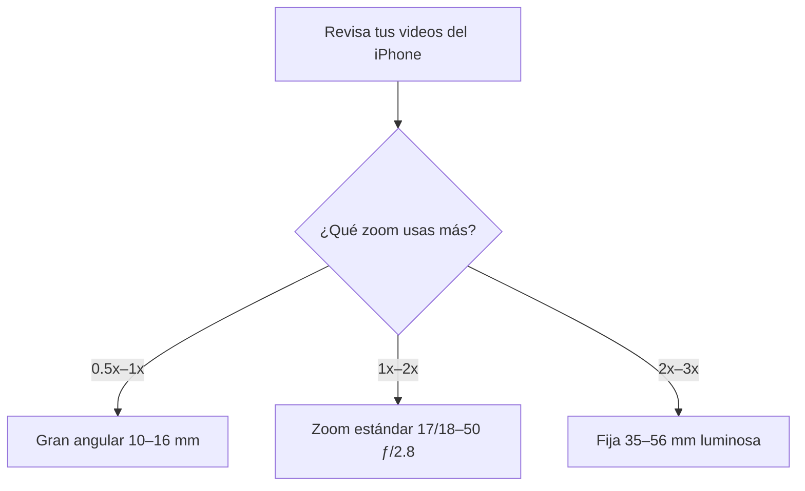

# Lentes para la Sony a6700

Parte de: [[34-Equipo/02 Próximo equipo/_Índice Próximo equipo|Próximo equipo]]

> [!info] Cómo avanzar
> `progreso`: **pendiente** → **viendo** (estudiando) → **visto** (contestaste la autoevaluación sin abrir las respuestas) → **dominado** (hiciste el laboratorio o lo aplicaste de verdad).

## Contenido

### Qué es
La a6700 es una cámara sin espejo de montura **Sony E** con sensor **APS-C**. Eso define qué lentes puedes poner y cómo se van a ver. Elegir lentes es la decisión de compra más importante con una cámara intercambiable: el cuerpo se renueva cada pocos años, las buenas lentes duran mucho más. Esta nota te ayuda a decidir qué necesitas según lo que realmente grabas.

### Cómo funciona
**Factor de recorte.** Un sensor APS-C es más pequeño que uno de formato completo (35 mm), así que "ve" solo el centro de la imagen que proyecta la lente. El efecto práctico es que la focal se comporta como si fuera **~1.5 veces más larga**:

| Focal en la lente | Se ve como (equivalente FF) |
|---|---|
| 10–11 mm | ~15–16.5 mm (vlog con la mano) |
| 16 mm | ~24 mm (como el 1x del iPhone) |
| 18–50 mm | ~27–75 mm (zoom estándar) |
| 35 mm | ~52 mm (visión "natural") |
| 56 mm | ~84 mm (retrato) |

**Monturas compatibles.** Puedes montar lentes **E** (diseñadas para APS-C, más compactas) y **FE** (para formato completo, funcionan perfecto pero suelen ser más grandes y caras).

**Apertura.** Un número ƒ más bajo deja pasar más luz y desenfoca más el fondo. Un zoom ƒ/2.8 constante rinde en interiores; un kit ƒ/3.5–5.6 pierde luz al hacer zoom.

**Estabilización.** La a6700 tiene IBIS de 5 ejes y un modo *Active* para video que **recorta un poco** la imagen: si ya ibas justo de ángulo, el recorte se nota.

### Ejemplo
Vas a comprar tu primera lente. Revisas las fotos y videos del último año en el iPhone y descubres que el 70 % son a 1x (24 mm), un 20 % a 2x y casi nada a 0.5x.

- Tu "1x" en la a6700 es ~16 mm; tu "2x" (48 mm) es ~32 mm. Un **zoom estándar 17/18–50 mm ƒ/2.8** (por ejemplo el Sigma 18-50mm F2.8 DC DN | Contemporary) cubre ambos con luz suficiente para interiores.
- Si en cambio te grabas mucho con la cámara en la mano, a brazo extendido, a 18 mm te verás demasiado cerca; ahí necesitas una lente de **10–11 mm** (por ejemplo la Sony E 11mm F1.8 o un zoom 10–20 mm), que equivale a ~15–16 mm.
- El kit 18-135 mm (versión ILCE-6700M) es versátil para viajes con luz de día, pero es oscuro en interiores.

Compra la segunda lente solo cuando la primera te quede corta en algo concreto: "no me alcanza para el fondo desenfocado en retratos" es una razón; "todos dicen que es buena" no lo es.

### Cuándo usar cada tipo y cuándo no
- **Zoom estándar ƒ/2.8**: primera lente para casi todo. No es el mejor para vlog con la mano (no abre lo suficiente).
- **Gran angular 10–11 mm**: vlogs, interiores chicos, arquitectura. Deforma caras si las pones en los bordes.
- **Fija luminosa (ƒ/1.4–1.8)**: poca luz, retratos con fondo desenfocado, entrevistas. Te obliga a moverte para encuadrar.
- **Tele (70 mm o más)**: deportes, fauna, conciertos. No es prioridad para tu tipo de contenido actual.

### Errores comunes
- **Comprar lentes antes de saber qué grabas**: revisa tu material actual y deja que los datos decidan.
- **Olvidar el factor 1.5x**: una "35 mm" no se verá como en una cámara de formato completo.
- **Comprar solo lentes FE "por si cambio de cámara"**: pagas más peso y precio hoy por un cambio que quizá nunca hagas.
- **Ignorar el recorte del modo Active y de 4K120**: una lente justa de ángulo se vuelve demasiado cerrada.
- **Cambiar lentes en ambientes con polvo o arena**: entra suciedad al sensor. Hazlo de espaldas al viento y con la cámara hacia abajo.

### Para profundizar
- [Sony: especificaciones de la a6700](https://www.sony.co.in/interchangeable-lens-cameras/products/ilce-6700/spec)
- [Sony: comunicado de lanzamiento de la a6700](https://www.sony.eu/presscentre/sony-launches-its-most-advanced-aps-c-camera-ever-a6700-and-versatile-compact-shotgun-microphone-ecm-m1)

## Autoevaluación

Contesta primero en voz alta o en papel; luego despliega la respuesta.

> [!question]- ¿Qué significa que la a6700 sea APS-C para las lentes?
> Multiplica la distancia focal aparente por **~1.5x**: una 16 mm se ve como ~24 mm de formato completo, una 35 mm como ~52 mm. Puedes montar lentes **E** (APS-C) y **FE** (formato completo); las FE funcionan pero suelen ser más grandes.

> [!question]- Si solo pudieras tener una lente para empezar, ¿qué tipo elegirías y por qué?
> Un **zoom estándar luminoso** tipo 17–50 / 18–50 mm **f/2.8** (p. ej. Sigma 18-50mm F2.8 DC DN | C) o, si vas a grabarte mucho, un **gran angular** de 10–11 mm para vlog con la cámara en la mano. El kit 18-135 mm (ILCE-6700M) es versátil pero oscuro (f/3.5–5.6) en interiores.

> [!question]- Caso: grabas vlogs con la cámara en la mano y te ves demasiado cerca. ¿Qué necesitas?
> Una lente de **10–11 mm** (equivale a ~15–16 mm), por ejemplo Sony E 11mm F1.8 o un zoom 10–20 mm. Además, recuerda que el modo *Active* del IBIS recorta un poco más.

> [!question]- Error común: comprar lentes antes de saber qué grabas. ¿Cómo decidir?
> Revisa tus fotos/videos actuales del iPhone: si casi todo es 1x (24 mm) necesitas ~16 mm en APS-C; si usas mucho 3x (77 mm) necesitas ~50 mm. Compra la segunda lente solo cuando la primera te quede corta en algo concreto.

## Práctica

- [[Lab 3 - Primer día con la Sony a6700 (perfiles, LUT y tarjetas)]]

