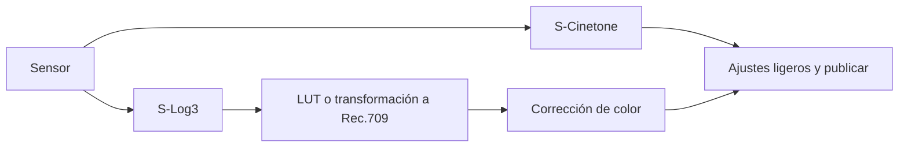

# Sony S-Cinetone y S-Log3

Parte de: [[34-Equipo/02 Próximo equipo/_Índice Próximo equipo|Próximo equipo]]

> [!info] Cómo avanzar
> `progreso`: **pendiente** → **viendo** (estudiando) → **visto** (contestaste la autoevaluación sin abrir las respuestas) → **dominado** (hiciste el laboratorio o lo aplicaste de verdad).

## Contenido

### Qué es
Son dos **perfiles de imagen** de la a6700, es decir, dos formas de convertir lo que capta el sensor en el archivo de video:

- **S-Cinetone** es un perfil "listo para entregar", heredado de las cámaras de cine de Sony: tonos de piel agradables, luces que se apagan suave y contraste moderado. Lo grabas y casi lo puedes publicar tal cual.
- **S-Log3** es una curva **logarítmica**: aplana la imagen para guardar el máximo rango dinámico (Sony habla de más de 14 pasos de latitud). El archivo se ve gris y sin contraste y **siempre** necesita transformación y corrección de color.

### Cómo funciona
Una curva normal reparte los valores del archivo priorizando lo que el ojo ve "bonito"; las luces altas y las sombras profundas se recortan. S-Log3 reparte los valores para que quepan más pasos de luz, a costa de que cada paso tenga menos niveles. Por eso conviene grabarlo en **10 bits**: con 8 bits, al estirar el contraste aparecen bandas en cielos y paredes.

**Exposición de S-Log3.** Se suele **sobreexponer ligeramente** (alrededor de +1 a +1.7 pasos sobre lo que marca el exposímetro) para limpiar las sombras, cuidando que las luces no se quemen; las zebras son tu aliado. El ISO mínimo en S-Log3 es más alto que en los perfiles normales; para la a6700 se reporta ISO 800 (Pendiente de confirmar en la guía de ayuda). Consecuencia: a pleno sol, con obturación al doble de la cadencia, necesitas **filtros ND** (ver [[Filtros ND y Black Mist para video]]).

**LUTs de usuario.** La cámara puede cargar LUTs en formato **.cube** para **ver** en pantalla una conversión a Rec.709 mientras grabas en S-Log3 (o incrustarla en el clip). Así juzgas exposición y color con una imagen normal. Sony documenta que se importan desde la tarjeta y que puedes registrar hasta 16 ([artículo de soporte](https://www.sony.co.in/electronics/support/e-mount-body-ilce-6000-series/articles/00283315); confírmalo para la a6700).

### Ejemplo
**Caso 1: primer video con la a6700, se publica mañana.** Usa **S-Cinetone**, 4K a 24 o 30 fps, obturación a 1/50 o 1/60, balance de blancos fijo. En DaVinci Resolve solo ajustas exposición, un poco de contraste y listo. Grabar S-Log3 aquí te obligaría a colorear todo con prisa y, si lo expones mal, se vería peor que S-Cinetone.

**Caso 2: un atardecer con sol de frente y sombras en primer plano, sin prisa.** Usa **S-Log3** en 10 bits 4:2:2, ISO base del perfil, ND para mantener la obturación, zebras para no quemar el sol más de lo inevitable y una LUT de vista a Rec.709 en la cámara. En Resolve aplicas la transformación de S-Log3/S-Gamut3.Cine a Rec.709 y luego corriges. Recuperas el cielo y las sombras a la vez.

### Cuándo usarlo y cuándo no
- **S-Cinetone**: entregas rápidas, entrevistas, vlogs, eventos, cuando no tienes tiempo de colorear o cuando la luz está controlada.
- **S-Log3**: contraste fuerte, proyectos donde vas a colorear con calma, mezcla con otras cámaras en Log (por ejemplo la Pocket 4P en D-Log 2).
- **Evita S-Log3** en 8 bits, con poca luz (el ISO alto añade ruido) o si no sabes aún exponerlo con zebras.

El panorama general de Log y LUTs está en [[Material Log y LUTs]].

### Errores comunes
- **Exponer S-Log3 "a ojo" en la pantalla**: se ve gris y engaña. Usa zebras o una LUT de vista.
- **Subexponerlo**: al convertir, las sombras se llenan de ruido.
- **Grabar en 8 bits**: aparecen bandas al corregir.
- **Olvidar el ND en exterior**: con el ISO base alto, la imagen se quema o te ves forzado a una velocidad muy rápida.
- **Aplicar una LUT creativa sin transformar primero**: el resultado es impredecible. Primero la transformación técnica, luego el estilo.

### Para profundizar
- [Sony: especificaciones de la a6700](https://www.sony.co.in/interchangeable-lens-cameras/products/ilce-6700/spec)
- [Sony: uso de LUTs de usuario](https://www.sony.co.in/electronics/support/e-mount-body-ilce-6000-series/articles/00283315)
- [Sony: comunicado de lanzamiento de la a6700](https://www.sony.eu/presscentre/sony-launches-its-most-advanced-aps-c-camera-ever-a6700-and-versatile-compact-shotgun-microphone-ecm-m1)

## Autoevaluación

Contesta primero en voz alta o en papel; luego despliega la respuesta.

> [!question]- ¿Qué diferencia hay entre S-Cinetone y S-Log3?
> **S-Cinetone**: perfil "listo para entregar" con tonos de piel agradables y luces suaves; casi no necesita corrección. **S-Log3**: curva logarítmica plana que guarda el máximo rango dinámico (Sony indica **más de 14 pasos** de latitud); siempre necesita transformación y corrección de color.

> [!question]- ¿Cómo se expone S-Log3 y qué ISO mínimo tiene?
> Se suele **sobreexponer ligeramente** (+1 a +1.7 pasos sobre lo que marca el exposímetro) para limpiar sombras, cuidando que las luces no se quemen. El ISO base en S-Log3 es más alto que en perfiles normales (en la a6700 se habla de **ISO 800** (Pendiente de confirmar)), así que en exterior necesitas ND.

> [!question]- ¿Para qué sirven las LUTs de usuario en la cámara?
> Para **ver** (o incrustar) una conversión a Rec.709 mientras grabas en S-Log3, y juzgar exposición y color. Se importan en **.cube** desde la tarjeta (carpeta `PRIVATE/SONY/PRO/LUT` en SD) y Sony permite registrar hasta **16 LUTs** de usuario ([artículo de soporte Sony](https://www.sony.co.in/electronics/support/e-mount-body-ilce-6000-series/articles/00283315); confírmalo en la guía de la a6700).

> [!question]- Caso: es tu primer video con la a6700 y lo vas a publicar mañana. ¿Qué perfil usas?
> **S-Cinetone**. S-Log3 vale la pena cuando tienes contraste fuerte, tiempo para colorear y buena exposición; mal expuesto se ve peor que un perfil normal. Ver [[Material Log y LUTs]].

## Práctica

- [[Lab 3 - Primer día con la Sony a6700 (perfiles, LUT y tarjetas)]]

