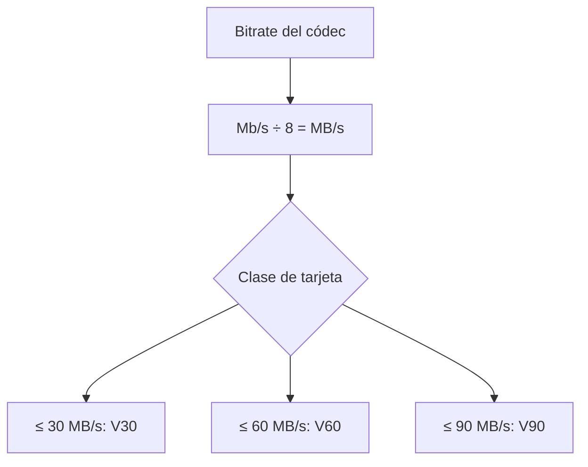

# Sony a6700

Parte de: [[34-Equipo/02 Próximo equipo/_Índice Próximo equipo|Próximo equipo]]

> [!info] Cómo avanzar
> `progreso`: **pendiente** → **viendo** (estudiando) → **visto** (contestaste la autoevaluación sin abrir las respuestas) → **dominado** (hiciste el laboratorio o lo aplicaste de verdad).

## Contenido

### Qué es
La Sony a6700 es una cámara sin espejo APS-C de lentes intercambiables, pensada tanto para foto como para video. Es tu próximo paso en calidad: sensor mucho más grande que el del iPhone, lentes que cambian el look, autoenfoque muy confiable y perfiles de cine. Lo que ganas en imagen lo pagas en tamaño, peso y en tener que decidir más cosas.

### Cómo funciona
**Cinco datos clave** ([comunicado de Sony](https://www.sony.eu/presscentre/sony-launches-its-most-advanced-aps-c-camera-ever-a6700-and-versatile-compact-shotgun-microphone-ecm-m1) y [especificaciones](https://www.sony.co.in/interchangeable-lens-cameras/products/ilce-6700/spec)):

1. Sensor **APS-C de ~26 MP**: ver [[Lentes para la Sony a6700]] para el factor 1.5x.
2. **IBIS de 5 ejes**, con modo *Active* para video que recorta un poco.
3. Video **4K hasta 120p** (con recorte del sensor; el factor exacto está (Pendiente de confirmar)) y 4K sobremuestreado desde datos equivalentes a 6K (en qué cadencias aplica: (Pendiente de confirmar)).
4. Perfiles **S-Cinetone y S-Log3**: ver [[Sony S-Cinetone y S-Log3]].
5. **Una ranura SD UHS-I/II** y batería NP-FZ100.

**Códecs**:

| Códec | Compresión | Uso |
|---|---|---|
| XAVC S (H.264) | Entre cuadros | Empezar: 4K 24/30p, fácil de editar |
| XAVC HS (H.265) | Entre cuadros, más eficiente | Archivos pequeños, 4K120; exige más a la PC |
| XAVC S-I (intra) | Cada cuadro completo, hasta 600 Mbps en 4K60 | Edición fluida y máxima calidad; archivos enormes |

### Ejemplo
**Primer día de video** (lo practicarás en el [[Lab 3 - Primer día con la Sony a6700 (perfiles, LUT y tarjetas)]]):

- Modo **M** (o prioridad de apertura mientras aprendes).
- Perfil **S-Cinetone**, XAVC S 4K a 24 o 30p.
- Obturación **1/50 en 24p** o **1/60 en 30p**; ND si hay sol.
- ISO automático con un límite superior razonable.
- Enfoque **AF-C** con reconocimiento de rostro/ojo.
- Zebras al 95–100 %.
- Balance de blancos fijo (no automático).
- Audio: el receptor de cámara del [[DJI Mic Mini 2]] a la entrada de micrófono de 3.5 mm.

**Evento largo**: la NP-FZ100 da, según CIPA, alrededor de 95–100 minutos de grabación real. Lleva una batería de repuesto o alimenta por USB-C PD. Tarjeta: 10 bits a 200 Mbps son 25 MB/s, pero conviene **V60** por margen; XAVC S-I a 600 Mbps son 75 MB/s y exige **V90** (4.5 GB por minuto). Ver [[Tarjetas de memoria (clases de velocidad)]].

**Cámara lenta**: si grabas 4K120 y el encuadre se cierra, es el recorte del sensor. Usa una lente más abierta o graba 1080p120.

### Cuándo usarla y cuándo no
- **Úsala** en entrevistas, retratos, poca luz, cuando quieres fondo desenfocado y en proyectos donde la calidad de imagen manda.
- **No la saques** para tomas rápidas donde el iPhone o la [[DJI Osmo Pocket 4P]] resuelven sin llamar la atención.
- En la calle, su tamaño la hace más visible: cuida tu seguridad (ver [[Cuidado del equipo en viaje, calle y lluvia]]).

### Errores comunes
- **Una sola batería en un evento**: te quedas sin cámara a la hora y media.
- **Tarjeta lenta**: con XAVC S-I o 4K120 la grabación se corta.
- **Dejar balance de blancos en automático**: el color cambia entre tomas.
- **Grabar en XAVC HS sin probar la PC**: H.265 de 10 bits 4:2:2 es pesado de decodificar; prueba antes o usa proxies.
- **S-Log3 en el primer proyecto con prisa**: usa S-Cinetone.

### Para profundizar
- [Sony: especificaciones de la a6700](https://www.sony.co.in/interchangeable-lens-cameras/products/ilce-6700/spec)
- [Sony: comunicado de lanzamiento](https://www.sony.eu/presscentre/sony-launches-its-most-advanced-aps-c-camera-ever-a6700-and-versatile-compact-shotgun-microphone-ecm-m1)
- [SD Association: clases de velocidad para video](https://www.sdcard.org/consumers/about-sd-memory-card-choices/speed-class-standards-for-video-recording/)

## Autoevaluación

Contesta primero en voz alta o en papel; luego despliega la respuesta.

> [!question]- Resume la Sony a6700 en cinco datos.
> Sensor **APS-C de ~26 MP**, estabilización en el cuerpo de **5 ejes** (IBIS, más modo *Active* para video con ligero recorte), video **4K hasta 120p** (con recorte del sensor) y 4K sobremuestreado a partir de datos equivalentes a **6K** (Sony no detalla en el comunicado en qué cadencias aplica; se reporta 4K60 (Pendiente de confirmar)), perfiles **S-Cinetone y S-Log3**, una ranura **SD UHS-I/II**. Fuentes: [comunicado Sony](https://www.sony.eu/presscentre/sony-launches-its-most-advanced-aps-c-camera-ever-a6700-and-versatile-compact-shotgun-microphone-ecm-m1) · [especificaciones](https://www.sony.co.in/interchangeable-lens-cameras/products/ilce-6700/spec).

> [!question]- ¿Qué códecs tiene y cuál usar al empezar?
> XAVC HS (H.265), XAVC S (H.264) y XAVC S-I (intra, hasta **600 Mbps** en 4K60) ([especificaciones](https://www.sony.co.in/interchangeable-lens-cameras/products/ilce-6700/spec)). Para empezar: **XAVC S 4K 24/30p** a 100 Mbps o 10 bits 4:2:2 cuando vayas a colorear; XAVC S-I solo si tu PC y tus tarjetas lo aguantan (son archivos enormes).

> [!question]- Ajustes recomendados para tu primer día de video.
> Modo **M** o prioridad de apertura; **S-Cinetone** (se ve bien sin corregir); obturación a **1/50 en 24p o 1/60 en 30p**; ISO automático con límite; enfoque **AF-C** con reconocimiento de rostro/ojo; zebras al 95–100 %; balance de blancos fijo (no AWB) y audio con el Mic Mini 2 por el receptor de 3.5 mm a la entrada de micrófono.

> [!question]- Caso: grabas 4K a 120p y notas que el encuadre se cerró. ¿Por qué?
> 4K120 usa un **recorte del sensor** (el factor exacto (Pendiente de confirmar)): tu lente se ve más cerrada que en 4K60. Mídelo en el Lab 3. Si necesitas angular en cámara lenta, usa una lente más abierta o graba 1080p120.

> [!question]- Error común: usar la a6700 con la batería que trae y una tarjeta lenta en un evento largo. ¿Qué te faltará?
> Batería: CIPA da ~**95–100 min de grabación real** con una NP-FZ100 ([especificaciones](https://www.sony.co.in/interchangeable-lens-cameras/products/ilce-6700/spec)); lleva una de repuesto o carga por USB-C PD. Tarjeta: para 4K 10 bits a 200 Mbps usa al menos **V60**; para XAVC S-I, **V90** (ver [[Tarjetas de memoria (clases de velocidad)]]).

## Práctica

- [[Lab 3 - Primer día con la Sony a6700 (perfiles, LUT y tarjetas)]]

