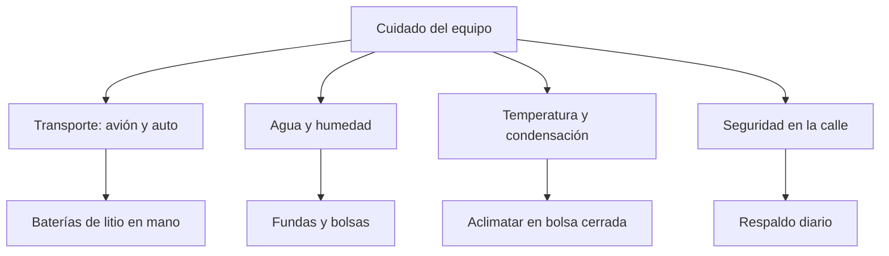

# Cuidado del equipo en viaje, calle y lluvia

Parte de: [[34-Equipo/03 Compras y accesorios/_Índice Compras y accesorios|Compras y accesorios]]

> [!info] Cómo avanzar
> `progreso`: **pendiente** → **viendo** (estudiando) → **visto** (contestaste la autoevaluación sin abrir las respuestas) → **dominado** (hiciste el laboratorio o lo aplicaste de verdad).

## Contenido

### Qué es
Cuidar el equipo es un conjunto de hábitos para que tus cámaras, el dron y sus baterías lleguen enteros al destino, no se dañen con agua, calor o condensación, y no te los roben en la calle. También incluye proteger el **trabajo**: un equipo se reemplaza; las grabaciones de un viaje, no.

### Cómo funciona
Hay cuatro frentes:

**1. Avión.** Las baterías de litio (dron, cámara, power bank) van en el **equipaje de mano**, nunca documentadas, con terminales protegidas (su caja, bolsas separadas o un estuche ignífugo). La batería del Mini 4K es de **17.32 Wh** según DJI, muy por debajo del umbral de 100 Wh que suelen manejar las aerolíneas, pero cada aerolínea tiene sus reglas: revísalas antes. Para el dron, DJI sugiere transportar las baterías con carga baja (menos de ~30 %). Más detalle en [[Baterías de dron (cuidado y viajes)]].

**2. Agua.** El iPhone 15 Pro tiene clasificación **IP68** (Apple: hasta 6 m durante 30 minutos), pero Apple no cubre daños por líquido. El Mini 4K, el Mic Mini 2 y la a6700 no tienen clasificación IP publicada en sus fichas, y la de la Pocket 4P está (Pendiente de confirmar). Regla práctica: si llueve, todo lo que no sea el iPhone va en funda o bolsa, y el dron **no vuela**.

**3. Condensación.** Al pasar del aire acondicionado al calor húmedo, el equipo frío condensa agua por fuera y por dentro de la lente. Lo correcto es dejar que se aclimate **dentro de una bolsa cerrada** o la mochila: la humedad se forma en la bolsa, no en la lente. No limpies a la fuerza el interior ni guardes el equipo húmedo; un sobre de sílica gel en la mochila ayuda.

**4. Calle.** Correa cruzada, mochila con el cierre hacia la espalda, cámara guardada entre tomas, nunca dejar el equipo visible en el auto y respaldar al final del día.

### Ejemplo
Viaje de cuatro días a Oaxaca con iPhone, Mini 4K, Mic Mini 2 y una mochila:

- **Antes**: revisas las reglas de tu aerolínea para baterías; bajas las del dron a ~30 %; cada batería en su bolsa o en el estuche del Fly More.
- **En el aeropuerto**: dron, baterías, estuche del micrófono y power bank en la mochila de mano.
- **En la calle**: mochila al frente en el mercado; sacas la cámara solo para la toma.
- **Al salir del hotel con aire acondicionado** a la calle húmeda: la mochila cerrada 15–20 minutos antes de sacar el equipo.
- **Cada noche**: copias tarjetas y teléfono a un SSD y subes lo más importante a la nube si hay buena conexión. Si te roban la mochila al día siguiente, pierdes equipo, no el viaje.

### Cuándo aplicar cada medida
- **Siempre**: baterías en mano, respaldo diario, correa.
- **Clima húmedo o cambios bruscos de temperatura**: aclimatar en bolsa, sílica gel.
- **Lluvia ligera**: funda para cámara y micrófono; el dron se queda en la mochila.
- **Equipo de valor alto**: considera un seguro para equipo; las condiciones dependen de la aseguradora.

### Errores comunes
- **Documentar baterías** en la maleta: está prohibido en la mayoría de los vuelos y es peligroso.
- **Limpiar la condensación con la camiseta**: rayas la lente y no quitas la humedad interna.
- **Confiar en el IP68 del iPhone en agua salada o con presión**: Apple no cubre ese daño.
- **Cámara colgada y mochila abierta** en zonas concurridas: invitación al robo.
- **No respaldar en el viaje**: el riesgo de perder todo se acumula día a día. Ver [[Respaldo 3-2-1 de fotos y videos]].

### Para profundizar
- [Apple: especificaciones del iPhone 15 Pro (resistencia al agua)](https://support.apple.com/en-us/111829)
- [DJI: especificaciones del Mini 4K (batería)](https://www.dji.com/mini-2-se/specs)
- [Manual del DJI Mini 4K (PDF)](https://dl.djicdn.com/downloads/DJI_Mini_4K/20260427/DJI_Mini_4K_User_Manual_v1.0_zh-cn.pdf)

## Autoevaluación

Contesta primero en voz alta o en papel; luego despliega la respuesta.

> [!question]- ¿Dónde van las baterías de litio (dron, cámara, power bank) al volar en avión?
> En el **equipaje de mano**, con terminales protegidas (en su caja o bolsas separadas) y, para el dron, con carga baja (DJI sugiere bajar de ~30 % para transporte). Las reglas exactas de Wh dependen de la aerolínea: revísalas antes de volar.

> [!question]- ¿Qué tanto aguanta el agua tu equipo?
> El iPhone 15 Pro tiene clasificación **IP68** (Apple: hasta 6 m por 30 min) pero Apple no cubre daño por líquido. El Mini 4K, el Mic Mini 2, la Pocket 4P y la a6700 **no tienen clasificación IP** publicada en sus fichas: protégelos con funda/bolsa y no vueles con lluvia ((Pendiente de confirmar) para Pocket 4P).

> [!question]- Caso: pasas de un auto con aire acondicionado al calor húmedo y la lente se empaña. ¿Qué haces?
> Espera a que el equipo se aclimate (dentro de una bolsa cerrada para que la condensación se forme en la bolsa), no limpies a la fuerza el interior y no lo guardes húmedo.

> [!question]- Error común en la calle: llevar la cámara colgada y la mochila abierta. ¿Qué prácticas te protegen?
> Correa cruzada, mochila con cierre hacia la espalda, no dejar el equipo en el auto a la vista, respaldar al final del día (si te roban, que no se lleven el trabajo) y un seguro si el equipo vale mucho.

