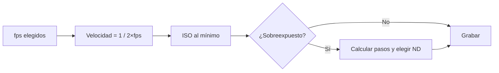

# Filtros ND y Black Mist para video

Parte de: [[34-Equipo/03 Compras y accesorios/_Índice Compras y accesorios|Compras y accesorios]]

> [!info] Cómo avanzar
> `progreso`: **pendiente** → **viendo** (estudiando) → **visto** (contestaste la autoevaluación sin abrir las respuestas) → **dominado** (hiciste el laboratorio o lo aplicaste de verdad).

## Contenido

### Qué es
Un **filtro ND** (densidad neutra) es un "lente de sol" para la cámara: reduce la cantidad de luz que entra **sin cambiar el color**. Sirve para mantener una velocidad de obturación lenta (la de la regla de 180°) aunque haya mucho sol, sobre todo en equipos de **apertura fija** como el iPhone, el Mini 4K y la Pocket 4P. Un filtro **Black Mist** es otra cosa: un filtro de difusión que suaviza las altas luces con un ligero halo y baja un poco el contraste para un look más de cine.

### Cómo funciona
**Pasos de luz.** Cada "paso" divide la luz a la mitad. El número del ND dice entre cuánto divide:

| Filtro | Factor | Pasos |
|---|---|---|
| ND8 | 1/8 | 3 |
| ND16 | 1/16 | 4 |
| ND32 | 1/32 | 5 |
| ND64 | 1/64 | 6 |

Para saber cuál necesitas: **pasos = log₂(velocidad correcta sin filtro ÷ velocidad que quieres)**. Si la cámara expone bien a 1/2000 y quieres 1/60, son log₂(2000/60) ≈ 5.1 pasos: un **ND32**. Si ya tienes un ND16 y sigues 2 pasos sobreexpuesto, necesitas 4 + 2 = 6 pasos: **ND64**.

**Por qué importa.** Con la [[Regla de los 180 grados del obturador]], la velocidad es el doble de la cadencia: 24 fps → 1/48 (1/50), 30 fps → 1/60, 60 fps → 1/120 (1/125). Esa velocidad da un desenfoque de movimiento natural. Sin ND, a pleno sol la cámara sube la velocidad a 1/2000 o más y el movimiento se ve "entrecortado".

**ND variable.** Dos polarizadores que giran uno sobre otro para cambiar la densidad. Prácticos, pero cerca de su extremo producen una **cruz o X oscura** y manchas de color (polarización cruzada), sobre todo con angulares. Úsalos lejos del máximo, o usa fijos.

**Black Mist.** Viene en intensidades (por ejemplo 1/8, 1/4). Suaviza piel y altas luces, y crea halos alrededor de fuentes de luz. **No se puede quitar** en la edición.

### Ejemplo
**Mini 4K al mediodía.** ƒ/2.8 fija, ISO 100. Por la regla del "sol 16", la exposición correcta sería ~1/3200 s. Quieres 4K30 a 1/60: log₂(3200/60) ≈ 5.7 pasos. **ND64** te deja ~0.3 paso abajo (fácil de compensar); ND32 te dejaría ~0.7 arriba. Eliges ND64 y fijas la exposición en **manual**.

**iPhone en la calle.** Con Blackmagic Camera a 24 fps y 180° (1/48), un ND variable de clip te permite ajustar entre sombra y sol. Si pasas a 60 fps (1/120), entra 1.3 pasos menos de luz: quizá necesites menos densidad.

**Entrevista nocturna con luces de ciudad** en la a6700: un Black Mist 1/8 suaviza la piel y da halos bonitos a los focos del fondo. En paisaje diurno lo quitas.

### Cuándo usarlos y cuándo no
- **ND**: exterior con sol, apertura fija, cuando quieres 180° o abrir el diafragma en una cámara que sí lo tiene. **No** en interiores oscuros ni de noche.
- **Black Mist**: retratos, ambientes nocturnos, look cinematográfico. **No** cuando buscas nitidez máxima (paisaje, producto, arquitectura) ni si te molestan los halos.

### Errores comunes
- **ND con exposición automática**: la cámara compensa y pierdes el efecto. Usa manual.
- **ND variable al máximo**: aparece la cruz oscura.
- **Filtros baratos**: dominantes de color (magenta o verde) y pérdida de nitidez.
- **En el dron, filtros de terceros pesados**: pueden afectar el gimbal y el peso total, que no debe pasar de 250 g.
- **Black Mist en todo**: no hay vuelta atrás en la edición.

### Para profundizar
- [DJI: especificaciones del Mini 4K (apertura y obturación)](https://www.dji.com/mini-2-se/specs)
- [Blackmagic Camera: especificaciones (ángulo de obturación)](https://www.blackmagicdesign.com/products/blackmagiccamera/techspecs)
- Nota relacionada: [[Filtros ND en video]]

## Ejercicios

Resuélvelos en papel o en la herramienta; la solución está plegada.

> [!question]- Mini 4K (ƒ/2.8 fija) a ISO 100 con sol: por la regla del "sol 16" la exposición correcta sería ~1/3200 s a ƒ/2.8. Quieres 1/60 (30 fps). ¿Qué ND necesitas?
> log₂(3200 / 60) ≈ **5.7 pasos** → el más cercano es **ND64 (6 pasos)** (quedas ~0.3 paso subexpuesto, fácil de compensar); con ND32 quedarías ~0.7 paso sobreexpuesto.

> [!question]- Grabas a 24 fps a 180°. ¿Qué velocidad buscas y cuánto cambia si pasas a 60 fps?
> 24 fps → **1/48** (1/50 en cámaras que no tienen 1/48). 60 fps → **1/120** (≈1/125): entra **1.3 pasos menos** de luz (log₂(120/48) ≈ 1.32), quizá necesites un ND más suave.

> [!question]- Tienes un ND16 y la imagen sigue sobreexpuesta 2 pasos. ¿Qué filtro total necesitarías?
> 4 + 2 = 6 pasos → **ND64**.

## Autoevaluación

Contesta primero en voz alta o en papel; luego despliega la respuesta.

> [!question]- ¿Para qué sirve un filtro ND en video?
> Reduce la luz que entra **sin cambiar el color** para poder usar la obturación de **180°** (1/48–1/60) con sol, sobre todo en equipos de **apertura fija** como el iPhone, el Mini 4K o la Pocket 4P. Ver [[Filtros ND en video]].

> [!question]- ¿Cómo se traduce ND8, ND16, ND32, ND64 a pasos de luz?
> ND8 = 3 pasos, ND16 = 4, ND32 = 5, ND64 = 6 (cada paso divide la luz a la mitad: 2³ = 8, 2⁶ = 64).

> [!question]- ¿Qué hace un filtro Black Mist y cuándo NO usarlo?
> Suaviza las altas luces con un halo y baja un poco el contraste para un look más "de cine". No lo uses si quieres nitidez máxima (paisaje, producto) ni en tomas con fuentes de luz fuertes si no te gusta el halo; no se puede quitar en la edición.

> [!question]- Error común: usar un ND variable al máximo. ¿Qué artefacto aparece?
> Una **cruz o X oscura** y manchas de color (polarización cruzada), sobre todo con angulares. Usa el ND variable lejos de su extremo o filtros fijos.

