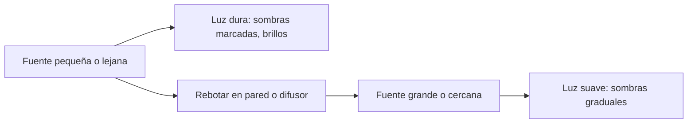

# Luces LED portátiles

Parte de: [[34-Equipo/03 Compras y accesorios/_Índice Compras y accesorios|Compras y accesorios]]

> [!info] Cómo avanzar
> `progreso`: **pendiente** → **viendo** (estudiando) → **visto** (contestaste la autoevaluación sin abrir las respuestas) → **dominado** (hiciste el laboratorio o lo aplicaste de verdad).

## Contenido

### Qué es
Una luz LED portátil es un panel o lámpara pequeña, normalmente con batería o alimentación USB-C, que añades a la escena para iluminar una cara, un producto o un rincón oscuro. Junto con el audio, la luz es lo que más mejora un video casero: una cámara modesta con buena luz se ve mejor que una cámara cara con mala luz. El reto no es encenderla, sino que se vea **natural**.

### Cómo funciona
**Qué revisar al comprar**:

| Especificación | Qué significa | Busca |
|---|---|---|
| CRI / TLCI | Qué tan fiel reproduce los colores | 95 o más |
| Temperatura de color | Del cálido (≈3200 K) al día (≈5600 K) | Bicolor ajustable |
| Potencia / brillo | Cuánta luz da a cierta distancia | Suficiente para 1–2 m |
| Regulación | Bajar intensidad sin parpadeo | Sin *flicker* a tu cadencia |
| Alimentación | Batería interna, USB-C, NP-F | USB-C para cargar con tu power bank |

Un CRI bajo hace que la piel se vea verdosa o grisácea, y no se arregla bien con corrección de color.

**Luz dura y luz suave.** El tamaño de la fuente **respecto al sujeto** define la calidad:

Por eso una ventana grande con luz indirecta suele verse mejor que una luz LED de bolsillo: la ventana es una fuente enorme. Para suavizar una LED pequeña: **rebótala** en una pared o techo blanco, ponle un difusor o acércala lo más que puedas sin que salga en cuadro.

**Mezcla de temperaturas.** La cámara solo puede tener un balance de blancos. Si la cara tiene luz de 5600 K y el fondo focos cálidos de 2700–3000 K, uno de los dos va a verse mal.

### Ejemplo
Grabas un tutorial sentado en tu escritorio, de noche, con el iPhone en un tripié y el [[DJI Mic Mini 2]]:

1. **Apaga o iguala** la luz del techo: si es cálida, pon la LED en ~3200 K; si prefieres luz de día, apaga los focos y usa solo la LED en ~5600 K.
2. **Luz principal**: la LED a 45° de tu cara y un poco arriba de los ojos, rebotada en la pared o con difusor.
3. **Relleno**: una hoja blanca o la pantalla del monitor del otro lado suaviza las sombras.
4. **Separación**: una tira LED o una lámpara cálida detrás de ti, fuera de cuadro, da profundidad al fondo.
5. En [[Blackmagic Camera (app)]], **fija el balance de blancos** a la temperatura de la LED y revisa que no haya parpadeo a 24 o 30 fps.

### Cuándo usarla y cuándo no
- **Úsala** en interiores de noche, para rellenar sombras en una entrevista, para producto, o para separar al sujeto del fondo.
- **No la necesitas** si tienes una ventana grande con luz indirecta: aprovéchala primero.
- **En exterior a pleno sol** una LED pequeña casi no se nota; mejor un reflector (rebotador) o buscar sombra.
- **Evita** usarla directa y de frente: aplana la cara y produce brillos.

### Errores comunes
- **Luz directa y de frente**: cara plana y brillosa. Rebota o difumina.
- **Mezclar 5600 K con focos cálidos**: dominantes distintas en cara y fondo.
- **CRI bajo**: piel verdosa difícil de corregir.
- **Atenuar demasiado y ver parpadeo**: algunas LEDs baratas parpadean a baja intensidad; pruébala grabando.
- **Balance de blancos automático**: cambia mientras te mueves. Fíjalo.

### Para profundizar
- [Blackmagic Camera: especificaciones (balance de blancos y monitoreo)](https://www.blackmagicdesign.com/products/blackmagiccamera/techspecs)
- [Apple: especificaciones del iPhone 15 Pro](https://support.apple.com/en-us/111829)

## Autoevaluación

Contesta primero en voz alta o en papel; luego despliega la respuesta.

> [!question]- ¿Qué especificaciones revisar en una luz LED para video?
> **Índice de reproducción cromática (CRI/TLCI ≥ 95)** para que la piel no se vea verdosa, **bicolor** (≈3200–5600 K) para igualar luz cálida o de día, potencia suficiente, regulación sin parpadeo y batería o alimentación por USB-C.

> [!question]- ¿Por qué una luz pequeña puede verse peor que la luz de una ventana?
> Una fuente pequeña es **luz dura**: sombras marcadas y brillos en la piel. Rebota la luz en una pared/techo blanco o usa un difusor para hacerla más grande y suave.

> [!question]- Error común: mezclar una LED de 5600 K con focos cálidos de casa. ¿Qué pasa?
> Dominantes de color distintas en la cara y en el fondo que no se corrigen con un solo balance de blancos. Iguala temperaturas (pon la LED en cálido o apaga los focos).

