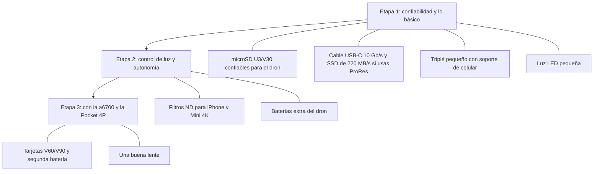

# Qué comprar primero (guía para principiantes)

Parte de: [[34-Equipo/03 Compras y accesorios/_Índice Compras y accesorios|Compras y accesorios]]

> [!info] Cómo avanzar
> `progreso`: **pendiente** → **viendo** (estudiando) → **visto** (contestaste la autoevaluación sin abrir las respuestas) → **dominado** (hiciste el laboratorio o lo aplicaste de verdad).

## Contenido

### Qué es
Una guía para decidir **en qué orden** gastar en accesorios. Ya tienes un buen equipo base (iPhone 15 Pro, DJI Mic Mini 2 y DJI Mini 4K) y vendrán la Osmo Pocket 4P y la a6700. El error típico es comprar lo que se ve emocionante (otra cámara, una lente) antes de lo que más mejora el resultado. La regla: **gasta primero en lo que hoy te limita**, y empieza por audio, luz, almacenamiento y seguridad del material.

### Cómo funciona
**Por qué audio antes que imagen.** El público tolera una imagen regular, pero abandona un video con voz sucia, lejana o con eco. Ya tienes el Mic Mini 2: aprender a colocarlo y ajustar niveles rinde más que cualquier lente nueva.

**Etapas recomendadas**:

**Preguntas para decidir cada compra**:
1. ¿Qué me falló o me limitó en mis últimas tres grabaciones?
2. ¿Esto lo resuelve, o es un "por si acaso"?
3. ¿Lo voy a usar en el próximo mes?
4. ¿Algo que ya viene en camino lo hace innecesario?

### Ejemplo
**Gimbal para el iPhone o SSD externo.** Revisas tus últimos videos: las tomas caminando tiemblan poco (el iPhone estabiliza bastante), pero varias veces te quedaste sin espacio y quieres probar ProRes 4K60. El SSD resuelve un límite real hoy. Además, la Pocket 4P ya trae gimbal: comprar uno para el iPhone perdería sentido en cuanto llegue. Decisión: **SSD** que cumpla los requisitos de Apple (ver [[SSD externo para grabar y respaldar]]).

**Accesorios para el dron.** Te ofrecen un kit genérico con protectores de hélice, luces LED y un soporte para gimbal. El Mini 4K pesa **246 g**: con solo 4 g de margen, cualquier accesorio puede pasarlo de **250 g**. Entonces ya requiere registro ante la autoridad y pierde la excepción de volar sobre personas de la NOM-107. Antes de usarlos, **pésalo con todo puesto**; si pasa, vuela sin ellos. Ver [[NOM-107-SCT3-2019 y registro ante la AFAC]].

**Tarjetas.** Con 100 Mbps, el Mini 4K usa 12.5 MB/s: una microSD U3/V30 de marca conocida sobra. No compres V90 para el dron; guárdalo para la a6700 (ver [[Tarjetas de memoria (clases de velocidad)]]).

### Cuándo comprar y cuándo esperar
- **Compra** cuando el límite es concreto y repetido.
- **Espera** si en semanas llega equipo que lo cubre (Pocket 4P con gimbal, a6700 con mejor sensor).
- **Prioriza lo que protege el trabajo** (tarjetas confiables, respaldo) sobre lo que lo embellece.
- **Compra lo original** en accesorios del dron (hélices, baterías): la seguridad de vuelo depende de ellos.

### Errores comunes
- **Comprar una cámara nueva antes que luz y audio**.
- **Accesorios genéricos para el dron sin pesarlo**: riesgo legal y de vuelo.
- **Tarjetas baratas o falsas**: cortes de grabación y archivos corruptos.
- **Comprar "el kit completo"** de una vez: la mitad no se usa.
- **Olvidar el respaldo**: sin un segundo disco, todo lo demás está en riesgo. Ver [[Respaldo 3-2-1 de fotos y videos]].

### Para profundizar
- [DJI: especificaciones del Mini 4K (peso de despegue)](https://www.dji.com/mini-2-se/specs)
- [NOM-107-SCT3-2019 en el DOF](https://dof.gob.mx/normasOficiales/8006/sct11_C/sct11_C.html)
- [Apple: grabar ProRes (requisitos de disco)](https://support.apple.com/en-us/109041)
- [SD Association: clases de velocidad](https://www.sdcard.org/consumers/about-sd-memory-card-choices/speed-class-standards-for-video-recording/)

## Autoevaluación

Contesta primero en voz alta o en papel; luego despliega la respuesta.

> [!question]- ¿Cuál es el orden recomendado de compras para tu equipo actual (iPhone, Mic Mini 2, Mini 4K)?
> **Etapa 1 (lo que más mejora tus videos):** tarjetas microSD confiables para el dron, cable USB-C 10 Gb/s y un SSD que cumpla 220 MB/s si vas a usar ProRes, un tripié pequeño con soporte para celular y luz LED pequeña. **Etapa 2:** filtros ND para el iPhone y el Mini 4K, baterías extra del dron. **Etapa 3 (con la a6700/Pocket 4P):** tarjetas V60/V90, segunda batería, una buena lente. Antes que cámara nueva: **audio y luz**.

> [!question]- ¿Por qué se dice que el audio importa más que la imagen?
> El público tolera una imagen regular, pero abandona un video con voz sucia o con eco. Ya tienes el Mic Mini 2: aprender a colocarlo y a ajustar niveles te rinde más que cualquier lente.

> [!question]- Caso: tienes que elegir entre un gimbal para el iPhone o un SSD externo. ¿Cómo decides?
> Pregúntate qué te limita hoy. Si tus tomas en movimiento tiemblan (aunque el iPhone estabiliza bastante), gimbal. Si quieres ProRes 4K60 o te quedas sin espacio, SSD. Y si pronto llega la Pocket 4P (ya trae gimbal), el gimbal para iPhone pierde sentido.

> [!question]- Error común: comprar accesorios genéricos para el dron (protector, luces, soportes). ¿Qué riesgo legal hay?
> Pueden subir el peso de despegue **por encima de 250 g**, y entonces el dron sí requiere registro y pierde las excepciones de la NOM-107 para drones de 250 g o menos. Pesa el dron con todo puesto. Ver [[NOM-107-SCT3-2019 y registro ante la AFAC]].

## Práctica

- [[Lab 4 - Plan de almacenamiento y respaldo de mis grabaciones]]

