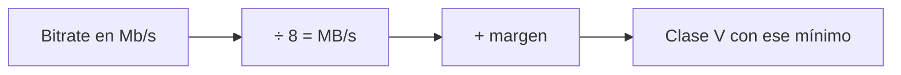

# Tarjetas de memoria (clases de velocidad)

Parte de: [[34-Equipo/03 Compras y accesorios/_Índice Compras y accesorios|Compras y accesorios]]

> [!info] Cómo avanzar
> `progreso`: **pendiente** → **viendo** (estudiando) → **visto** (contestaste la autoevaluación sin abrir las respuestas) → **dominado** (hiciste el laboratorio o lo aplicaste de verdad).

## Contenido

### Qué es
Las tarjetas SD y microSD llevan varios símbolos de velocidad (C10, U3, V30, V60, V90) que garantizan una **escritura mínima sostenida**. Para video eso es lo que importa: si la tarjeta no escribe tan rápido como la cámara genera datos, la grabación se corta o el archivo queda corrupto. Elegir bien es una cuenta sencilla a partir del **bitrate** del códec.

### Cómo funciona
**Lo que garantiza cada símbolo** (SD Association, [guía](https://www.sdcard.org/press/thoughtleadership/the-more-you-know-choosing-the-sd-speed-class-thats-right-for-you/) y [clases para video](https://www.sdcard.org/consumers/about-sd-memory-card-choices/speed-class-standards-for-video-recording/)):

| Símbolo | Escritura mínima |
|---|---|
| C10, U1, V10 | 10 MB/s |
| U3, V30 | 30 MB/s |
| V60 | 60 MB/s |
| V90 | 90 MB/s |

V60 y V90 solo existen en tarjetas **UHS-II o superiores**. Los números grandes de la etiqueta ("170 MB/s") suelen ser la velocidad máxima de **lectura** con un lector compatible; no garantizan escritura sostenida.

**La cuenta.** El bitrate viene en megabits por segundo (Mb/s); la tarjeta en megabytes por segundo (MB/s). **Divide entre 8** y elige una clase con margen:

| Equipo y modo | Bitrate | MB/s | Clase mínima | GB por minuto |
|---|---|---|---|---|
| Mini 4K, 4K30 | 100 Mbps | 12.5 | U3/V30 | 0.75 |
| a6700 XAVC HS 4K120 | 280 Mbps | 35 | V60 | 2.1 |
| a6700 XAVC S-I 4K60 | 600 Mbps | 75 | V90 | 4.5 |

(Sony puede exigir una clase concreta por modo en la guía de ayuda de la a6700: confírmalo ahí.)

**A1/A2** es otra cosa: la clase de rendimiento de **aplicaciones** (lecturas y escrituras aleatorias para apps en Android). Para grabar video no importa.

**Sistemas de archivos.** DJI admite FAT32 en tarjetas de 32 GB o menos y exFAT en las mayores. Lo más seguro es **formatear en el propio equipo**.

### Ejemplo
**Dron.** El Mini 4K graba a 100 Mbps. En una microSD de 64 GB: 64 000 MB ÷ 750 MB/min ≈ **85 minutos** (algo menos por el formato). Con tres baterías de vuelo real, sobra. DJI recomienda **U3 o superior**: una V30 de marca conocida es la elección.

**a6700 en un evento.** Planeas S-Cinetone en XAVC S 4K a 10 bits y algunas tomas a 4K120 en XAVC HS (280 Mbps = 35 MB/s): supera los 30 MB/s de V30, así que necesitas **V60**. Si quisieras XAVC S-I 4K60 (600 Mbps = 75 MB/s), solo una **V90** sirve, y un minuto ocupa 4.5 GB.

**Rutina antes de cada sesión**: respaldas la tarjeta (ver [[Lab 4 - Plan de almacenamiento y respaldo de mis grabaciones]]) y la formateas **en el dron o en la cámara**, no en la computadora.

### Cuándo pagar más y cuándo no
- **Paga por V60/V90** solo si tu modo de grabación lo exige (a6700 en 4K120 o intra).
- **Para el dron y el iPhone** (que no usa tarjeta), U3/V30 basta.
- **Prefiere varias tarjetas medianas** a una enorme: si una falla, pierdes menos.

### Errores comunes
- **Fijarse en los "170 MB/s"** de la etiqueta y no en la clase V/U.
- **Comprar tarjetas falsas** en mercados en línea dudosos: anuncian 256 GB y escriben 32. Compra en tiendas oficiales.
- **Formatear en la computadora** y meterla al equipo: errores de sistema de archivos.
- **Borrar clips sueltos en la cámara** en lugar de formatear: fragmenta la tarjeta.
- **Elegir por la clase A1/A2** para video.

### Para profundizar
- [SD Association: clases de velocidad para video](https://www.sdcard.org/consumers/about-sd-memory-card-choices/speed-class-standards-for-video-recording/)
- [SD Association: cómo elegir la clase de velocidad](https://www.sdcard.org/press/thoughtleadership/the-more-you-know-choosing-the-sd-speed-class-thats-right-for-you/)
- [DJI: especificaciones del Mini 4K (microSD)](https://www.dji.com/mini-2-se/specs)
- [Sony: especificaciones de la a6700](https://www.sony.co.in/interchangeable-lens-cameras/products/ilce-6700/spec)

## Ejercicios

Resuélvelos en papel o en la herramienta; la solución está plegada.

> [!question]- El Mini 4K graba a 100 Mbps. ¿Cuántos minutos de 4K caben en una microSD de 64 GB?
> 100 / 8 = 12.5 MB/s → 750 MB por minuto. 64 000 / 750 ≈ **85 minutos** (algo menos por el formato de la tarjeta).

> [!question]- La a6700 graba XAVC S-I 4K 60p a 600 Mbps. ¿Qué clase mínima necesitas y cuántos GB ocupa un minuto?
> 600 / 8 = **75 MB/s** → **V90** (V60 = 60 MB/s no alcanza). 75 × 60 = 4500 MB ≈ **4.5 GB/min**.

> [!question]- XAVC HS 4K 120p a 280 Mbps: ¿V30 o V60?
> 280 / 8 = **35 MB/s**: supera los 30 MB/s de V30 → **V60** como mínimo. (Sony puede pedir una clase concreta por modo en la guía de ayuda de la cámara; confírmalo ahí.)

> [!question]- Una tarjeta dice "UHS-I, U3, V30, 170 MB/s". ¿Cuál de esos números importa para grabar?
> **V30/U3** (mínimo sostenido de 30 MB/s). Los 170 MB/s suelen ser velocidad máxima de **lectura** con lectores compatibles; no garantizan escritura sostenida.

## Autoevaluación

Contesta primero en voz alta o en papel; luego despliega la respuesta.

> [!question]- ¿Qué garantiza cada símbolo de velocidad (C10, U3, V30, V60, V90)?
> Una **escritura secuencial mínima**: C10 y U1 = 10 MB/s, **U3 y V30 = 30 MB/s**, **V60 = 60 MB/s**, **V90 = 90 MB/s** (SD Association, [ver](https://www.sdcard.org/press/thoughtleadership/the-more-you-know-choosing-the-sd-speed-class-thats-right-for-you/)). V60 y V90 solo existen en tarjetas **UHS-II o superior** ([SD Association](https://www.sdcard.org/consumers/about-sd-memory-card-choices/speed-class-standards-for-video-recording/)).

> [!question]- ¿Cómo eliges la clase a partir del bitrate del códec?
> Divide los **Mb/s entre 8** para obtener MB/s y elige una clase con margen. Ejemplos: Mini 4K 100 Mbps → 12.5 MB/s → **U3/V30**; a6700 XAVC S-I 600 Mbps → 75 MB/s → **V90**; a6700 4K120 280 Mbps → 35 MB/s → **V60**.

> [!question]- ¿Qué significa A1/A2 en una microSD y te importa para video?
> Es la clase de **rendimiento de aplicaciones** (lecturas/escrituras aleatorias para apps en Android). Para grabar video importa la clase de velocidad V/U, no la A.

> [!question]- Error común: formatear la tarjeta en la computadora y meterla al dron o a la cámara. ¿Qué es mejor?
> Formatearla **en el propio equipo** antes de cada sesión (después de respaldar). Evita errores de sistema de archivos (DJI usa FAT32 hasta 32 GB y exFAT arriba) y reduce archivos corruptos.

## Práctica

- [[Lab 4 - Plan de almacenamiento y respaldo de mis grabaciones]]

