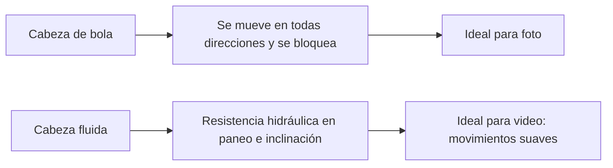

# Tripiés y soportes

Parte de: [[34-Equipo/03 Compras y accesorios/_Índice Compras y accesorios|Compras y accesorios]]

> [!info] Cómo avanzar
> `progreso`: **pendiente** → **viendo** (estudiando) → **visto** (contestaste la autoevaluación sin abrir las respuestas) → **dominado** (hiciste el laboratorio o lo aplicaste de verdad).

## Contenido

### Qué es
Tripiés, minitripiés, monopiés y soportes son los accesorios que mantienen la cámara quieta o la mueven de forma controlada. Una toma estable se ve profesional; una toma que tiembla sin intención se ve descuidada. También son lo que te permite grabarte solo, hacer timelapses y tomas largas sin cansarte. La clave es tener el soporte adecuado para cada equipo y cada tipo de toma.

### Cómo funciona
**Tipos de soporte y para qué**:

| Soporte | Equipo | Uso |
|---|---|---|
| Minitripié flexible o de mesa con adaptador de celular | iPhone, Pocket 4P | Vlog sentado, timelapse, tutoriales de escritorio |
| Tripié de tamaño completo con cabeza fluida | a6700, iPhone | Entrevistas, paneos suaves, tomas largas |
| Monopié o selfie stick con patas | iPhone, Pocket 4P | Moverse rápido, vlog caminando, ganar altura |
| Gimbal | iPhone | Tomas caminando (la Pocket 4P ya trae uno) |

**Cabeza de bola contra cabeza fluida.**

La de bola es rápida para encuadrar una foto, pero si la aflojas para panear, el movimiento sale a tirones. La fluida tiene un brazo (*pan bar*) y resistencia ajustable para que el paneo empiece y termine suave.

**Estabilidad.** El orden correcto al montar un tripié: abre **primero las patas** (las secciones más gruesas antes que las delgadas), nivela y sube la columna central **al final** y solo si hace falta. La columna es el punto más inestable: con viento vibra y puede volcar el equipo. Si el tripié tiene gancho bajo la columna, cuelga tu mochila para bajar el centro de gravedad.

**Zapata y tornillo.** La mayoría usa rosca de 1/4"; las placas de liberación rápida (tipo Arca-Swiss en muchas cabezas) te ahorran tiempo al cambiar de equipo. Confirma que la placa de tu tripié sea compatible con la que pongas en la a6700.

### Ejemplo
**Timelapse del atardecer con el iPhone.** Minitripié con adaptador de celular sobre una barda, iPhone a 1x, modo Time-lapse, exposición bloqueada. Patas cortas, nada de columna. Peso: tu mochila al lado sujetando una pata si hay viento.

**Entrevista con la a6700.** Tripié completo con cabeza fluida, patas abiertas, columna abajo; cámara a la altura de los ojos del entrevistado. Ajustas la resistencia del paneo para un pequeño movimiento de reencuadre. El iPhone en un minitripié como segundo ángulo.

**Vlog caminando.** Monopié o selfie stick con la Pocket 4P; si es con el iPhone, la estabilización del teléfono ayuda pero un gimbal mejora mucho los pasos.

### Cuándo usar cada uno y cuándo no
- **Minitripié**: siempre en la mochila; ligero y versátil.
- **Tripié completo**: entrevistas, paisaje, timelapse largo. No en lugares donde está prohibido (algunos museos y zonas arqueológicas) ni en multitudes.
- **Monopié**: eventos y movimiento; no sirve para timelapse.
- **Gimbal para iPhone**: solo si grabas mucho caminando y no tienes la Pocket 4P.

### Errores comunes
- **Columna central extendida al máximo con viento**: vibra y puede volcar.
- **Panear con cabeza de bola**: tirones visibles.
- **Tripié demasiado ligero para la cámara**: se mueve al tocar el botón; usa el temporizador o un control remoto.
- **No nivelar**: el horizonte torcido obliga a rotar y recortar en la edición.
- **Dejar el tripié desatendido en la calle**: riesgo de caída y robo.

### Para profundizar
- [Apple: especificaciones del iPhone 15 Pro (time-lapse y estabilización)](https://support.apple.com/en-us/111829)
- [Sony: especificaciones de la a6700](https://www.sony.co.in/interchangeable-lens-cameras/products/ilce-6700/spec)

## Autoevaluación

Contesta primero en voz alta o en papel; luego despliega la respuesta.

> [!question]- ¿Qué tipos de soporte necesitas para tu equipo y para qué?
> **Tripié pequeño/mini** con adaptador de celular (vlog, timelapse, mesa), **tripié de tamaño completo** con cabeza fluida para paneos suaves con la a6700, y **monopié o selfie stick** para moverse. La Pocket 4P ya trae gimbal y no necesita estabilizador.

> [!question]- ¿Qué diferencia hay entre una cabeza de bola y una cabeza fluida?
> La **de bola** se mueve en todas direcciones y se bloquea: ideal para foto. La **fluida** tiene resistencia hidráulica para **paneos e inclinaciones suaves** en video.

> [!question]- Error común: usar el tripié con la columna central extendida al máximo con viento. ¿Qué pasa?
> La columna es el punto más inestable: vibra y puede volcarse. Abre primero las patas, sube la columna al final y cuelga peso (mochila) del gancho si lo tiene.

