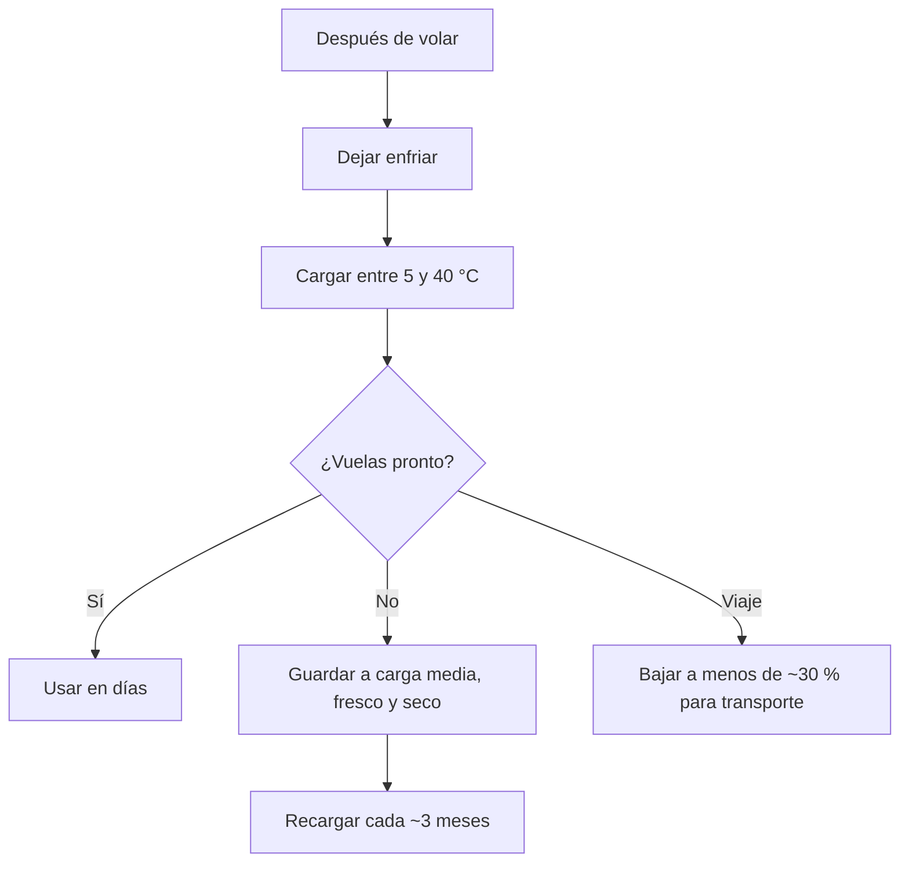

# Baterías de dron (cuidado y viajes)

Parte de: [[35-Drones/01 Normativa y seguridad/_Índice Normativa y seguridad|Normativa y seguridad]]

> [!info] Cómo avanzar
> `progreso`: **pendiente** → **viendo** (estudiando) → **visto** (contestaste la autoevaluación sin abrir las respuestas) → **dominado** (hiciste el laboratorio o lo aplicaste de verdad).

## Contenido

### Qué es
Las baterías del DJI Mini 4K son baterías inteligentes de **ion de litio** de 2250 mAh, 7.7 V y **17.32 Wh** (según la [ficha de DJI](https://www.dji.com/mini-2-se/specs)), con unos 82.5 g cada una. Son la pieza que más limita tus vuelos y la que más riesgo tiene si se maltrata: una batería dañada puede perder potencia en el aire o, en el peor caso, incendiarse. Cuidarlas alarga su vida y hace tus vuelos más seguros.

### Cómo funciona
Una batería inteligente tiene un circuito que mide carga, temperatura y celdas, y que se comunica con el dron y la app DJI Fly. Puntos clave:

- **Autodescarga de almacenamiento.** Según el [manual](https://dl.djicdn.com/downloads/DJI_Mini_4K/20260427/DJI_Mini_4K_User_Manual_v1.0_zh-cn.pdf), una batería llena que no se usa baja sola a alrededor de 96 % en un día y a 72 % tras nueve días: el sistema la descarga para protegerla, porque guardar litio al 100 % lo desgasta.
- **Rango de carga.** DJI indica cargar entre **5 y 40 °C**. Fuera de ese rango, la batería se degrada o no carga.
- **Frío.** Con temperaturas bajas el litio entrega menos energía: el voltaje cae rápido y el dron puede avisar de batería baja antes de lo esperado. Con el dron operando de 0 a 40 °C, una batería helada es un riesgo.
- **Calor.** Recién aterrizada la batería está caliente; cargarla así acelera su desgaste.

### Ejemplo
**Antes de un viaje en avión con tres baterías:**

1. Dos días antes, vuelas o dejas que se descarguen hasta **menos de ~30 %**, como sugiere DJI para transporte.
2. Revisas la capacidad impresa en cada batería: 17.32 Wh, muy por debajo del límite habitual de 100 Wh de las aerolíneas. Aun así, revisa la política de tu aerolínea, porque algunas limitan el número de baterías de repuesto.
3. Las llevas en **equipaje de mano**, nunca documentadas, con terminales protegidas: en el estuche de carga, en bolsas individuales o en una bolsa ignífuga para baterías de litio.
4. Al llegar, cargas en el hotel con el cargador original y sin dejarlas desatendidas.

**Una mañana fría en la montaña:** guardas las baterías en un bolsillo interior hasta el momento de volar. Despegas, flotas 30 segundos a 2–3 m para que se calienten y vigilas el voltaje en la app. Vuelos más cortos y aterrizar con más margen del habitual.

**Inspección**: antes de cada uso revisa que no esté inflada, golpeada o con terminales dañadas. Si lo está, no la uses; recíclala en un punto de acopio de baterías.

### Cuándo aplicar cada cuidado
- **Después de cada vuelo**: dejar enfriar antes de cargar.
- **Pausas de semanas**: carga media, lugar fresco y seco, lejos del sol y de objetos metálicos. DJI recomienda recargarlas aproximadamente cada tres meses.
- **Viajes**: carga baja, equipaje de mano, terminales protegidas.
- **Frío**: mantenerlas tibias y vuelos más cortos.

### Errores comunes
- **Cargar la batería recién aterrizada y caliente**: espera a que se enfríe.
- **Guardarlas al 100 % por meses**: se degradan más rápido.
- **Documentarlas en la maleta**: prohibido en la mayoría de los vuelos y peligroso.
- **Despegar con una batería helada**: puede apagarse antes de tiempo.
- **Usar una batería inflada o golpeada**: riesgo de falla en vuelo o incendio.
- **Volar hasta el último porcentaje**: planea aterrizar con margen (ver [[Viento, clima y retorno automático (RTH)]]).

### Para profundizar
- [DJI: especificaciones del Mini 4K (batería)](https://www.dji.com/mini-2-se/specs)
- [Manual de usuario del DJI Mini 4K (PDF)](https://dl.djicdn.com/downloads/DJI_Mini_4K/20260427/DJI_Mini_4K_User_Manual_v1.0_zh-cn.pdf)
- Nota relacionada: [[Cuidado del equipo en viaje, calle y lluvia]]

## Autoevaluación

Contesta primero en voz alta o en papel; luego despliega la respuesta.

> [!question]- ¿Cómo guardas las baterías del Mini 4K si no vas a volar en semanas?
> Con carga media, en lugar fresco y seco; el manual indica que una batería llena baja a ~96 % en 1 día y ~72 % tras 9 días por autodescarga, y recomienda **recargarlas cada ~3 meses**. Para transporte, bájalas a **menos de ~30 %** ([manual](https://dl.djicdn.com/downloads/DJI_Mini_4K/20260427/DJI_Mini_4K_User_Manual_v1.0_zh-cn.pdf)).

> [!question]- ¿Cómo viajas en avión con las baterías?
> En **equipaje de mano**, nunca documentadas, con terminales protegidas (bolsa o estuche ignífugo) y con carga baja. Revisa la capacidad en Wh impresa en la batería y las reglas de tu aerolínea; la batería de vuelo del Mini 4K es de ion de litio, 2250 mAh a 7.7 V, es decir **17.32 Wh** según la ficha de DJI: muy por debajo del límite habitual de 100 Wh para equipaje de mano (confirma siempre con tu aerolínea).

> [!question]- Error común: cargar la batería recién aterrizada y caliente. ¿Qué hacer?
> Deja que se enfríe antes de cargarla; cargarla caliente acelera su desgaste. Tampoco despegues con una batería helada: caliéntala en tu bolsillo.

## Práctica

- [[Lab 1 - Checklist pre-vuelo y revisión legal del lugar]]

