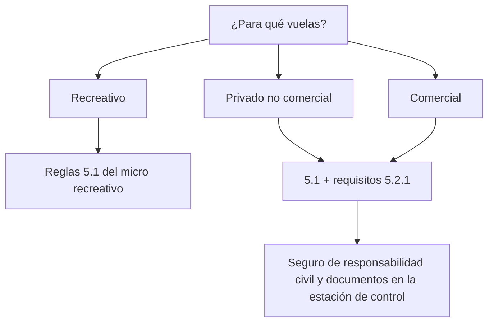

# Categorías de uso de drones (recreativo, privado y comercial)

Parte de: [[35-Drones/01 Normativa y seguridad/_Índice Normativa y seguridad|Normativa y seguridad]]

> [!info] Cómo avanzar
> `progreso`: **pendiente** → **viendo** (estudiando) → **visto** (contestaste la autoevaluación sin abrir las respuestas) → **dominado** (hiciste el laboratorio o lo aplicaste de verdad).

## Contenido

### Qué es
La NOM-107-SCT3-2019 clasifica los drones (RPAS) de dos formas: por **para qué** los usas y por **cuánto pesan**. La combinación define tus obligaciones: no es lo mismo volar tu Mini 4K por gusto en el campo que cobrarle a un restaurante por grabar su fachada. Entender la categoría te evita pensar que estás exento cuando no lo estás.

### Cómo funciona
**Por uso** (definiciones 3.47 a 3.49 de la [norma en el DOF](https://dof.gob.mx/normasOficiales/8006/sct11_C/sct11_C.html)):

| Categoría | Definición | Ejemplo |
|---|---|---|
| Recreativo (3.48) | Uso para recreación | Tomas de tus vacaciones para ti y tu familia |
| Privado no comercial (3.49) | Tareas sin fines de lucro | Revisar el techo de tu casa, grabar la fiesta de un amigo gratis |
| Comercial (3.47) | Tareas con fines de lucro | Te pagan por grabar, vendes las tomas, es parte de un servicio |

**Por peso máximo de despegue** (4.9.1): **micro** hasta 2 kg, **pequeño** de más de 2 kg hasta 25 kg, **grande** más de 25 kg. Tu Mini 4K (246 g) es **micro**.

**Qué se añade para micro privado o comercial** (5.2.1): cumplir los requisitos y límites del micro recreativo (salvo el inciso de vuelo sobre personas, que se regula aparte) y además:

- **Seguro de responsabilidad civil** vigente por daños a terceros (con referencia al artículo 72 de la Ley de Aviación Civil).
- Llevar en la estación de control copia del registro del RPAS, la póliza y, si aplica, la **autorización del INEGI** para fotografía aérea con cámaras métricas o de reconocimiento.

**El registro de un micro de 250 g o menos en uso comercial.** El numeral 5.1.1 a) pide el folio de registro para micro recreativos de **más de 0.250 kg**. El 5.2.1 remite a esos requisitos, pero también pide llevar copia del "folio de registro" sin repetir el umbral de peso. Si un dron de 246 g en uso comercial debe registrarse está (Pendiente de confirmar): consulta a la AFAC antes de cobrar.

### Ejemplo
**Caso: te pagan por grabar con tu Mini 4K la fachada de un restaurante.**

1. **Categoría**: comercial (hay fin de lucro).
2. **Seguro**: contratas una póliza de responsabilidad civil para drones antes del vuelo y llevas copia.
3. **Registro**: consultas a la AFAC si tu micro de 246 g lo necesita para uso comercial (Pendiente de confirmar).
4. **Operación**: todo lo del recreativo aplica igual: altura, distancia, línea de vista, horario diurno, distancia a aeródromos y helipuertos (ver [[NOM-107-SCT3-2019 y registro ante la AFAC]] y [[Zonas restringidas y privacidad al volar]]).
5. **Privacidad**: si salen comensales identificables, cuidas su imagen y pides permiso.

**Caso dudoso: videos en tus redes.** Si solo compartes tus viajes, es recreativo. Si el video es por encargo, patrocinado o promociona algo que vendes, trátalo como **comercial**. Para la monetización de tus propios videos el criterio de la autoridad está (Pendiente de confirmar); ante la duda, consulta y contrata el seguro.

### Cuándo aplica cada categoría
- **Recreativo**: no hay pago ni encargo, y el uso es personal.
- **Privado no comercial**: haces una tarea útil, sin cobrar.
- **Comercial**: cualquier pago, trueque por servicios, contenido patrocinado o uso para tu negocio.

### Errores comunes
- **"Subir a redes nunca es comercial"**: un video patrocinado sí lo es.
- **Creer que el peso te exime de todo**: el umbral de 250 g afecta el registro y el vuelo sobre personas, no las demás reglas.
- **Cobrar sin seguro**: si algo sale mal, la responsabilidad es tuya (4.11.1).
- **No llevar documentos**: en uso privado o comercial, la norma pide tenerlos en la estación de control.

### Para profundizar
- [NOM-107-SCT3-2019 en el DOF](https://dof.gob.mx/normasOficiales/8006/sct11_C/sct11_C.html)
- [NOM-107-SCT3-2019 en PDF (Secretaría de Economía)](https://platiica.economia.gob.mx/normalizacion/wp-content/uploads/sites/2/PDF_Normas_Publicas/NOM-107-SCT3-2019.pdf)

## Autoevaluación

Contesta primero en voz alta o en papel; luego despliega la respuesta.

> [!question]- ¿Qué categorías de uso define la NOM-107?
> **Recreativo** (3.48: para recreación), **privado no comercial** (3.49: tareas sin fines de lucro) y **comercial** (3.47: tareas con fines de lucro). Además clasifica por peso (4.9.1): **micro ≤ 2 kg**, **pequeño > 2 kg y hasta 25 kg**, **grande > 25 kg**.

> [!question]- ¿Qué pide la norma de más para un micro de uso privado o comercial?
> Cumplir todo lo del recreativo y además (5.2.1): **seguro de responsabilidad civil** vigente por daños a terceros (art. 72 de la Ley de Aviación Civil), llevar en la estación de control copia del registro, la póliza y, si aplica, la **autorización del INEGI** para fotografía aérea con cámaras métricas o de reconocimiento.

> [!question]- Caso: te pagan por grabar con tu Mini 4K la fachada de un restaurante. ¿En qué categoría estás?
> **Comercial** (fin de lucro). Necesitas al menos el seguro de responsabilidad civil. Si un micro ≤ 250 g de uso comercial requiere además registro ante la AFAC está (Pendiente de confirmar): confírmalo con la AFAC antes de cobrar.

> [!question]- Error común: pensar que subir videos a redes nunca es comercial. ¿Qué harías para no equivocarte?
> Si el video es por encargo, patrocinado o para vender algo, trátalo como **comercial**. Para monetización de tus propios videos el criterio de la autoridad está (Pendiente de confirmar): ante la duda, consulta a la AFAC y contrata el seguro.

