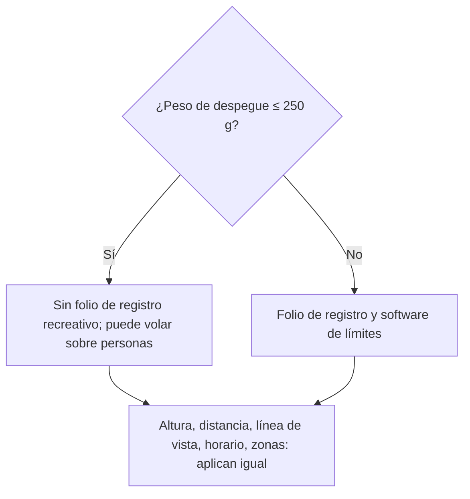

# NOM-107-SCT3-2019 y registro ante la AFAC

Parte de: [[35-Drones/01 Normativa y seguridad/_Índice Normativa y seguridad|Normativa y seguridad]]

> [!info] Cómo avanzar
> `progreso`: **pendiente** → **viendo** (estudiando) → **visto** (contestaste la autoevaluación sin abrir las respuestas) → **dominado** (hiciste el laboratorio o lo aplicaste de verdad).

## Contenido

### Qué es
La **NOM-107-SCT3-2019** es la Norma Oficial Mexicana que fija los requerimientos para operar **sistemas de aeronaves pilotadas a distancia** (RPAS, es decir, drones) en el espacio aéreo mexicano. Se publicó en el [DOF](https://dof.gob.mx/normasOficiales/8006/sct11_C/sct11_C.html); hay copia en [PDF de la Secretaría de Economía](https://platiica.economia.gob.mx/normalizacion/wp-content/uploads/sites/2/PDF_Normas_Publicas/NOM-107-SCT3-2019.pdf). La norma habla de la SCT y la DGAC; esas funciones hoy las ejerce la **Agencia Federal de Aviación Civil (AFAC)**. Es la regla que tienes que conocer antes de despegar.

### Cómo funciona
La norma combina **categoría de uso** (recreativo, privado, comercial: ver [[Categorías de uso de drones (recreativo, privado y comercial)]]) con **peso** (micro hasta 2 kg). Para tu Mini 4K, micro recreativo, los numerales clave son:

| Numeral | Regla |
|---|---|
| 5.1.1 a) | Folio de registro para micro recreativos con peso máximo de despegue **mayor a 0.250 kg** |
| 5.1.1 b) | Altura máxima **122 m (400 ft)** |
| 5.1.1 c) | Máximo **457 m (1500 ft)** horizontales respecto al piloto |
| 5.1.1 d) | Máximo **100 m (328 ft)** de altura entre los círculos de 9.2 y 18.5 km de los aeródromos listados |
| 5.1.1 e) | No exceder la velocidad máxima del fabricante |
| 5.1.1 f) y Nota 1 | No volar sobre personas no involucradas (10 m de perímetro), **excepto** si el RPAS pesa 250 g o menos |
| 5.1.2 | Siempre **a la vista**, sin más ayuda que lentes correctivos |
| 4.10.1 / 4.10.2 | **9.2 km** de cualquier aeródromo y **0.9 km** de helipuertos |
| 4.10.3 | No arrojar objetos |
| 4.10.10 | Solo **entre la salida y la puesta del sol** |
| 4.11.4 | No volar bajo efectos de alcohol o drogas |

**Tu Mini 4K.** DJI publica **246 g** de peso de despegue con batería, hélices y microSD ([ficha](https://www.dji.com/mini-2-se/specs)). En uso recreativo no necesita registro. Pero el margen es de solo 4 g: protectores de hélice, luces o soportes pueden pasarlo de 250 g, y entonces sí necesitas registro y pierdes la excepción de volar sobre personas. Pésalo con todo puesto en una báscula de cocina. El portal y el procedimiento actuales de registro ante la AFAC están (Pendiente de confirmar).

**Conversiones** (1 ft = 0.3048 m): 122 m ≈ 400 ft; 457 m ≈ 1499 ft ≈ 1500 ft; 100 m ≈ 328 ft.

### Ejemplo
Quieres volar en un parque a **12 km** de un aeropuerto. Estás fuera del círculo de 9.2 km, pero dentro del de 18.5 km: tu altura máxima es **100 m**, no 122. Configuras en DJI Fly la altura máxima en 100 m y la distancia máxima en 457 m. Tu dron puede transmitir video a varios kilómetros, pero eso es capacidad técnica, no permiso: no lo alejas más de 457 m ni lo pierdes de vista. Vuelas de día, sin haber bebido, lejos de cualquier helipuerto y respetando la privacidad de la gente del parque.

### Cuándo aplica y cuándo hay más requisitos
- **Siempre**: zonas, altura, distancia, línea de vista, horario, responsabilidad y privacidad (4.10, 4.11, 5.1.1 y 5.1.2).
- **Uso privado o comercial**: seguro de responsabilidad civil y documentos (5.2.1).
- **De noche o fuera de línea de vista**: requiere autorización especial (numeral 8); no es para uso recreativo normal.
- Las zonas GEO de DJI **no sustituyen** a la ley: el propio manual lo advierte.

### Errores comunes
- **"Pesa menos de 250 g, puedo volar donde quiera"**: la exención es del registro y del vuelo sobre personas, nada más.
- **Confundir alcance de transmisión con distancia legal**.
- **Olvidar el límite de 100 m cerca de aeródromos**.
- **Agregar accesorios sin pesar**.
- **Confiar solo en la app**: revisa las zonas con la información oficial (ver [[Zonas restringidas y privacidad al volar]]).

### Para profundizar
- [NOM-107-SCT3-2019 en el DOF](https://dof.gob.mx/normasOficiales/8006/sct11_C/sct11_C.html)
- [NOM-107-SCT3-2019 en PDF](https://platiica.economia.gob.mx/normalizacion/wp-content/uploads/sites/2/PDF_Normas_Publicas/NOM-107-SCT3-2019.pdf)
- [DJI: especificaciones del Mini 4K](https://www.dji.com/mini-2-se/specs)

## Ejercicios

Resuélvelos en papel o en la herramienta; la solución está plegada.

> [!question]- Estás a 12 km de un aeropuerto. Según 5.1.1 d), ¿a qué altura máxima puedes volar?
> Entre los círculos de **9.2 km (5 MN) y 18.5 km (10 MN)** la altura máxima es **100 m (328 ft)**. A 12 km aplica ese límite.

> [!question]- Tu dron transmite video hasta 6–10 km según la ficha de DJI. ¿Hasta dónde puedes alejarlo legalmente en uso recreativo?
> Hasta **457 m (1500 ft)** horizontales del piloto (5.1.1 c) y siempre **a la vista** (5.1.2). El alcance técnico no es permiso.

> [!question]- Convierte 122 m a pies y 457 m a pies (1 ft = 0.3048 m). ¿Coinciden con la norma?
> 122 / 0.3048 ≈ **400 ft**; 457 / 0.3048 ≈ **1499 ft ≈ 1500 ft**. Sí coinciden.

## Autoevaluación

Contesta primero en voz alta o en papel; luego despliega la respuesta.

> [!question]- ¿Qué es la NOM-107-SCT3-2019 y dónde lees el texto oficial?
> Es la Norma Oficial Mexicana que fija los requerimientos para operar **sistemas de aeronaves pilotadas a distancia (RPAS, drones)** en el espacio aéreo mexicano. Texto en el [DOF](https://dof.gob.mx/normasOficiales/8006/sct11_C/sct11_C.html) (copia en [PDF de Economía](https://platiica.economia.gob.mx/normalizacion/wp-content/uploads/sites/2/PDF_Normas_Publicas/NOM-107-SCT3-2019.pdf)). La norma habla de la SCT/DGAC; hoy esas funciones las ejerce la **Agencia Federal de Aviación Civil (AFAC)**.

> [!question]- ¿Tu DJI Mini 4K necesita registro para uso recreativo?
> No, mientras pese **250 g o menos**. El numeral **5.1.1 a)** pide obtener el folio de registro solo para RPAS micro recreativos "con un peso máximo de despegue **mayor a 0.250 kg**". DJI publica **246 g** de peso de despegue con batería, hélices y microSD ([ficha](https://www.dji.com/mini-2-se/specs)). El portal y el procedimiento actuales del registro ante la AFAC están (Pendiente de confirmar).

> [!question]- Caso: le pones al Mini 4K protectores de hélice y una luz para encontrarlo. ¿Qué tienes que revisar?
> El **peso máximo de despegue** cuenta todo lo que vuela. Con solo 4 g de margen (246 g), un accesorio puede pasarlo de **250 g**: entonces ya necesitas registro y pierdes excepciones (p. ej. volar sobre personas). Pésalo con todo puesto en una báscula de cocina. Como referencia, DJI publica 23.5 g por lado para el protector de hélices 360° (el de la Mini 2, compatible con la Mini 4K): con él puesto el total pasa de 250 g, así que vuela sin protector o asume las reglas de la categoría de más peso.

> [!question]- ¿Qué límites de operación aplican aunque tu dron esté exento de registro?
> Todos los demás: altura máxima **122 m (400 ft)**, máximo **457 m** horizontales del piloto, **a línea de vista** sin más ayuda que lentes correctivos, **solo entre la salida y la puesta del sol**, **9.2 km** de aeródromos y **0.9 km** de helipuertos, no volar bajo efectos de alcohol o drogas, no arrojar objetos y respetar privacidad (numerales 4.10, 4.11, 5.1.1 y 5.1.2).

> [!question]- Error común: "pesa menos de 250 g, entonces puedo volar donde quiera". ¿Por qué es falso?
> La exención es solo del **registro** (y de algunas reglas como volar sobre personas). Las zonas prohibidas, la altura, la distancia, el horario diurno y la línea de vista **aplican igual**. Además, las zonas GEO de DJI no sustituyen a la ley: el propio manual lo advierte.

## Práctica

- [[Lab 1 - Checklist pre-vuelo y revisión legal del lugar]]

