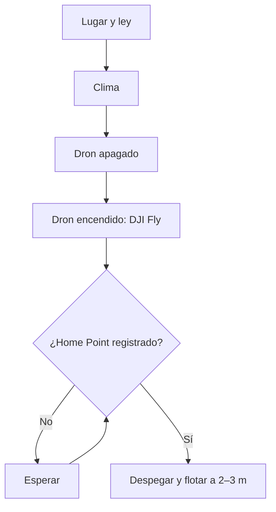

# Revisión antes de despegar (checklist)

Parte de: [[35-Drones/01 Normativa y seguridad/_Índice Normativa y seguridad|Normativa y seguridad]]

> [!info] Cómo avanzar
> `progreso`: **pendiente** → **viendo** (estudiando) → **visto** (contestaste la autoevaluación sin abrir las respuestas) → **dominado** (hiciste el laboratorio o lo aplicaste de verdad).

## Contenido

### Qué es
El checklist pre-vuelo es una lista que recorres **siempre**, en el mismo orden, antes de despegar. Los pilotos de aviones lo hacen aunque lleven miles de horas: no porque no sepan, sino porque la memoria falla con prisa, emoción o cansancio. Con un dron sin sensores de obstáculos como el Mini 4K, la mayoría de los accidentes vienen de algo que una revisión de dos minutos habría detectado.

### Cómo funciona
El checklist tiene cuatro bloques: **lugar y ley**, **clima**, **dron** y **app**. Primero decides si se puede volar; después, si el equipo está listo.

**1. Lugar y ley**
- Fuera de **9.2 km** de aeródromos y **0.9 km** de helipuertos; sin NOTAM ni zonas prohibidas activas (ver [[Zonas restringidas y privacidad al volar]]).
- Espacio abierto: sin cables, árboles altos ni edificios cerca de tu ruta.
- Personas alrededor: dónde están y si saben que vas a volar.
- Un sitio plano y limpio para despegar y aterrizar.

**2. Clima**
- Viento sostenido y ráfagas claramente por debajo de **10.7 m/s (≈38.5 km/h)**, el límite del Mini 4K. Arriba sopla más.
- Sin lluvia, niebla ni nieve. Temperatura entre 0 y 40 °C.
- Luz de día (la norma limita al horario entre la salida y la puesta del sol).

**3. Dron (apagado)**
- Hélices bien instaladas, sin grietas ni muescas, y desplegadas.
- Brazos delanteros y traseros completamente abiertos.
- Protector del gimbal retirado; lente limpia.
- Batería cargada y bien insertada; microSD formateada.
- Solo accesorios originales y peso total de 250 g o menos.

**4. App (encendido)**
- Señal GNSS suficiente y **Home Point registrado** en el lugar correcto del mapa.
- **Altura de RTH** mayor que el obstáculo más alto de la zona (y menor que el límite legal).
- Acción ante pérdida de señal: RTH.
- Carga del dron, del control y del teléfono.
- Sin avisos de brújula o IMU.
- Modo de vuelo **Cine o Normal**.
- Límites de altura y distancia configurados según la ley.

### Ejemplo
Llegas a un campo para practicar. Revisas en el mapa que no haya aeródromo cerca, notas una línea de alta tensión al norte y decides volar hacia el sur. Tu app de clima marca 15 km/h con ráfagas de 25: margen razonable. Despliegas los brazos, revisas hélices, quitas el protector del gimbal. Enciendes control y dron, y esperas: la app avisa "punto de origen actualizado" y el ícono H aparece exactamente donde estás parado. Pones la altura de RTH en 40 m porque hay árboles de 20. Despegas, flotas a 3 m 20 segundos para ver que no deriva y empiezas. Todo esto está en el [[Lab 1 - Checklist pre-vuelo y revisión legal del lugar]].

### Cuándo usarlo
- **Siempre**, incluso en el patio de tu casa.
- Repite el bloque 4 al cambiar de batería, y el bloque 1 si cambias de lugar.
- Si algo falla, **no vueles**: el checklist es para decidir, no para cumplir un trámite.

### Errores comunes
- **Despegar en cuanto aparece la imagen, sin esperar el Home Point**: si se pierde la señal, el dron no sabe a dónde volver o vuelve al lugar equivocado.
- **Altura de RTH por defecto** en zona con árboles: el regreso en línea recta puede chocar.
- **Olvidar el protector del gimbal**: error de gimbal al encender.
- **Hélice mal asentada**: vibración o pérdida en el aire.
- **Hacerlo de memoria**: imprímelo o tenlo en el teléfono.

### Para profundizar
- [Manual de usuario del DJI Mini 4K (PDF)](https://dl.djicdn.com/downloads/DJI_Mini_4K/20260427/DJI_Mini_4K_User_Manual_v1.0_zh-cn.pdf)
- [DJI: especificaciones del Mini 4K](https://www.dji.com/mini-2-se/specs)
- [NOM-107-SCT3-2019 en el DOF](https://dof.gob.mx/normasOficiales/8006/sct11_C/sct11_C.html)

## Autoevaluación

Contesta primero en voz alta o en papel; luego despliega la respuesta.

> [!question]- ¿Qué revisas del dron antes de encenderlo?
> Hélices bien instaladas, sin grietas y desplegadas; brazos delanteros y traseros totalmente abiertos; lente y gimbal limpios y sin protector; batería cargada y bien insertada; microSD formateada; solo accesorios originales (y peso ≤ 250 g).

> [!question]- ¿Qué revisas en DJI Fly antes de despegar?
> Señal GPS suficiente y **punto de origen (Home Point) registrado**; **altura de RTH** mayor que los obstáculos de la zona; acción ante pérdida de señal (RTH); carga de dron, control y teléfono; avisos de brújula o IMU; modo de vuelo (empieza en **Cine o Normal**).

> [!question]- ¿Qué revisas del lugar y del clima?
> Zona permitida y lejos de aeropuertos/helipuertos, sin NOTAM; espacio abierto sin cables ni árboles; viento por debajo de **10.7 m/s** (nivel 5, límite del Mini 4K), sin lluvia; luz de día; personas alrededor; un sitio plano para despegar y aterrizar.

> [!question]- Error común: despegar en cuanto aparece la imagen, sin esperar el Home Point. ¿Qué riesgo hay?
> Si se pierde la señal, el dron **no sabe a dónde volver** o vuelve al punto equivocado. Espera el aviso de "punto de origen actualizado" y comprueba en el mapa que está donde estás.

## Práctica

- [[Lab 1 - Checklist pre-vuelo y revisión legal del lugar]]

