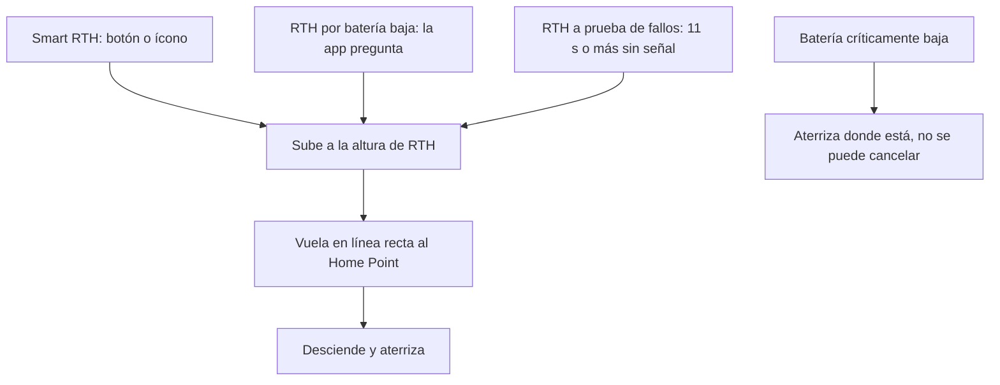

# Viento, clima y retorno automático (RTH)

Parte de: [[35-Drones/01 Normativa y seguridad/_Índice Normativa y seguridad|Normativa y seguridad]]

> [!info] Cómo avanzar
> `progreso`: **pendiente** → **viendo** (estudiando) → **visto** (contestaste la autoevaluación sin abrir las respuestas) → **dominado** (hiciste el laboratorio o lo aplicaste de verdad).

## Contenido

### Qué es
El viento es el enemigo número uno de un dron de 246 g: lo empuja, lo hace gastar más batería y puede impedirle regresar. El **retorno automático (RTH, Return to Home)** es la función que trae el dron de vuelta al punto de despegue cuando lo pides, cuando la batería baja o cuando se pierde la señal. Entender ambos te permite decidir cuándo volar y qué tan lejos ir.

### Cómo funciona
**Límites del Mini 4K** según la [ficha de DJI](https://www.dji.com/mini-2-se/specs):

- Resistencia al viento: **10.7 m/s (nivel 5)**. En km/h: 10.7 × 3.6 ≈ **38.5 km/h**. El manual pide no volar con viento de esa intensidad o más.
- Temperatura de operación: **0 a 40 °C**.
- Las apps de clima miden el viento a unos 10 m; a 80–100 m de altura suele ser más fuerte, y las ráfagas importan más que el promedio.

**El viento y la batería.** La velocidad respecto al suelo es la velocidad del dron menos el viento en contra. Si regresas a 10 m/s (modo Normal) contra 5 m/s de viento, avanzas a ~5 m/s: tardas el **doble** y gastas más. Por eso, si al alejarte el viento te ayuda, el regreso costará mucho más.

**Tipos de RTH** según el [manual](https://dl.djicdn.com/downloads/DJI_Mini_4K/20260427/DJI_Mini_4K_User_Manual_v1.0_zh-cn.pdf):

1. **Smart RTH**: lo activas tú.
2. **RTH por batería baja**: el dron calcula si le alcanza y te pregunta; si ignoras, sigue. Con batería **críticamente** baja aterriza donde esté.
3. **RTH a prueba de fallos**: tras **11 segundos o más** sin señal, si lo configuraste y hay GNSS, brújula y Home Point válidos.

Detalle crucial: el dron **sube a la altura de RTH y vuelve en línea recta**. No esquiva nada: solo tiene sensores hacia abajo.

### Ejemplo
Tu app marca ráfagas de **35 km/h** ≈ **9.7 m/s**: apenas por debajo del límite. Con más viento en altura, **no vuelas**.

Otro día, viento de 15 km/h. Despegas y te alejas a favor del viento; a 400 m la batería marca 50 %. Sin viento, el regreso a 10 m/s tomaría 40 s; con 5 m/s en contra, 80 s y más consumo. Decides volver ya: la regla es **la mitad para ir y la mitad (con margen) para volver**, y aterrizar con 20–30 %.

Antes de despegar fijas la altura de RTH en 50 m porque hay un edificio de 35 m entre tú y la zona que vas a grabar, sin pasar los 122 m legales.

### Cuándo confiar en el RTH y cuándo no
- **Confía** en campo abierto, con Home Point correcto y altura de RTH bien puesta.
- **No confíes** cerca de árboles, edificios o cables si la altura de RTH es baja, ni con viento fuerte en contra (puede no llegar).
- **Mejor que el RTH**: volver tú, a tiempo, en modo Normal o Sport si el viento aprieta.

### Errores comunes
- **Altura de RTH por defecto** con obstáculos altos: choque en el regreso.
- **Calcular la batería sin el viento del regreso**.
- **Mirar solo el viento promedio** e ignorar ráfagas.
- **Volar con frío extremo sin calentar baterías** (ver [[Baterías de dron (cuidado y viajes)]]).
- **Mover el Home Point sin querer**: si despegaste desde un bote o un auto, el dron volverá al punto original.

### Para profundizar
- [Manual de usuario del DJI Mini 4K (PDF)](https://dl.djicdn.com/downloads/DJI_Mini_4K/20260427/DJI_Mini_4K_User_Manual_v1.0_zh-cn.pdf)
- [DJI: especificaciones del Mini 4K](https://www.dji.com/mini-2-se/specs)

## Ejercicios

Resuélvelos en papel o en la herramienta; la solución está plegada.

> [!question]- Tu app de clima marca ráfagas de 35 km/h. ¿Están dentro del límite del Mini 4K?
> 35 / 3.6 ≈ **9.7 m/s**, apenas debajo de 10.7 m/s. Con ráfagas tan cerca del límite y más viento en altura, **mejor no volar**.

> [!question]- El dron está a 400 m y regresa a 10 m/s (Normal). ¿Cuánto tarda sin viento? ¿Y con 5 m/s de viento en contra?
> 400 / 10 = **40 s**. Con 5 m/s en contra su velocidad respecto al suelo baja a ~5 m/s: 400 / 5 = **80 s** (el doble), con más consumo.

## Autoevaluación

Contesta primero en voz alta o en papel; luego despliega la respuesta.

> [!question]- ¿Cuál es el límite de viento del Mini 4K y cómo lo conviertes a km/h?
> **10.7 m/s (nivel 5)** según DJI ([ficha](https://www.dji.com/mini-2-se/specs)); el manual pide **no volar** con viento de 10.7 m/s o más. En km/h: 10.7 × 3.6 ≈ **38.5 km/h**. Recuerda que arriba sopla más que en el suelo.

> [!question]- ¿Qué tipos de RTH tiene y cuándo se activa cada uno?
> **Smart RTH** (lo pides tú con el botón o el ícono), **RTH por batería baja** (el dron calcula si le alcanza y te pregunta; con batería críticamente baja aterriza y no puedes cancelarlo) y **RTH a prueba de fallos** (tras **11 s o más sin señal**, si así lo configuraste y hay GPS, brújula y Home Point válidos). Fuente: [manual del Mini 4K](https://dl.djicdn.com/downloads/DJI_Mini_4K/20260427/DJI_Mini_4K_User_Manual_v1.0_zh-cn.pdf).

> [!question]- Caso: vuelas con viento a favor alejándote y la batería marca 50 %. ¿Por qué deberías volver ya?
> El regreso será **contra el viento**: más lento y con más consumo. Planea la mitad de la batería para ir y la otra mitad (con margen) para volver.

> [!question]- Error común: dejar la altura de RTH por defecto en una zona con árboles o edificios altos. ¿Qué pasa?
> El dron vuelve en línea recta a esa altura y **no esquiva obstáculos** (solo tiene sensores hacia abajo): puede chocar. Fija la altura de RTH por encima del obstáculo más alto antes de despegar (y respeta el máximo de 122 m).

> [!question]- ¿En qué temperaturas puede operar el Mini 4K?
> De **0 a 40 °C** según la ficha de DJI. Con frío la batería rinde menos: mantenla tibia antes del vuelo.

## Práctica

- [[Lab 1 - Checklist pre-vuelo y revisión legal del lugar]]

