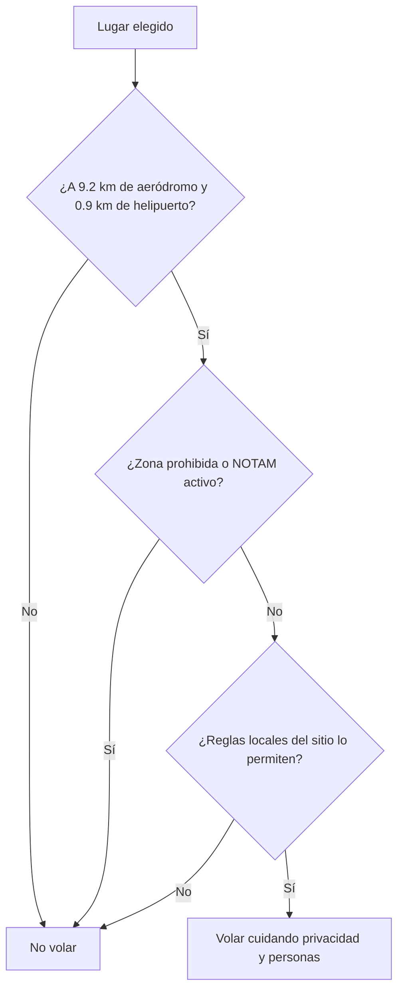

# Zonas restringidas y privacidad al volar

Parte de: [[35-Drones/01 Normativa y seguridad/_Índice Normativa y seguridad|Normativa y seguridad]]

> [!info] Cómo avanzar
> `progreso`: **pendiente** → **viendo** (estudiando) → **visto** (contestaste la autoevaluación sin abrir las respuestas) → **dominado** (hiciste el laboratorio o lo aplicaste de verdad).

## Contenido

### Qué es
Aunque tu Mini 4K esté exento de registro, **no puedes volar en cualquier lugar**: hay espacios aéreos prohibidos, restringidos o peligrosos, distancias mínimas a aeródromos y helipuertos, y leyes de privacidad que aplican a lo que grabas. Esta nota junta las dos preguntas antes de cada vuelo: **¿puedo volar aquí?** y **¿puedo grabar esto?**

### Cómo funciona
**Espacio aéreo** (NOM-107-SCT3-2019, [DOF](https://dof.gob.mx/normasOficiales/8006/sct11_C/sct11_C.html)):

- **4.10.1**: al menos **9.2 km (5 MN)** de cualquier aeródromo.
- **4.10.2**: al menos **0.9 km (0.5 MN)** de cualquier helipuerto (hospitales, edificios, instalaciones).
- **4.10.5**: no volar en áreas **prohibidas, restringidas o peligrosas** publicadas en la PIA/AIP, sección ENR 5.1.
- **4.10.6**: antes de volar, revisar los **NOTAM** que activan áreas prohibidas o restringidas.
- **5.1.1 d)**: entre 9.2 y 18.5 km de los aeródromos listados, altura máxima de 100 m.

Además pueden aplicar reglas locales o de administración del sitio (parques nacionales, zonas arqueológicas, eventos masivos): (Pendiente de confirmar) en cada lugar; pregunta a la administración.

**Personas.** La norma prohíbe volar sobre personas no involucradas y pide 10 m de perímetro (5.1.1 f), pero la **Nota 1** permite volar sobre personas a los RPAS de **250 g o menos**. Tu Mini 4K califica mientras no le agregues peso. Que sea legal no lo hace prudente: evita pasar sobre grupos.

**Privacidad.** El operador es **responsable del uso de la información** que obtiene (4.11.2) y debe cumplir las leyes de privacidad y propiedad intelectual (4.11.3). La imagen de una persona identificable es un dato personal. Detalle en [[Permiso de modelo y fotografía en espacios públicos en México]].

**Zonas GEO de DJI.** DJI Fly muestra zonas y puede bloquear despegues, pero el manual advierte que esas zonas **no siempre coinciden con la ley local**. Son una ayuda, no la referencia legal.

### Ejemplo
Quieres grabar el amanecer sobre la ciudad desde una azotea. En el mapa ves que a 600 m hay un hospital con helipuerto. DJI Fly no marca ninguna zona GEO. **No vuelas ahí**: la norma exige 0.9 km a cualquier helipuerto, y la app no lo sabe todo. Buscas otra azotea a más de un kilómetro y a más de 9.2 km del aeropuerto.

En la nueva ubicación hay departamentos con ventanas y patios. Encuadras hacia el horizonte, no hacia el interior de las casas, y si alguien queda identificable en primer plano, borras la toma o pides permiso.

### Cuándo volar y cuándo no
- **Vuela** en campo abierto, lejos de aeródromos y helipuertos, con permiso del dueño o administrador si es privado.
- **No vueles** en zonas prohibidas, cerca de instalaciones estratégicas, sobre eventos masivos, en zonas con NOTAM activo o donde el reglamento local lo prohíba.
- **No grabes** el interior de casas o patios ajenos, ni a personas que te piden no hacerlo.

### Errores comunes
- **Confiar solo en las zonas GEO de DJI**.
- **Olvidar los helipuertos** de hospitales y edificios.
- **Pensar que "sobre personas" significa "sin cuidado"**.
- **Publicar tomas con personas identificables** sin pensar en su privacidad; borra lo que te pidan.
- **No revisar NOTAM** antes de volar.

### Para profundizar
- [NOM-107-SCT3-2019 en el DOF](https://dof.gob.mx/normasOficiales/8006/sct11_C/sct11_C.html)
- [NOM-107-SCT3-2019 en PDF](https://platiica.economia.gob.mx/normalizacion/wp-content/uploads/sites/2/PDF_Normas_Publicas/NOM-107-SCT3-2019.pdf)
- [Manual del DJI Mini 4K (zonas GEO)](https://dl.djicdn.com/downloads/DJI_Mini_4K/20260427/DJI_Mini_4K_User_Manual_v1.0_zh-cn.pdf)

## Autoevaluación

Contesta primero en voz alta o en papel; luego despliega la respuesta.

> [!question]- ¿Qué zonas no puedes sobrevolar con un dron en México?
> Las **áreas prohibidas, restringidas o peligrosas** publicadas en la PIA/AIP (sección ENR 5.1) y las que activen los **NOTAM** (4.10.5 y 4.10.6); además mantén **9.2 km** de cualquier aeródromo y **0.9 km** de helipuertos (4.10.1 y 4.10.2). Revisa también reglamentos locales (parques, zonas arqueológicas, eventos): cambian según el municipio y el lugar, así que confírmalos con la autoridad o el administrador del sitio antes de volar (en zonas del INAH se requiere su autorización).

> [!question]- ¿Puedes volar el Mini 4K sobre personas?
> La norma prohíbe volar sobre personas no involucradas y pide **10 m** de distancia perimetral (5.1.1 f), pero la **NOTA 1** permite volar sobre personas a los RPAS de **250 g o menos**. Aun así, por seguridad y privacidad, evita pasar sobre grupos.

> [!question]- ¿Qué dice la norma sobre privacidad y qué otras leyes aplican?
> El operador es **responsable del uso de la información obtenida** (4.11.2) y debe respetar las leyes de **privacidad y propiedad intelectual** (4.11.3). La imagen de una persona identificable es un **dato personal**: no grabes dentro de casas o patios ajenos, pide permiso si alguien aparece claramente y borra lo que te pidan. Ver [[Permiso de modelo y fotografía en espacios públicos en México]].

> [!question]- Caso: DJI Fly no te marca ninguna zona GEO junto a un helipuerto de hospital. ¿Vuelas?
> No. Las zonas GEO de DJI **no siempre coinciden con la ley local** (lo dice el manual). La norma exige **0.9 km** de cualquier helipuerto: aléjate.

## Práctica

- [[Lab 1 - Checklist pre-vuelo y revisión legal del lugar]]

