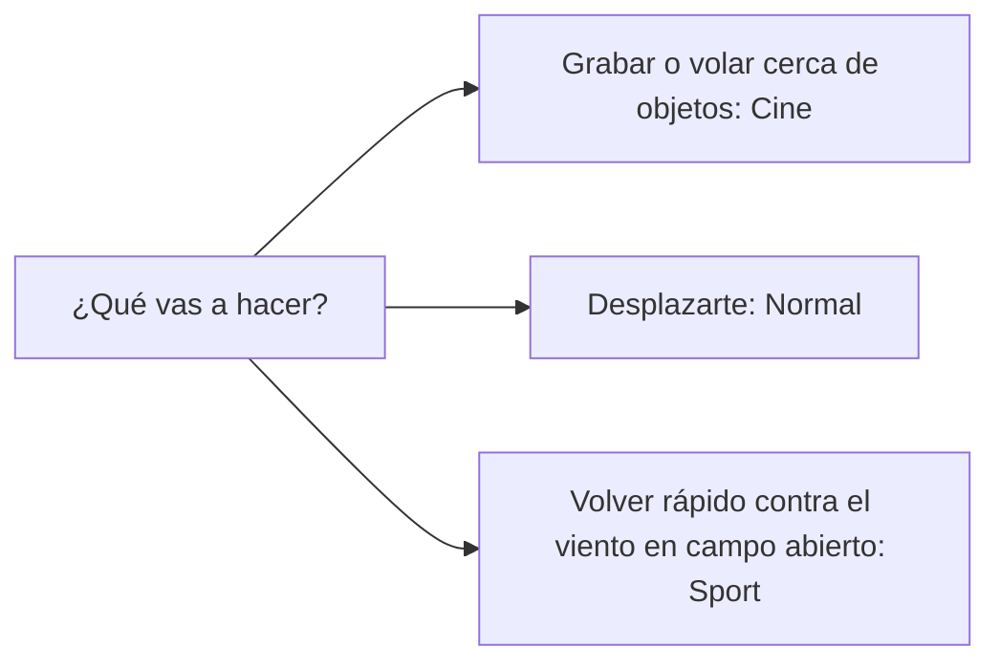

# Controles y modos de vuelo (Cine, Normal y Sport)

Parte de: [[35-Drones/02 Pilotaje/_Índice Pilotaje|Pilotaje]]

> [!info] Cómo avanzar
> `progreso`: **pendiente** → **viendo** (estudiando) → **visto** (contestaste la autoevaluación sin abrir las respuestas) → **dominado** (hiciste el laboratorio o lo aplicaste de verdad).

## Contenido

### Qué es
El control del Mini 4K tiene dos palancas que mueven el dron en cuatro ejes, y un selector con tres **modos de vuelo** que cambian qué tan rápido y brusco responde: **Cine**, **Normal** y **Sport**. Dominar las palancas y elegir el modo correcto es la base de todo: de la seguridad (frenar a tiempo) y de las tomas (movimientos suaves).

### Cómo funciona
**Modo 2** (el predeterminado de DJI):

| Palanca | Arriba / abajo | Izquierda / derecha |
|---|---|---|
| Izquierda | Subir / bajar (acelerador) | Girar sobre su eje (guiñada) |
| Derecha | Adelante / atrás (cabeceo) | Desplazarse a los lados (alabeo) |

La rueda del hombro izquierdo inclina el gimbal. Los movimientos deben ser **pequeños y graduales**: la palanca es proporcional, y el dron responde a cuánto la mueves.

**Modos** según el [manual](https://dl.djicdn.com/downloads/DJI_Mini_4K/20260427/DJI_Mini_4K_User_Manual_v1.0_zh-cn.pdf):

| Modo | Horizontal | Sube | Baja | En km/h |
|---|---|---|---|---|
| Cine | 6 m/s | 2 m/s | 1.5 m/s | 21.6 |
| Normal | 10 m/s | 3 m/s | 3 m/s | 36 |
| Sport | 16 m/s | 5 m/s | 3.5 m/s | 57.6 |

**Orientación.** Las palancas actúan respecto a la **nariz** del dron, no respecto a ti. Cuando el dron te da la espalda, todo es intuitivo; cuando **te da el frente**, izquierda y derecha se ven invertidas. Es la fuente número uno de choques de principiantes.

**Frenado.** En Sport el dron tarda mucho más en detenerse: necesitas más espacio libre delante. La norma también te pide no exceder la velocidad máxima del fabricante.

### Ejemplo
**Plano de acercamiento de 15 s en Cine.** A velocidad máxima recorres 6 × 15 = **90 m**. En la práctica, para que se vea suave irás a 2–4 m/s: entre 30 y 60 m. Eliges un punto de inicio a esa distancia del sujeto, empujas la palanca derecha poco a poco hasta la velocidad deseada, la mantienes constante y la regresas al centro **despacio** al final.

**Regreso con viento.** Estás a 300 m, el viento sopla en contra y en Normal el dron avanza lento. Cambias a **Sport** en campo abierto para ganar velocidad, sin obstáculos en la ruta, y vuelves a Normal antes de acercarte al punto de aterrizaje.

**Ajuste fino.** En DJI Fly puedes cambiar la sensibilidad de las palancas y la velocidad del gimbal (EXP y suavidad); para video, una respuesta más suave ayuda.

### Cuándo usar cada modo y cuándo no
- **Cine**: grabar, aprender, volar cerca de árboles o personas.
- **Normal**: desplazarte entre tomas, explorar.
- **Sport**: emergencias de viento en campo abierto. **Nunca** cerca de obstáculos ni para grabar movimientos finos.

### Errores comunes
- **Confundir izquierda y derecha** con el dron de frente: practica esa orientación en simulador y usa la vista de cámara y el mapa para orientarte.
- **Mover la palanca a tope** de entrada: tirones en el video y riesgo.
- **Soltar la palanca de golpe**: el dron frena y se balancea.
- **Volar en Sport cerca de objetos**: la distancia de frenado es mayor.
- **No saber dónde está el selector de modo**: revísalo antes de cada vuelo.

### Para profundizar
- [Manual de usuario del DJI Mini 4K (PDF)](https://dl.djicdn.com/downloads/DJI_Mini_4K/20260427/DJI_Mini_4K_User_Manual_v1.0_zh-cn.pdf)
- [DJI: especificaciones del Mini 4K](https://www.dji.com/mini-2-se/specs)
- Práctica: [[Maniobras básicas con dron]]

## Ejercicios

Resuélvelos en papel o en la herramienta; la solución está plegada.

> [!question]- Quieres un plano de acercamiento de 15 s en modo Cine a máxima velocidad. ¿Qué distancia recorres?
> 6 m/s × 15 s = **90 m**. En la práctica irás más lento (2–4 m/s) para que se vea suave: 30–60 m.

> [!question]- Convierte las velocidades máximas de los tres modos a km/h.
> 6 × 3.6 = **21.6**; 10 × 3.6 = **36**; 16 × 3.6 = **57.6 km/h**.

## Autoevaluación

Contesta primero en voz alta o en papel; luego despliega la respuesta.

> [!question]- ¿Qué hace cada palanca en el modo 2 (el predeterminado de DJI)?
> **Izquierda:** arriba/abajo = subir/bajar; izquierda/derecha = girar (guiñada). **Derecha:** arriba/abajo = adelante/atrás; izquierda/derecha = desplazarse a los lados. Practica con suavidad: movimientos pequeños y graduales.

> [!question]- ¿Qué velocidades máximas tiene cada modo del Mini 4K?
> Según el [manual](https://dl.djicdn.com/downloads/DJI_Mini_4K/20260427/DJI_Mini_4K_User_Manual_v1.0_zh-cn.pdf): **Cine 6 m/s** (sube 2, baja 1.5), **Normal 10 m/s** (sube y baja 3), **Sport 16 m/s** (sube 5, baja 3.5). En km/h: 21.6, 36 y 57.6.

> [!question]- ¿Cuándo usar Cine y cuándo Sport?
> **Cine** para grabar (movimientos lentos y suaves) y para volar cerca de obstáculos. **Normal** para desplazarte. **Sport** solo para volver rápido contra el viento en campo abierto: frena mucho más tarde.

> [!question]- Error común: girar el dron cuando viene hacia ti y confundir izquierda y derecha. ¿Cómo lo evitas?
> Cuando el dron te da el frente, los controles laterales se ven **invertidos**. Practica en el simulador con el dron de frente y en campo usa la vista de cámara y el mapa para orientarte.

## Práctica

- [[Lab 2 - Seis maniobras básicas en simulador y en campo abierto]]

